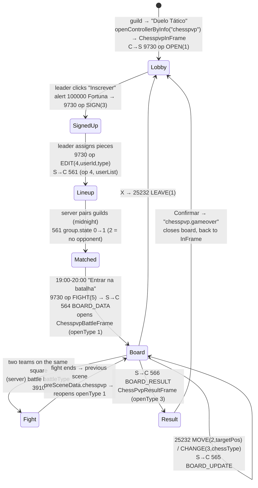
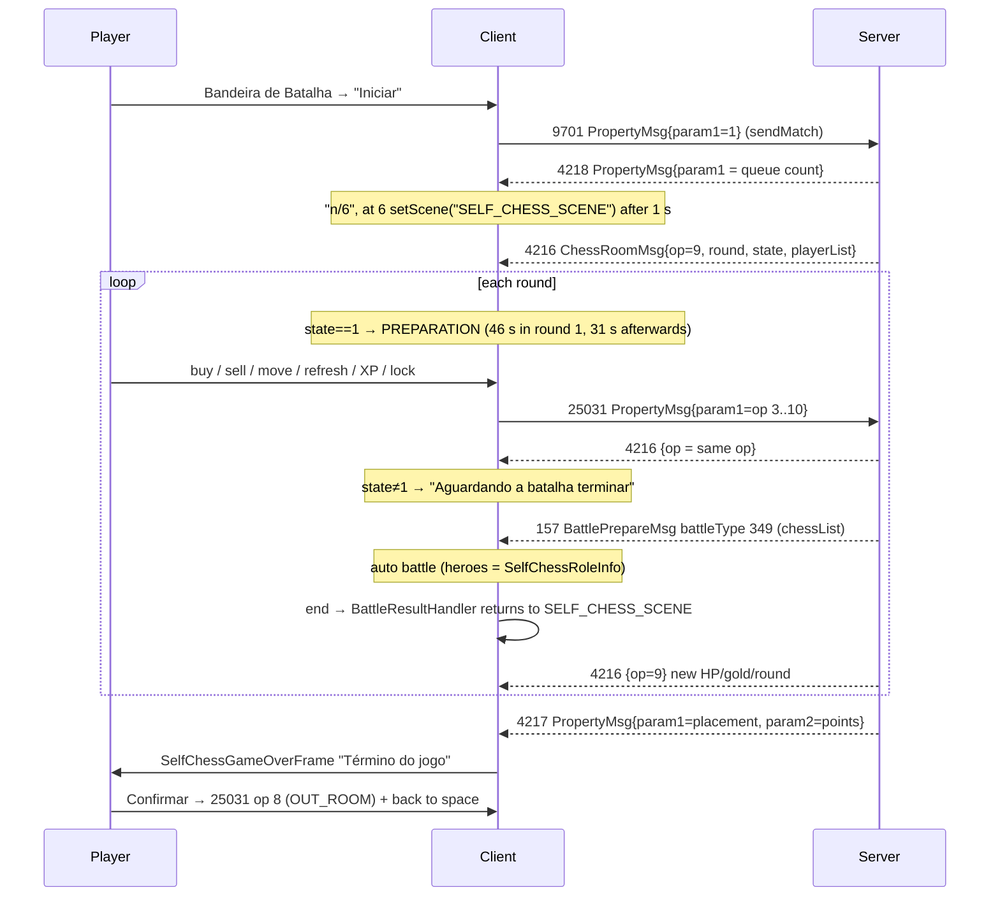

# Chess modes (Legend Online BR, OAS1264)

This document describes the two chess game modes of the client, which share no code: **Duelo Tático**, a real 8×8
chess board played guild against guild, and **Supremacia do Legend**, a six-player auto-chess. For each mode it covers
the in-game rules, the phase sequence, the board or field layout, the pieces, rewards, protocol (opcodes and protobuf
messages), screens and HUD, and graphic assets. Part B also explains how auto-chess pieces enter a normal battle
(battleType 349). Part C lists gaps, bugs and notes for the rebuild. The battle grid used by auto-chess fights is
described in [formation.md](formation.md).

## Overview

| | **Duelo Tático** (方寸对决, "consortiachess") | **Supremacia do Legend** (自走棋, auto-chess, "selfchess") |
|---|---|---|
| What it is | **Real** 8×8 chess, guild vs guild. Each member is **one piece** (Peão…Rei); pieces march in real time and fights happen on squares | 6-player auto-battler. Each player buys heroes with match gold, fills 8 slots, fights automatic rounds |
| Client code | `decompiled/m3/scripts/consortiachess/**` + `core_module` `managers/ChessPvpManager.as`, `mvc/module/chesspvp/**` | `decompiled/m3/scripts/chess/**` + `core_module` `mvc/module/chess/**`, `battle/view/roles/SelfChessRoleView.as` |
| Entry | Guild activity panel (`ConsortiaViewHelper.as:110-136`) | 7th-anniversary "Bandeira de Batalha" event (`m11/.../SevenYearSelfChessView.as`) |
| UI SWF | `ui/zh_cn/swf/chesspvp.swf` | `ui/zh_cn/swf/selfchess.swf` |
| Main screen | Frame `consortiachess.ChesspvpBattleFrame` "Duelo Tático" 1316×749 | Scene `SELF_CHESS_SCENE` → `chess.SelfChessSceneController` 1495×895 |
| battleType | **3910** `CHESS_PVP` (`CM/yishi/datas/battle/BattleType.as:252`) | **349** `SELF_PROPELLED_CHESS_BATTLE` (`CM/yishi/datas/battle/BattleType.as:206`) |
| Schedule (ConfigInfos) | `chess_pvp_times` = `19:00:00\|20:00:00` | `chess_game_time` = `00:00,22:30` |
| Other configs | `chess_pvp_sign_offer` = 100000 (guild Fortuna to sign up) | `chess_room_num` = 6, `chess_game_over_award` = 600,400,300,200,100,50, `snow_vehicle_daily_reward_max` = 600 |
| Templates | `ChessPvpRankDrop`, `ChessPvpFightDrop` (**not** in `data/tpl/tempinfos/`) | `AutoChessHeroInfos` (112), `AutoChessBuffInfos` (25), `UpGradeTempInfos` Types=81 (7) |
| Opcodes | C→S 9730, 25232 · S→C 561-566 | C→S 9701, 25031 · S→C 4216-4219 |
| Switch | `VersionSwitch.CHESS_PVP = false` (`CM/yishi/datas/VersionSwitch.as:246`, never reassigned). **Hides** the guild-panel entry (`CM/mvc/module/consortia/ConsortiaViewHelper.as:71-74`) and the shop tab (`decompiled/m15/scripts/view/subshop/ConsortiaShopFrame.as:224-228`). Handlers 561-566 stay registered, so a server 564 still opens the board | `SwitchInfo.SELF_CHESS = true` (`CM/yishi/datas/SwitchInfo.as:6`), enables the Iniciar button (`M11/sevenyear/view/battleflag/SevenYearSelfChessView.as:90,176`) |

## Conventions

Citation prefixes (all paths relative to the project root):

| Prefix | Folder |
|---|---|
| `CC/` | `decompiled/m3/scripts/consortiachess/` |
| `CH/` | `decompiled/m3/scripts/chess/` |
| `CM/` | `decompiled/core_module/scripts/` |
| `M10/` | `decompiled/m10/scripts/` |
| `M11/` | `decompiled/m11/scripts/` |
| `XPVP` | `raw/ui/zh_cn/xml/decoded/chesspvp.xml` (stylenames, x/y/w/h) |
| `XSC` | `raw/ui/zh_cn/xml/decoded/selfchess.xml` |
| `TPL/` | `data/tpl/tempinfos/` |
| `LANG` | `index/language.json` (language keys) |

pt-BR titles and screen sizes match [docs/ui/screens.md](../ui/screens.md) (lines 701-716) and `web/public/layout/screens.json`.

---

## Part A: Duelo Tático (consortiachess)

### A.1 Rules (in-game text)

`chesspvp.help.content` (LANG), summarized:

1. 1v1 competition between guilds of the server.
2. **One round per week**: ranking matches **Monday-Friday**, rewards by final ranking. **Saturday**: **promotion/relegation** match; the winner moves up a group, ranking unaffected.
3. The **leader** signs up the guild and sets the participating members.
4. Each member acts according to the **identity** (piece) the leader assigned.
5. Battles are **team** battles with reinforcement. The winner **occupies the square**; the loser returns to the **respawn point**.
6. Most **occupied squares** at the end wins.
7. If no King is set, or the King is defeated, the match ends **immediately as a loss**.
8. Rewards: per match (daily) and per ranking (weekly), by group.

Leagues (groups): 0 Bronze, 1 Prata, 2 Ouro, 3 Diamante (`chesspvp.in.groupName0..3`). Promotion: top 6 of Bronze, 4 of Prata, 3 of Ouro move up; Diamante is the top (`chesspvp.rank.des0..3`).

### A.2 Phase sequence



Sources:
- lobby open: `CM/mvc/module/consortia/ConsortiaViewHelper.as:110-136`; exists only with `VersionSwitch.CHESS_PVP`, which is `false` in this build (`:71-74`);
- `operFun` per screen: OPEN `CC/ChesspvpInFrame.as:40`, CLOSE `:96`, SIGN `CC/ui/ChesspvpInLeftUI.as:155`, EDIT `CC/item/ChesspvpRoleComMenu.as:85`, FIGHT `CC/ui/ChesspvpInLeftGroupUI.as:115`, VIEW_RANK `CC/ChesspvpRankFrame.as:55`, VIEW_RECORD `CC/ChesspvpRecordFrame.as:36`;
- board opened by 564: `CM/managers/ChessPvpManager.as:200-213`;
- result: `ChessPvpManager.as:78-93`;
- leave: `CC/ChesspvpBattleFrame.as:70-77`;
- return from fight: `CM/battle/handler/BattleResultHandler.as:510-512` sets `chesspvp = true`; `decompiled/m3/scripts/map/space/SpaceSceneController.as:482-487` and `decompiled/m4/scripts/castle/CastleSceneView.as:252-257` reopen `("chesspvp",1)` if the player has a guild.

`ChessPvpGroupInfo.state` (561): 0 = not paired yet (`chesspvp.in.noMatch`), 1 = opponent set, enables "Entrar na batalha", 2 = no opponent (`chesspvp.in.noVs` "Vazio") (`CC/ui/ChesspvpInLeftGroupUI.as:82-100`).

### A.3 Board

#### Size and numbering

- **8×8 squares**, built from `boradInfo.boxDic` sorted by `pos` (`CC/board/ConsortiaChessBoard.as:86-105`). All **64 squares come from the server** (`ChessPvpBoxMsg`); the client assumes exactly 64.
- `pos` runs **1-64**, row by row from the top-left **in White's view**:
  - `row = ⌊(pos−1)/8⌋`, `col = (pos−1) % 8`;
  - list index = `row·8 + col` (`ConsortiaChessBoard.as:98`).
- Panel algebraic notation (`CC/ui/ChesspvpBattleNodeUI.as:62-68,114-126`): `col → A..H`, `row → 8..1`.
  - For Black both grid and labels are flipped, so **a square has the same name** on both sides.
  - E.g. pos 1 = A8, pos 8 = H8, pos 57 = A1, pos 64 = H1.
- **Black** view (team 2): `_boxTwoList.reverse()` plus each row reversed (180° rotation); background switches to frame 2 (`ConsortiaChessBoard.as:106-114`). Each player sees their own side **at the bottom**.

```
Team 1 (White) view. Each cell shows pos (label).
Team 2 sees the same grid rotated 180°.

          A        B        C        D        E        F        G        H
     ┌────────┬────────┬────────┬────────┬────────┬────────┬────────┬────────┐
  8  │  1  A8 │  2  B8 │  3  C8 │  4  D8 │  5  E8 │  6  F8 │  7  G8 │  8  H8 │ ← White promotion (pos 1-8)
     ├────────┼────────┼────────┼────────┼────────┼────────┼────────┼────────┤
  7  │  9     │ 10     │ 11     │ 12     │ 13     │ 14     │ 15     │ 16     │
     ├────────┼────────┼────────┼────────┼────────┼────────┼────────┼────────┤
  6  │ 17     │ 18     │ 19     │ 20     │ 21     │ 22     │ 23     │ 24     │
     ├────────┼────────┼────────┼────────┼────────┼────────┼────────┼────────┤
  5  │ 25     │ 26     │ 27     │ 28     │ 29     │ 30     │ 31     │ 32     │
     ├────────┼────────┼────────┼────────┼────────┼────────┼────────┼────────┤
  4  │ 33     │ 34     │ 35     │ 36     │ 37     │ 38     │ 39     │ 40     │
     ├────────┼────────┼────────┼────────┼────────┼────────┼────────┼────────┤
  3  │ 41     │ 42     │ 43     │ 44     │ 45     │ 46     │ 47     │ 48     │
     ├────────┼────────┼────────┼────────┼────────┼────────┼────────┼────────┤
  2  │ 49     │ 50     │ 51     │ 52     │ 53     │ 54     │ 55     │ 56     │
     ├────────┼────────┼────────┼────────┼────────┼────────┼────────┼────────┤
  1  │ 57  A1 │ 58     │ 59     │ 60     │ 61     │ 62     │ 63     │ 64  H1 │ ← Black promotion (pos 57-64)
     └────────┴────────┴────────┴────────┴────────┴────────┴────────┴────────┘
         ↑ White advances up (dy = −1); Black, in its own (rotated) view, also moves "up"
```

#### Pixel positions (inside `ChesspvpBattleFrame` content)

| Layer | Position | Source |
|---|---|---|
| Board sprite (`ConsortiaChessBoard`) | x = 320 (right of chat) | `ConsortiaChessBoard.as:62` |
| Background `asset.chesspvp.bg` (2-frame sprite, 674×670; frame 1 = White, frame 2 = Black) | (0,0) on board | XPVP:494; `web/public/lib/chesspvp/library.json` (char 126) |
| Square, piece and line containers (`ui.chesspvp.battleBoxContainer`) | (40,44) | XPVP:362-365 |
| Square (screen column c, row r) | `x = 73·c`, `y = 73·r` in container; hit area (1,1) 71×71 | `ConsortiaChessBoard.as:122-125`; `CC/board/ChesspvpBoxItem.as:64-67` |
| Masks `upmask1` / `upMask2` (586×586) | (42,42) / (41,41) | XPVP:259-265 |
| Scoreboard `ChessPvpBattleRTopUI` | (678,0) on board | XPVP:477-480 |
| Square panel `ChesspvpBattleNodeUI` | (678,160) | XPVP:482-485 |

Absolute square position in frame content: `(320+40+73c, 44+73r)` = `(360+73c, 44+73r)`. Square center is at +36.5 (`CC/board/ConsortiaChessBasePiece.as:194`).

#### Square layers (`ChesspvpBoxItem`)

| Layer | When | Source |
|---|---|---|
| Owner | `team` 0 = none, 1 = `asset.chesspvp.box1` (White), 2 = `box2` (Black) | `ChesspvpBoxItem.as:78-96` |
| Square buff | `buffId` ∈ {10,11,12,20,21,22,30,31,32} → `asset.chesspvp.buff{id}` (53×57) at (15,10). No template defines the effect | `ChesspvpBoxItem.as:62-63,98-113`; `CC/util/ChesspvpResourceUtil.as:84-92` |
| Fight | `blackList` and `whiteList` both non-empty → `asset.chesspvp.fightState` | `ChesspvpBoxItem.as:115-130,181-188` |
| Stack | 2+ units → `asset.chesspvp.moreRole` + "x{N}" (`ui.chesspvp.numTxt` at (39,47)); individual pieces hidden | `ChesspvpBoxItem.as:132-156,189-197` |
| Selection | click → overlay `asset.chesspvp.choooseState` + side panel | `ChesspvpBoxItem.as:210-219` |
| "Me" | `asset.chesspvp.selfState` added to my piece's square | `ConsortiaChessBasePiece.as:262-270` |

Everything is redrawn **every frame** (`ConsortiaChessBoard.as:225-240`). On open, the client simulates a click on its own piece's square (`:141-146`).

### A.4 Pieces

#### Types, quotas and sprites

| chessType | Piece (`chesspvp.role.typeN`) | Quota per guild | White / Black sprite (73×73) | Icon (30×30) |
|---|---|---|---|---|
| 1 | Peão (pawn) | **16** | `asset.chesspvp.w1` / `b1` | `role1` |
| 2 | Torre (rook) | 2 | `w2` / `b2` | `role2` |
| 3 | Cavalo (knight) | 2 | `w3` / `b3` | `role3` |
| 4 | Bispo (bishop) | 2 | `w4` / `b4` | `role4` |
| 5 | Rainha (queen) | 1 | `w5` / `b5` | `role5` |
| 6 | Rei (king) | 1 | `w6` / `b6` | `role6` |

- Constants: `CC/util/ChesspvpConst.as:6-16`.
- Quotas: `CC/ui/ChesspvpRoleNumUI.as:35-48`. **24 members per guild** (16 pawns, not 8).
- Class per type: `ConsortiaChessBoard.as:188-212`. Sprites: `ChesspvpResourceUtil.as:73-83`.
- `team` 1 = White, 2 = Black.
- `color` (`CM/managers/ChessPvpManager.as:286-305`): 1 = me, 2 = ally, 3 = enemy. With `color` 1 the client overlays `asset.chesspvp.myselfImg` (36×34) at (36,1) on the sprite (`ConsortiaChessBasePiece.as:295-302`).
- Assignment: in the lobby the leader (`dutyId == 1`) picks each member's piece from a 7-option menu (0 = "--", removes; 1..6); client sends `9730 op EDIT(4, userId, type)` (`CC/ui/ChesspvpInRightUI.as:134-140`, `CC/item/ChesspvpRoleComMenu.as:43-51,85`). Server returns `chessTypeDic[userId]` in `561.userList` (`ChessPvpManager.as:124-127`).
- Start position: from server in `ChessPvpRoleMsg.currPos`. The client has no opening table.

#### States (`ChesspvpConst.as:18-24`; `ConsortiaChessBasePiece.as:112-147`)

| state | Name | Visual |
|---|---|---|
| 0 | STAND | visible, snaps to square `currPos`; Pawn checks promotion |
| 1 | MOVE | visible, interpolates `currPos` → `targetPos` |
| 2 | FIGHT | hidden (square shows fight icon) |
| 3 | DIE | hidden. Panel "Aguarde a Ressurreição" |

#### Movement rules (`ChesspvpConst.as:26-162`)

Vectors are in the **player's view** (negative dy = forward/up). Black's board is rotated, so the same vector serves both teams.

| Piece | Directions (dx,dy) | Range | Rule |
|---|---|---|---|
| Peão | move (0,−1) and (0,−2); capture (−1,−1) and (1,−1) | 1 step per direction | (0,−2) is **removed** when `firstMove == true` (`CC/board/ConsortiaChessPawn.as:33-40`), so the server field means "has moved". `PAWN_RULES_*_2` (downward) are declared, unused |
| Torre | (0,±1), (±1,0) | to edge | `getLines(dir)` with range 999 |
| Cavalo | (±2,±1), (±1,±2) | 1 jump | - |
| Bispo | (±1,±1) | to edge | - |
| Rainha | 8 directions | to edge | - |
| Rei | 8 directions | 1 square | - |

Algorithm (`ConsortiaChessBasePiece.as:41-86`):
- `getLines(dir, max)` walks `dir` from the current square until leaving `0..7` or reaching `max`, emitting `"x_y"` keys in the **screen** grid.
- `getPaths(x,y)` returns the ray prefix up to the clicked square, or `null`.
- The client **does not check blocking** by other pieces, nor whether the pawn's diagonal square is occupied; the server validates.
- Paths are recomputed when `pos` changes (`set pos`, `:252-260`), own piece only.

#### March (`CC/ui/ChesspvpBattleNodeUI.as:172-195`; `CC/item/ChesspvpMoveCdItem.as:47-87`)

1. Player clicks a square, then **Marchar** (`asset.chesspvp.b.movebtn`).
2. If `selfChess.getPaths(posX,posY)` exists, the button is disabled and the client sends `25232 {op: MOVE(2), boardUid, userId, serverName, targePos: box.pos}`. Otherwise tip `chesspvp.battle.noPath` "O local do alvo não pode ser alcançado".
3. Server replies 565 with `state = 1`, `targetPos`, `moveTotalTime` (ms), `movePassTime` (ms).
4. Animation (`ConsortiaChessBasePiece.as:162-215`):
   - interpolates `currPos` → `targetPos` over `totalFrame = (needMoveTime − hasMoveTime)/40` one-frame steps; if time has already elapsed, starts at the proportional point;
   - draws an arrow line from current position to target (`ConsortiaChessBoard.as:247-307`), color by `color`: 1 = `0x00D8FF`, 2 = `0x00FF00` (ally), 3 = `0xFF0000` (enemy).
5. Texts:
   - marching: `chesspvp.battle.moveTime` "Tempo restante de marcha: {0}s";
   - stopped with `waitCd > 0`: `chesspvp.battle.moveCd` "Tempo de resfriamento restante de marcha: {0}s", button disabled.
6. Timers are **local** (1 s `setInterval`), reset on every update (`CM/mvc/module/chesspvp/ChesspvpRoleInfo.as:64-215`).

#### Revive ("reiver")

- Max **3** (`REIVER_TIME = 3`, `ChesspvpMoveCdItem.as:23`). `reiverTime` = times used.
- `chesspvp.battle.riverTime` "Vez(es) de Ressuscitações restantes: {0}/{1}" uses `3 − reiverTime`.
- Dead (state 3): `ChesspvpRiverCdItem` shows "Aguarde a Ressurreição" and `reiverCd` as mm:ss. With `reiverTime == 3` it shows `chesspvp.battle.Noriver` "Vezes de ressuscitações consumidas, não pode continuar o lutar." (`CC/item/ChesspvpRiverCdItem.as:41-65`).
- In the square list each unit shows `chesspvp.battle.teamInfo` "{apelido} ({restantes}/3)" (`CC/item/ChessPvpTeamRoleItem.as:43-49`).

#### Pawn promotion

- Trigger: **my** Pawn stops (state 0) on the last rank: pos 1-8 for White, 57-64 for Black (`ConsortiaChessPawn.as:95-123`). Opens `ChesspvpUpRoleFrame` "Promover o Peão" (openType 2), **no close button**.
- Options in order: Rainha (5), Bispo (4), Cavalo (3), Torre (2); Rainha preselected (`CC/ui/ChesspvpRoleUpUI.as:64-80`).
- Confirm sends `25232 {op: CHANGE(3), …, targePos: −1, chessType}` (`ChesspvpRoleUpUI.as:100-113`).
- When `chessType` changes, the Pawn is **replaced** by a new instance of the right class (`ConsortiaChessPawn.as:48-62` → `ConsortiaChessBoard.changeRoleUp` `:168-186`).

#### Combat and victory

- Two teams on one square (`blackList` and `whiteList` non-empty) = fight, resolved by the server as a **battleType 3910** battle. Afterwards the player returns to the scene and the board reopens (see A.2).
- Winner occupies the square (`box.team`); loser returns to respawn (help text).
- End: at `endTime` (countdown `TimeDownView` in `CC/ui/ChessPvpBattleRTopUI.as:89-98`) or on King death. Result arrives in 566: `result` 0 loss, 1 win, 2 draw (`CC/ui/ChesspvpResultUI.as:93-104`).
- `ChesspvpTeamInfo.addScore` = match score shown on scoreboard and result.

### A.5 Rewards, ranking and records

| Screen | Data | Source |
|---|---|---|
| Ranking (4 tabs: Diamante/Ouro/Prata/Bronze; 8 per page) | 562 `ChessPvpRankListMsg.groups[].ranks[] {rank,name,serverName,score,fightPower}` + `rankTime`; own guild from `selfGroupInfo.rank/score` | `ChessPvpManager.as:131-157`; `CC/ChesspvpRankFrame.as`; `CC/view/ChesspvpRankView.as`; `CC/item/ChesspvpRankSelfItem.as` |
| Record (Esta Semana / Semana Passada, grouped by group) | 563 `currWeek[]/lastWeek[]` `ChessPvpRecordMsg`, sorted by date desc | `ChessPvpManager.as:159-198`; `CC/ChesspvpRecordFrame.as:64-115` |
| Rewards (4 columns, one per league) | Weekly = `ChessPvpRankDrop.getDropGoods(site)`; daily = `ChessPvpFightDrop.getDropGoods(site)`; `site = group+1` (Bronze 1 … Diamante 4). Displayed value is always the **Pontos Táticos** amount (item −23000, `/item_chessintegral.png`). Daily rows by `para2`: 1 participation, 2 win, 3 loss, 4 draw | `CC/ui/ChesspvpRdGroupUI.as:73-105`; `CC/ui/ChesspvpRewardUI.as:49-57`; `CM/yishi/manager/TempleteManager.as:1420-1421` |
| Shop | lobby shop button → `("shop",2,{chesspvp:true})` → Pontos Táticos tab (shop 1030, [world_progression.md](../mechanics/world_progression.md) line 1022) | `CC/ui/ChesspvpInLeftUI.as:136-139`; `decompiled/m15/scripts/view/subshop/ConsortiaShopFrame.as:642-649` |

### A.6 Protocol

| Dir | Opcode | Name (`protocol/opcodes.csv`) | Message | Handler / sender |
|---|---|---|---|---|
| C→S | 9730 (0x2602) | `C_CHESS_PVP_CLIENT_OP` (csv:640) | `player.PlayerOpMsg {1 op, 7 userId, 2 type}` | `ChessPvpManager.operFun` :320-328 |
| C→S | 25232 (0x6290) | `CR_CHESS_PVP_CLIENT_OP` (csv:728) | `consortiaplay.ChessPvpBoardOpMsg` | `ChessPvpManager.operChess` :330-341 |
| S→C | 561 | `U_C_CHESS_PVP_DATA` (csv:1156) | `ChessPvpMsg` | `__pvpMatchDataHandler` :95-129 |
| S→C | 562 | `U_C_CHESS_PVP_RANK` | `ChessPvpRankListMsg` | `__rankHandler` :131-157 |
| S→C | 563 | `U_C_CHESS_PVP_RECORD` | `ChessPvpRecordListMsg` | `__recordHandler` :159-172 |
| S→C | 564 | `U_C_CHESS_PVP_BOARD_DATA` | `ChessPvpBoardMsg` | `__pvpBattleDataHandler` :200-213 |
| S→C | 565 | `U_C_CHESS_PVP_BOARD_UPDATE` | `ChessPvpBoardUpdateMsg` | `__pvpBattleUpdateHandler` :309-318 |
| S→C | 566 | `U_C_CHESS_PVP_BOARD_RESULT` (csv:1161) | `ChessPvpBoardResultMsg` | `__pvpBattleResultHandler` :78-93 |

Constants: `CM/yishi/datas/consant/ProtocolType.as:1472-1474`, `AcceptProtocolType.as:2300-2310`. Listeners registered in `ChessPvpManager.as:67-76`, called from `CM/yishi/lunch/Yishi.as:555`.

Ops (`CM/mvc/module/chesspvp/ChessPvpOp.as:12-30`):
- 9730: 1 OPEN, 2 CLOSE, 3 SIGN, 4 EDIT, 5 FIGHT, 6 VIEW_RANK, 7 VIEW_RECORD.
- 25232: 1 ROLE_LEAVE, 2 ROLE_MOVE, 3 ROLE_CHANGE.

Protobuf messages (package `com.road.yishi.proto.consortiaplay`, `CM/com/road/yishi/proto/consortiaplay/*.as`; field no.: name type):

| Message | Fields |
|---|---|
| `ChessPvpMsg` | 1 op int32 · 2 group `ChessPvpGroupMsg` · 3 userList `ChessPvpUserMsg[]` |
| `ChessPvpGroupMsg` | 1 op · 2 currTime str · 3 beginTime str · 4 endTime str · 5 group · 6 score · 7 state · 8 rivalName str · 9 rivalServerName str · 10 rivalScore · 11 isSignUp bool · 12 rank |
| `ChessPvpUserMsg` | 1 userId · 2 chessType |
| `ChessPvpRankListMsg` | 1 groups `ChessPvpGroupRankMsg[]` · 2 rankTime str |
| `ChessPvpGroupRankMsg` | 1 group · 2 ranks `ChessPvpRankMsg[]` |
| `ChessPvpRankMsg` | 1 rank · 2 name str · 3 serverName str · 4 score · 5 fightPower int64 |
| `ChessPvpRecordListMsg` | 1 currWeek `ChessPvpRecordMsg[]` · 2 lastWeek `ChessPvpRecordMsg[]` (`ChessPvpRecordListMsg.as:10-14`) |
| `ChessPvpRecordMsg` | 1 recordDate str "YYYY-MM-DD hh:mm:ss" · 2 result · 3 group · 4 name · 5 serverName · 6 addScore · 7 rivalGroup · 8 rivalName · 9 rivalServerName · 10 rivalAddScore |
| `ChessPvpBoardMsg` | 1 boardUid str · 2 currTime str · 3 endTime str · 4 teams `ChessPvpTeamMsg[]` · 5 boxes `ChessPvpBoxMsg[]` · 6 roles `ChessPvpRoleMsg[]` |
| `ChessPvpBoardUpdateMsg` | 1 teams[] · 2 boxes[] · 3 roles[] (`ChessPvpBoardUpdateMsg.as:10-17,52-80`). **Partial** update: only changed items, merged by key |
| `ChessPvpBoardResultMsg` | 1 result · 2 teams[] |
| `ChessPvpTeamMsg` | 1 team · 2 name str (guild) · 3 serverName · 4 score · 5 group · 6 addScore |
| `ChessPvpBoxMsg` | 1 pos · 2 buffId · 3 team · 4 blackList int32[] (roleIds) · 5 whiteList int32[] |
| `ChessPvpRoleMsg` | 1 roleId · 2 userId · 3 serverName · 4 nickName · 5 team · 6 currPos · 7 targetPos · 8 chessType · 9 movePassTime (ms) · 10 reiverTime · 11 reiverCd (ms) · 12 state · 13 firstMove bool · 14 waitCd (ms) · 15 moveTotalTime (ms) |
| `ChessPvpBoardOpMsg` | 1 op · 2 boardUid str · 3 userId · 4 serverName str · 5 targePos (sic) · 6 chessType |

Model merge: `teamDic[team]`, `boxDic[pos]`, `roleDic[roleId]` are created or updated (`ChessPvpManager.as:215-307`). 561 with `op == OPEN` calls `model.clean()`, which resets pieces and timers.

> **`protocol/proto.json` gap:** `ChessPvpBoardUpdateMsg` has `fields: []` and `ChessPvpRecordListMsg` is missing. Correct fields are in the table above.

### A.7 Screens and HUD

| openType | Frame | pt-BR title | Size | Group |
|---|---|---|---|---|
| - (default) | `consortiachess.ChesspvpInFrame` | Duelo Tático | 912×597 (XPVP:616); viewRect 945×574 (`CC/ChesspvpInFrame.as:54-57`) | MAIN_TOOLS_GROUP |
| 1 | `ChesspvpBattleFrame` | Duelo Tático | 1316×749 (XPVP:627) | MAIN_TOOLS_GROUP |
| 2 | `ChesspvpUpRoleFrame` | Promover o Peão | 461×325 | NONE, no close button |
| 3 | `ChessPvpResultFrame` | (no title) | 789×416 | NONE, no close button |
| 4 | `ChesspvpRankFrame` | Ranking | 715×531 | NONE |
| 5 | `ChesspvpRecordFrame` | Registro da Partida | 515×620 | NONE |
| 6 | `ChesspvpRewardFrame` | Prêmio | 899×531 | NONE |

openType → class map: `CM/mvc/controler/ConsortiaChessController.as:34-61`. `setLockPreFrame` reopens the previous screen on close (`:63-97`).

#### Lobby `ChesspvpInFrame`

- **Left column** (`CC/ui/ChesspvpInLeftUI.as`):
  - buttons Rank (23,386), Record (97,386), Shop (173,385), 65×65;
  - Inscrever button (50,204), alert `chesspvp.in.joinNeed` "Deseja gastar {0} pontos de fortuna da guilda para fazer a inscrição?" (:141-157).
- **"Next match" card** (`CC/ui/ChesspvpInLeftGroupUI.as`), visible when `isSignUp`:
  - league (GradientText) and `chesspvp.in.selfScore` "Pontos: {0}";
  - `chesspvp.in.jiondes` "Informações adversárias serão atualizadas à meia-noite no dia da partida";
  - `chesspvp.in.time` "Horário: {0}" and `chesspvp.in.battleVs` "Adversário: {0} {1}";
  - `chesspvp.in.vsScore` "Pontuação do adversário: {0}";
  - "Entrar na batalha" button (50,259), enabled only in state 1.
- **Lineup** (`CC/ui/ChesspvpInRightUI.as`, at (266,49), 609×462):
  - title `chesspvp.in.topTitle` "Membros Participantes da Guilda";
  - columns Membro / Profissão / Nível / Poder de combate / Identidade (`chesspvp.in.tilte0..4`);
  - list of `ChesspvpInItem`, 588 px wide, sorted by power;
  - 6 `ChesspvpRoleNumUI` "n/max" counters at y=426.
- Help: `ui.chesspvp.helpBtn` (838,−36) opens the A.1 text.

#### Match `ChesspvpBattleFrame`

```
 ┌──────────── ChesspvpBattleFrame 1316×749 ("Duelo Tático") ───────────────────────────────────────┐
 │ ChesspvpChatView        │ board x=320: bg 674×670, squares at (40,44), 8×73 px       │ (998,0)   │
 │ list (5,2) 300×505      │                                                            │ Scoreboard│
 │                         │                                                            │ "Informa- │
 │                         │                                                            │ ções da   │
 │                         │                                                            │ Batalha"  │
 │                         │                                                            ├───────────┤
 │                         │                                                            │ (998,160) │
 │ alert (10,528)          │                                                            │ Square    │
 │ emoticon (40,530)       │                                                            │ panel (E4)│
 │ input (5,562) 315×70    │                                                            │ Minha/    │
 │ Enviar (245,634)        │                                                            │ Inimiga   │
 │                         │                                                            │ Marchar   │
 └─────────────────────────┴────────────────────────────────────────────────────────────┴───────────┘
```

| Component | Content | Source |
|---|---|---|
| Scoreboard `ChessPvpBattleRTopUI` | "Informações da Batalha" (`chesspvp.battle.rtop`); White's guild left, Black's right, each with `addScore`; VS (115,39); countdown to `endTime` | `CC/ui/ChessPvpBattleRTopUI.as:60-114` |
| Square panel `ChesspvpBattleNodeUI` (298×501) | coordinate "(E4)" at (170,4); ScrollPanel (55,37) 237×360 with "Minha Equipe"/"Equipe Inimiga" (`chesspvp.battle.team0/1`) and the unit list; at y=395 Marchar (`ChesspvpMoveCdItem`) **or** revive (`ChesspvpRiverCdItem`) | `CC/ui/ChesspvpBattleNodeUI.as:77-155` |
| Chat `ChesspvpChatView` | reuses **guild chat** (channel 5), max 84 chars, 1 message/s, up to 20 blocks | `CC/board/ChesspvpChatView.as:104-492` |
| Result `ChesspvpResultUI` | loss/win/draw title (`asset.chesspvp.rz.l/w/p`); **my team on the left**; `addScore`; confirm button `rz.cf` (355,245) | `CC/ui/ChesspvpResultUI.as:56-116` |

### A.8 Graphic assets

- All inside `ui/zh_cn/swf/chesspvp.swf` (symbols `asset.chesspvp.*`, 115 bitmaps). Extracted to `build/ffdec_ui/chesspvp.swf/images/`; web library at `web/public/lib/chesspvp/library.json`.
- No CDN icons or avatars for this mode. `ChesspvpResourceUtil` builds no URLs (`CC/util/ChesspvpResourceUtil.as:57-95`).
- Related CDN items (already in `raw/<path>`):
  - `icon/item_chessintegral.png` (34×34), Pontos Táticos icon;
  - `swf/avatar/fashion_cloth_chess_mount/3_0.bswf`, from the "Xadrez" set (wings 1098001, hat 1108001, weapon 1118001, outfit 1128001 in `TPL/ItemTempInfos.xml`).

---

## Part B: Supremacia do Legend (auto-chess / SelfChess)

### B.1 Rules

`sevenyear.selfchess.helpContent` (LANG):
1. Players spend match **gold** to buy units and place them on the battle line.
2. The winner of each battle loses no HP. The loser loses HP based on the winner's **remaining pieces**.
3. At the end, the system awards **Pontos de Guerreiro** by placement.

| Parameter | Value | Source |
|---|---|---|
| Players per room | 6 (`chess_room_num`) | `TPL/ConfigInfos.xml`; `CM/mvc/module/chess/SelfChessManager.as:60-61` |
| Start/max HP | 100 (bar `hp/100`) | `CH/item/SelfChessPlayerItem.as:65-67,83` |
| Points by placement | 1st 600, 2nd 400, 3rd 300, 4th 200, 5th 100, 6th 50 (`chess_game_over_award`) | ConfigInfos |
| Daily points cap | 600 (`snow_vehicle_daily_reward_max`, shown as "x/600" at entry) | `M11/sevenyear/view/battleflag/SevenYearSelfChessView.as:107,191` |
| Schedule | 00:00-22:30 (`chess_game_time`) | ConfigInfos |
| Income per round | base +5, interest `min(5, ⌊gold/10⌋)`, win/loss streak 2-5 → +1, 6-8 → +2, 9+ → +3 (`selfchess.point.addTip`) | `CH/SelfChessBottomLeftView.as:148-149` |
| Shop refresh | 2 gold | `CH/SelfChessBottomView.as:88,212-226` |
| Buy XP | 4 gold → +4 XP | `CH/SelfChessBottomLeftView.as:96-104,119-120` |
| Buy piece | `Grade` gold (1-5) | `CH/item/SelfChessHeroItem.as:108-109,192-206` |
| Sell piece (client estimate) | `Grade + (Star−1)·2` | `CH/item/SelfChessTeamItem.as:282-288`; `CH/SelfChessTipView.as:79` |
| Field population | = player level (1-7) | `CH/SelfChessLimitView.as:58-84` |

### B.2 Phase sequence



Sources:
- matchmaking: `M11/sevenyear/view/battleflag/SevenYearSelfChessView.as:174-233`; `SelfChessManager.as:166-174,215-221`;
- round and timer: `CH/SelfChessTopView.as:45-104`;
- ops: `SelfChessManager.as:28-46,198-213`;
- battle: `CM/battle/transaction/CreateGameTransaction.as:134-137`;
- return to scene: `CM/battle/handler/BattleResultHandler.as:293-295`;
- game over: `SelfChessManager.as:176-191`, `CH/SelfChessGameOverFrame.as:78-126`.

**Round numbering** (`CH/SelfChessTopView.as:45-71`), shown as "{stage}ª Rodada · Rodada {sub}":
- `round ≤ 2`: stage 1, sub = round;
- else: stage = `ceil((round−2)/5 + 1)`, sub = `(round−2) % 5` (0 becomes 5).
- So stage 1 has 2 rounds, later stages 5 each (round 3 = 2-1, round 7 = 2-5, round 8 = 3-1).

**Monster (PvE) rounds:** the 19 Grade 0 templates ("Apolo (monstro)", MasterType 91-97) form groups of 1, 2, 2, 3, 3, 4, 4 units with rising HP and attack (`TPL/AutoChessHeroInfos.xml`). The client does not say which rounds use them; probably server-chosen "creep" waves (assumption).

### B.3 Auto-chess field (no grid)

The client has **no grid**: **8 fixed battle slots** drawn over `asset.selfchess.bg` (1495×895, 8 circles in perspective), plus **8 bench slots** and **5 shop cards**.

| `pos` range | Where | Server array | Created in |
|---|---|---|---|
| 1..8 | battlefield | `SelfChessPlayerMsg.battleAry[0..7]` | `CH/SelfChessHeroTeamView.as:58-67` |
| 11..18 | bench | `alternateAry[0..7]` | `CH/SelfChessBottomView.as:110-125` (`10+i+1`) |
| 1..5 (op 3) | shop cards | `cardPool[0..4]` | `CH/SelfChessBottomView.as:110-118` |

Scene positions (`SelfChessHeroTeamView` at (404,115); offsets in `CH/SelfChessHeroTeamView.as:33-57`):

```
        scene 1495×895: player field (2 columns of 4, in perspective)

                pos1 (691,322)                pos5 (900,322)
              pos2 (649,380)                pos6 (862,380)
            pos3 (606,432)                pos7 (816,432)
          pos4 (556,482)                pos8 (766,482)

  bench (y≈682): [11][12][13][14][15][16][17][18]   each slot 113 px, from x=354
  shop  (y≈748): [ c1 ][ c2 ][ c3 ][ c4 ][ c5 ]      cards 192×136, from x=267
                                                     lock (1241,758) · refresh (1241,820) · sell (1250,637)
```

Mapping to the 3×4 battle grid: `SelfChessHeroTeamView._standPos = [3,6,9,12,1,4,7,10]` (`CH/SelfChessHeroTeamView.as:18`) is **declared, unused**. It implies slots 1-4 (left column) go to the **back** column of the battle grid (pos 3/6/9/12) and slots 5-8 to the **front** (1/4/7/10). Column rules: [formation.md](formation.md) §1-§2. In battle the real `pos` comes from `HeroMsg.pos` (`CM/map/internals/utils/SocketGameReader.as:410-413`).

**Piece movement:** drag and drop (`CH/item/SelfChessTeamItem.as:205-302`):
- pick up: `mouseDown` + move, or click; fires after 100 ms. Source slot is emptied; all slots dim and become targets;
- drop on another slot → `25031 op 5 (source, target)`, move or swap. With a full field, `selfchess.battleFull` "Máximo de pessoas em batalha atingido" shows, **but the op is still sent**;
- drop on the "Vender" bin → `op 4 (source)` + "Ouro +N" animation;
- drop anywhere else returns the piece.

The client does not validate the phase; the server does.

### B.4 Pieces (`TPL/AutoChessHeroInfos.xml`, 112 rows)

- **31 buyable units** (MasterType 1-31), 3 stars each (`NextTemplateId` chains ★1 → ★2 → ★3; ★3 has `NextTemplateId` 0), plus **19 monsters** (Grade 0, MasterType 91-97).
- `TemplateId = 10000 + MasterType·100 + Star`.
- **Merge** (3 identical → next star) is server-side; the client only shows `Star` (`SelfChessTeamItem.as:430-449`).
- Fields (`CM/yishi/datas/templates/SelfChessTempInfo.as:6-42`): TemplateId, TemplateName, Icon, MasterType, Job ("class,race"), Grade (cost/quality 1-5), Star, Attack, Defence, MagicAttack, MagicDefence, Live, Parry, ForceHit, DefaultSkill, ResPath, SkillScript (skill per star), Scale (%), ResType.
- NextTemplateId and `Hit` exist in the XML but not in the class. `Hit` is 1/2/4 at Grade 1 up to 4/6/8 at Grade 5; per rule B.1 it is likely the loser's HP damage per remaining piece (assumption).

| MT | Name | Grade | Job (class, race) | ResType | ResPath | Life ★1/★2/★3 | Attack ★1/★2/★3 | Hit |
|---|---|---|---|---|---|---|---|---|
| 1 | Rainha Amazona | 1 | 101,204 | 2 | /pet_amazon | 456/684/912 | 81/97/121 | 1/2/4 |
| 2 | Lanceiro | 1 | 102,201 | 1 | 001 | 396/594/792 | 101/121/151 | 1/2/4 |
| 3 | Ares | 1 | 105,205 | 2 | /pet_ares | 404/606/808 | 100/120/150 | 1/2/4 |
| 4 | Deusa da Colheita | 1 | 103,201 | 2 | /pet_demeter | 432/648/864 | 104/124/156 | 1/2/4 |
| 5 | Bispo do Combate | 1 | 102,204 | 3 | /equip/autochess/wizard0{1,3,5}/2.swf | 392/588/784 | 102/122/153 | 1/2/4 |
| 6 | Feiticeiro da Condenação | 1 | 104,203 | 3 | /equip/hychild/atwizard0{1,3,5}/2.swf | 464/696/928 | 87/104/130 | 1/2/4 |
| 7 | Arqueiro | 1 | 105,205 | 1 | 002 | 356/534/712 | 105/126/157 | 1/2/4 |
| 8 | Espadachim | 1 | 101,202 | 1 | 003 | 328/492/656 | 94/112/141 | 1/2/4 |
| 9 | Pan | 2 | 103,203 | 2 | /pet_pan | 470/705/940 | 88/105/131 | 2/3/5 |
| 10 | Poseidon | 2 | 102,203 | 2 | /pet_poseidon | 403/604/806 | 106/127/158 | 2/3/5 |
| 11 | Hera | 2 | 104,202 | 2 | /pet_hera | 428/642/856 | 100/120/150 | 2/3/5 |
| 12 | Mensageiro da Alma | 2 | 105,204 | 3 | /equip/autochess/xlsz0{1,3,5}/2.swf | 348/522/697 | 86/103/128 | 2/3/5 |
| 13 | Anjo da Luz | 2 | 101,203 | 3 | /equip/hychild/szzw0{1,3,5}/2.swf | 445/667/890 | 107/128/160 | 2/3/5 |
| 14 | Sacerdote | 2 | 103,204 | 1 | 005 | 499/749/999 | 120/144/180 | 2/3/5 |
| 15 | Cavaleiro | 2 | 102,202 | 1 | 006 | 348/522/697 | 85/102/127 | 2/3/5 |
| 16 | Íris | 3 | 105,204 | 2 | /pet_rainbow | 444/666/888 | 107/129/161 | 2/4/6 |
| 17 | Zeus | 3 | 104,202 | 2 | /pet_zeus | 356/534/712 | 95/114/143 | 2/4/6 |
| 18 | Vênus | 3 | 104,205 | 2 | /pet_venus | 382/574/765 | 89/106/133 | 2/4/6 |
| 19 | Bruxo do Mar | 3 | 103,201 | 3 | /equip/hychild/shsw0{1,3,5}/2.swf | 435/653/871 | 111/133/166 | 2/4/6 |
| 20 | Guardião Demoníaco | 3 | 105,201 | 3 | /equip/hychild/mlws0{1,3,5}/2.swf | 365/547/730 | 129/155/194 | 2/4/6 |
| 21 | Anjo | 3 | 101,201 | 1 | 007 | 492/739/985 | 117/141/176 | 2/4/6 |
| 22 | Freya | 4 | 104,205 | 2 | /pet_freyja | 533/800/1067 | 136/164/204 | 3/5/7 |
| 23 | Espadachim Mágico | 4 | 101,202 | 1 | 008 | 400/600/800 | 101/121/151 | 3/5/7 |
| 24 | Sacerdote do Diabo | 4 | 103,204 | 1 | 009 | 469/703/938 | 121/146/182 | 3/5/7 |
| 25 | Cavaleiro Mágico | 4 | 102,205 | 1 | 010 | 437/655/874 | 128/154/192 | 3/5/7 |
| 26 | Anjo Mágico | 4 | 101,203 | 1 | 011 | 478/717/956 | 133/160/199 | 3/5/7 |
| 27 | Lokey | 5 | 101,201 | 2 | /pet_loki | 441/662/883 | 116/139/174 | 4/6/8 |
| 28 | Frigg | 5 | 103,202 | 2 | /pet_frigg | 446/669/892 | 139/167/208 | 4/6/8 |
| 29 | Odin | 5 | 105,201 | 2 | /pet_odin | 398/597/796 | 117/141/176 | 4/6/8 |
| 30 | Thrier | 5 | 102,205 | 2 | /pet_tyr | 436/655/873 | 120/144/180 | 4/6/8 |
| 31 | Thore | 5 | 104,203 | 2 | /pet_thor | 484/727/969 | 116/139/174 | 4/6/8 |
| 91-97 | Apolo (monstro) | 0 | 0 | 2 | /pet_apollo | 150 → 240 | 50 → 80 | 1-2 |

Units per Grade (1-5): 8 / 7 / 6 / 5 / 5. ResType: 30 rows type 1, 64 type 2, 18 type 3.

### B.5 Shop, level and quality

- **Shop:** 5 cards per round (`cardPool`). The server rolls quality by player **level**.
- **Lock** (`25031 op 10, 1|0`): freezes the shop only for the next **automatic** refresh (`selfchess.lockBtn.Tip`; `CH/SelfChessBottomView.as:177-191`).
- Card is grayed if `gold < Grade` (`CH/item/SelfChessHeroItem.as:79-93`).

Level (`TPL/UpGradeTempInfos.xml` Types=81; `Data` = XP to next level; `TemplateName` = % per quality, used in `selfchess.upgradeBtn.currTip`; `CH/SelfChessBottomLeftView.as:122-157`):

| Level (= pieces on field) | XP to next | Green (G1) | Blue (G2) | Purple (G3) | Orange (G4) | Red (G5) |
|---|---|---|---|---|---|---|
| 1 | 2 | 100 | 0 | 0 | 0 | 0 |
| 2 | 6 | 80 | 20 | 0 | 0 | 0 |
| 3 | 10 | 35 | 45 | 20 | 0 | 0 |
| 4 | 18 | 30 | 35 | 30 | 5 | 0 |
| 5 | 30 | 25 | 30 | 33 | 10 | 2 |
| 6 | 50 | 15 | 25 | 35 | 19 | 6 |
| 7 (max) | - | 10 | 15 | 25 | 35 | 15 |

### B.6 Synergies ("kinds" / Job): `TPL/AutoChessBuffInfos.xml`

Counting (`CM/mvc/module/chess/SelfChessModel.as:116-169`): only heroes **on the field** (`battleAry`); each **MasterType counts once** (copies and stars do not add). Each hero adds +1 to its class and +1 to its race.

Active tier = highest `Amount ≤ count` (`CM/yishi/datas/templates/cate/SelfChessBuffTampCate.as:43-65`; tooltip `CH/SelfChessBuffTip.as:30-66`). `AcceptObject` 2 = all units, 3 = synergy units only.

| Job | Name | Count | Effect (from pt-BR Desc) | SkillId |
|---|---|---|---|---|
| 101 | Guerreiro (class) | 2/4/6 | units' damage dealt +5% / +10% / +15% (all) | 61010101-03 |
| 102 | Cavaleiro (class) | 2/4/6 | Cavaleiro damage taken −8% / −16% / −24% | 61010201-03 |
| 103 | Sacerdote (class) | 3/6 | "pastor" block +20% / all units' block +20% | 61010301-02 |
| 104 | Feiticeiro (class) | 3/6 | Feiticeiro damage +12% / +24% | 61010401-02 |
| 105 | Arqueiro (class) | 3/6 | Arqueiro crit +20% / all units' crit +20% | 61010501-02 |
| 201 | Humano (race) | 2/4/6 | on skill cast, 20% chance to raise the enemy's damage taken by 10/20/30% | 61020101-03 |
| 202 | Demônio (race) | 2/4/6 | 20% chance to reduce the enemy's damage dealt by 10/20/30% (Desc says "humanos") | 61020201-03 |
| 203 | Anjo (race) | 3/6 | 20% chance to heal a random ally by 10/20% | 61020301-02 |
| 204 | Elfo (race) | 3/6 | 20% chance to raise healing received by all by 30/60% | 61020401-02 |
| 205 | Dragão (race) | 3/6 | 50/100% chance to raise all units' crit damage by 20% (Desc says "Elfos") | 61020501-02 |

Units per Job (★1): 101 → 7, 201 → 7, all others → 6.

Icon: `PathManager.getSelfChessKindIcon(big, job)` = `ResourcePath + "icon/autochess/" + (big ? "big/" : "small/") + job + ".png"` (`CM/yishi/manager/PathManager.as:932-936`):
- big (46×46) in the left list (`CH/item/SelfChessKindItem.as:56`);
- small (28×28) on the shop card (`CH/item/SelfChessHeroItem.as:118,130`) and in the tooltip (`CH/SelfChessTipView.as:89,98`).

### B.7 How `chessList` enters the normal battle

1. The server sends the battle via the normal **157 `BattlePrepareMsg`** with `battleType = 349`. Pieces come in field **29 `chessList`** (`HeroMsg[]`) (`CM/com/road/yishi/proto/battle/BattlePrepareMsg.as:79-80,654-659,905-908`).
   - With `totalPage > 1`, pages are concatenated, `chessList` included (`CM/yishi/manager/CoreTransactionManager.as:138-159`).
   - `ArmyMsg` also has `chessList` (field **34**, `CM/com/road/yishi/proto/battle/ArmyMsg.as:86-87,841-846,1134-1138`), but no code reads it.
2. `CreateGameTransaction` (`CM/battle/transaction/CreateGameTransaction.as:126-141`): `case 349` creates only **soldiers** (`createPawnRoleInfo`) and **pieces** (`createSelfChessRoleInfo`, `:777-795`). The player's heroes, pets and children are **not** added.
3. `SocketGameReader.readSelfChessRoleInfo(HeroMsg)` (`CM/map/internals/utils/SocketGameReader.as:397-445`) builds a `SelfChessRoleInfo` (subclass of `HeroRoleInfo`, `CM/yishi/datas/objects/SelfChessRoleInfo.as:9-62`):
   - `selfChessTempId = tempId` → `tempInfo` from `AutoChessHeroInfos`;
   - `userLivingId = livingId2`, `selfChessId = heroId`, `name = nickName`;
   - `pos` (if `hasPos`), `side`, HP (`maxHp`, `hp`, `hp2` int64), `sp`, `skillId[]`, `awake`, `coldDownTime = qteTime + castTime`, `isChildFake = true`;
   - `face = side == selfSide ? 1 : 2`.
4. `BattleModel.addRole` (`CM/yishi/datas/BattleModel.as:407-495`): the piece goes into `armyInfoLeft/Right.addHero`. With 349, the piece whose `userId` is the player's becomes `selfHero` (`:445-452`; getter `:1266-1278`). The "one hero per row" rule (`_heroList[(pos−1)/3_side]`) also applies (`:413-417`).
5. Visual: `SelfChessRoleView` (`CM/battle/view/roles/SelfChessRoleView.as:28-91`). Resource by `tempInfo.ResType`:
   - 1: `PathManager.solveRolePath(ResPath)` = `swf/{p}/{p}.swf`, class `slg.resource.movie.MovieAsset{p}` (`PathManager.as:97-100,135-138`);
   - 2: `solveHeroAvatarPath(ResPath,2)` = `equip{p}/2.swf` (`PathManager.as:55-59`);
   - 3: `solveCampaignMovieByUrl(ResPath)` = `ResourcePath + p` (`PathManager.as:252-255`);
   - `type == 3` (real hero): the hero's `resPath`.

   Always `_displayMode = 1`. Mirroring: `scaleX = −1` with face 2. Point from `BattleUtils.rolePointByPos(pos, face)` (`CM/battle/utils/BattleUtils.as:153`). Awake bar below (`delayInitView`, `:129-157`).
6. Battle 349 special cases:
   - treated as PvP (`BattleModel.isPvP`, `BattleModel.as:1001-1004`);
   - ally/enemy decided by `userId` (`BattleModel.as:1125-1131,1186-1188`);
   - dies as a pawn: `DieAction` uses `_isPawn = true` (`CM/battle/actions/DieAction.as:33-36`);
   - `DannyAction` skips the hero death animation (`CM/battle/actions/DannyAction.as:396-401`);
   - no buff icons (`CM/battle/view/roles/RoleViewBase.as:477`);
   - HUD without `BottomBar` (`M10/battle/view/ui/BattleUIView.as:1192,1314`), own layout for the "hide others" button (`:824-832`), no extra panel (`:1392`); `isSelfChess` at `:1982-1987`;
   - portrait click ignored (`:1672-1675`).
7. On end, `BattleResultHandler` returns to `SELF_CHESS_SCENE` (`CM/battle/handler/BattleResultHandler.as:293-295`).
8. Dead code: `BattleArmyInfo.addSelfChess`/`selfChessList` (`CM/yishi/datas/objects/BattleArmyInfo.as:26,39,306-319`) is never called and writes to `_goddessList`.

### B.8 Protocol

| Dir | Opcode | Name | Message | Use |
|---|---|---|---|---|
| C→S | 9701 (0x25e5) | `C_SELF_CHESS_OP` (csv:617) | `simple.PropertyMsg {param1: 1 start / 2 cancel}` | matchmaking (`SelfChessManager.sendMatch` :215-221) |
| C→S | 25031 (0x61c7) | `CR_SELF_PROPELLED_CHESS` (csv:699) | `simple.PropertyMsg {param1=op, param2=userId, param3=p1, param4=serverName, param5=roomUuid, param11=p2}` | room actions (`sendOp` :198-213) |
| S→C | 4216 | `U_C_SELF_PROPELLED_CHESS_DATA` (csv:1292) | `chat.ChessRoomMsg` | room state → `SELF_CHESS_UPDATA(op)` (:92-164) |
| S→C | 4217 | `U_C_SELF_PROPELLED_CHESS_OVER` | `simple.PropertyMsg {param1=placement, param2=points}` | game over (:176-191) |
| S→C | 4218 | `U_C_SELF_PROPELLED_CHESS_STATE` | `simple.PropertyMsg {param1=queue count}` | matchmaking counter (:166-174) |
| S→C | 4219 | `U_C_SELF_PROPELLED_CHESS_TIPS` (csv:1295) | `simple.PropertyMsg {param1=N}` | tip `selfchess.serverTipN`: 1 "Oponente sem herói em batalha. Obteve Vitória!", 2 "Fila de espera lotada." (:83-90) |
| S→C | 157 | (battle) | `BattlePrepareMsg.chessList` | see B.7 |

Constants: `CM/yishi/datas/consant/ProtocolType.as:1384-1386`, `AcceptProtocolType.as:2104-2110`. Installed in `SelfChessManager.setup` (:75-81), called from `CM/yishi/lunch/Yishi.as:530`.

25031 ops (`SelfChessManager.as:28-46`):

| op | Name | p1 / p2 | UI trigger |
|---|---|---|---|
| 3 | BUY_CHESS | card position 1..5 | `CH/item/SelfChessHeroItem.as:205` |
| 4 | DEL_CHESS (sell) | slot pos | `CH/item/SelfChessTeamItem.as:284` |
| 5 | CHANGE_CHESS | source / target | `CH/item/SelfChessTeamItem.as:275` |
| 6 | REFRESH | - | `CH/SelfChessBottomView.as:225` |
| 7 | ADD_EXP | - | `CH/SelfChessBottomLeftView.as:103` |
| 8 | OUT_ROOM | - | `SelfChessManager.exitGame` :223-227 |
| 9 | UPDATE_DATA | (server → client only: full refresh) | - |
| 10 | LOCK | 1 lock / 0 unlock | `CH/SelfChessBottomView.as:184,188` |

The op echoed in 4216 decides what is redrawn (`CH/SelfChessSceneView.as:75-122`):
- 3/4 → level panel, shop, bench, field, synergies, population;
- 5 → field, bench, synergies, population;
- 6 → shop and lock;
- 7 → level, population, shop;
- 9 → **everything** (including player list and round);
- 10 → lock.

Messages (package `com.road.yishi.proto.chat`, `CM/com/road/yishi/proto/chat/*.as`):

| Message | Fields |
|---|---|
| `ChessRoomMsg` | 1 roomUuid str · 2 round · 3 state (1 = preparation) · 4 op · 5 playerList `SelfChessPlayerMsg[]` |
| `SelfChessPlayerMsg` | 1 userId · 2 serverName · 3 name · 4 hp · 5 gold · 6 grade (level) · 7 exp · 8 winCount (negative = loss streak) · 9 lock · 10 battleAry int32[] (TemplateIds, 0 = empty) · 11 alternateAry int32[] · 12 cardPool int32[] · 13 rank |
| `simple.PropertyMsg` | 1 param1 int32 · 2 param2 int32 · 3 param3 int32 · 4 param4 str · 5 param5 str · 6 param6 str · 7-9 param7..9 bool · 10 param10 int32 · 11 param11 int32 · 12 param12 str (`CM/com/road/yishi/proto/simple/PropertyMsg.as:14-38,300-365`) |

> **`protocol/proto.json` gap:** key `PropertyMsg` points to `stargazing.PropertyMsg` (5 attribute fields). The `simple` version used here is missing due to the name collision.

Merge: players keyed by `userId_serverName`. `battleAry`, `alternateAry`, `cardPool` are overwritten by index. If the own `battleAry` changes, synergies are recounted (`SelfChessManager.as:108-161`).

### B.9 Screens and HUD

| Screen | Class | pt-BR title | Size |
|---|---|---|---|
| Entry / matchmaking | `M11/sevenyear/view/battleflag/SevenYearSelfChessView.as` (inside `SevenYearBattleFlagView`) | - | - |
| Scene | `chess.SelfChessSceneController` → `chess.SelfChessSceneView` | - | 1495×895, centered |
| Game over | `chess.SelfChessGameOverFrame` | "Término do jogo" (`selfchess.gameover.title`) | 430×400 |
| Tooltips | `chess.SelfChessTipView` (hero), `SelfChessBuffTip` (synergy), `SelfChessPlayZhenTip` (another player's formation) | - | - |

**Entry** (`SevenYearSelfChessView.as:77-233`):
- Iniciar and Parar buttons;
- "n/6" counter with search image;
- "Convidar" button (chat, once per 30 s, `sevenyear.selfchess.invite`);
- help (`selfchess.helpFrame`);
- daily points "x/600" and time until event end (`seven_year_stop_date`).

With 6 in queue the scene opens after 1 s.

**On entering the scene** (`CH/SelfChessSceneController.as:46-79`): the client hides QueueBar, TopToolsBar, MainToolBar, TaskTraceBar, TimeBoxView and SmallMapBar and **disables the keyboard**. Other systems block actions in this scene; e.g. chat shows "Você está atualmente na Supremacia do Legend, não pode executar esta operação" (`CM/chat/view/ChatOutputViewII.as:825-827`; also `TaskTraceBar.as:159,256`, `TopToolsBar.as:2486`, `QueueBar.as:168`, `TimeBoxView.as:247`, `SmallMapBar.as:958`, `BaseManager.as:2303`).

Scene layout (z-order from `CH/SelfChessSceneView.as:52-60`; positions from XSC):

| Block | Class | Position | Content |
|---|---|---|---|
| Background | `asset.selfchess.bg` | (0,0) 1495×895 | arena with 8 circles |
| Level panel | `SelfChessBottomLeftView` | (14,663) | "Vitórias/Perdas consecutivas:" + N, "Ouro possuído:" (income tooltip), XP bar `exp/Data`, level, "Elevação" button (4 gold → +4 XP) |
| Top | `SelfChessTopView` | (643,35) | "{stage}ª Rodada", "Rodada {sub}", "Contagem regressiva: Ns" or "Aguardando a batalha terminar" (all bitmap text) |
| Field | `SelfChessHeroTeamView` | (404,115) | 8 `SelfChessTeamItem` (table B.3) |
| Bottom strip | `SelfChessBottomView` | (260,637) | bench (8×113 px), shop (5 cards 192×136), lock, Atualizar (2 gold), Vender, Sair (alert `selfchess.room.exit.hint` "No momento você está na sala da Supremacia do Legend. Deseja sair?") |
| Synergies | `SelfChessKindListView` | x=45, vertically centered (57 px step, up to 10 items) | `SelfChessKindItem` 210×62: big icon, name, count |
| Players | `SelfChessPlayerListView` | (1264,53) | 6 × `SelfChessPlayerItem` 196×90: name, gold, HP (number + bar /100), level; sorted by HP desc, then rank; tooltip = formation ("Em batalha" / "Na reserva") + synergies |
| Hint | `asset.selfchess.drag` | (616,127) | "Arraste para posicionar" |
| Population | `SelfChessLimitView` | (1024,134) | pawn icon + "on field/level", animates on level-up |

Shop card (`CH/item/SelfChessHeroItem.as`):
- 80×80 icon (`ResourcePath + Icon`) with quality frame (frame = Grade);
- skill icon (1st id of `SkillScript`);
- 2 small synergy icons;
- name and price.

Hero tooltip (`CH/SelfChessTipView.as`): name, sell price, 2 synergies, attributes > 0 (`selfchess.attName_*`: Ataque, Defesa, Magia, Resistência, Vida, Bloqueio, Crítico), skill description.

Game over (`CH/SelfChessGameOverFrame.as`):
- art `overBigG`, "Ranking da rodada:" + "{N}º lugar", "Prêmio obtido:" + points;
- Confirmar button;
- closing by any means sends **op 8** and returns to space.

The frame opens via `AlertTipAction` only while the player is in `SELF_CHESS_SCENE` (`SelfChessManager.as:184`).

### B.10 Graphic assets

All assets below are already in `raw/<path>`, in the same tree as the central download.

| Group | Paths | Count | Format | Path origin |
|---|---|---|---|---|
| Synergy icons | `icon/autochess/big/{101..105,201..205}.png` | 10 | PNG 46×46 | `PathManager.getSelfChessKindIcon(true, job)` |
| | `icon/autochess/small/{…}.png` | 10 | PNG 28×28 | `getSelfChessKindIcon(false, job)` |
| ResType 3 bodies (mode-specific) | `equip/autochess/{wizard01,wizard03,xlsz01,xlsz03,xlsz05}/2.swf` | 5 | SWF (CWS) | `ResPath` |
| ResType 3 bodies (reused from "hychild") | `equip/hychild/{atwizard,mlws,shsw,szzw}0{1,3,5}/2.swf` | 12 | SWF | `ResPath` |
| ResType 2 bodies (pets) | `equip/pet_{amazon,apollo,ares,demeter,freyja,frigg,hera,loki,odin,pan,poseidon,rainbow,thor,tyr,venus,zeus}/2.swf` | 16 | SWF | `solveHeroAvatarPath(ResPath,2)` |
| ResType 1 bodies (soldiers) | `swf/{001,002,003,005,006,007,008,009,010,011}/{id}.swf` | 10 | SWF | `solveRolePath(ResPath)` |
| Portraits (`Icon`) | `icon/head_pawn{1,2,3,5,6,7,8,9}.jpg`, `icon/head_monster01{3,4}A.jpg`, `icon/pet/<id>/small.png` (16), `icon/hychild/{atwizard,mlws,shsw,szzw,wizard,xlsz}.png` | 34 | JPG/PNG | `ResourcePath + Icon` |
| UI | `ui/zh_cn/swf/selfchess.swf` (+ `chesspvp.swf`) | 2 | SWF | `ComponentSetting.getUISourcePath` (`CM/yishi/scene/SceneCreate.as:506-507`) |

- Scale in scene and battle: `Scale` 70 (most), 50 (Freya, Odin, Thrier, Guardião Demoníaco, Anjo da Luz), 40 (Hera, Lokey, Thore).
- Extracted UI assets: `build/ffdec_ui/selfchess.swf/images/`. pt-BR text is baked into bitmaps ("ª Rodada", "Vender", "Elevação", "Arraste para posicionar"…).
- **Missing:** `equip/autochess/wizard05/2.swf` (Bispo do Combate ★3, template 10503) is not in the manifest; the CDN returns **403** with and without hash. The original client cannot load it either.

All files above are already in `raw/` (≈52 MB). Scripts skip existing files. **Do not run without user authorization**: disk space is limited and a full CDN will be assembled later.

To reproduce the download:

```bash
python3 tools/fetch_chess_assets.py --jobs 6      # 29 manifest paths with chess/autochess in the name
python3 tools/fetch_autochess_heroes.py --jobs 6  # 76 resources referenced by AutoChessHeroInfos.xml (with and without hash)
```

The CDN serves files **outside the manifest** without the `_md5` suffix, at `{RES}/<path>`. The pets, soldiers and portraits above are only available that way.

---

## Part C: Gaps, bugs and notes for the rebuild

| # | Finding | Source |
|---|---|---|
| 0 | **Duelo Tático is disabled client-side in this BR build** (`VersionSwitch.CHESS_PVP = false`): no guild entry, no shop tab. When rebuilding, treat it as optional, behind a switch | `CM/yishi/datas/VersionSwitch.as:246`; `ConsortiaViewHelper.as:71-74` |
| 1 | `ChessPvpRankDrop` and `ChessPvpFightDrop` (Duelo Tático rewards) are not in `data/tpl/tempinfos/`; the rewards screen is empty without them | `CM/yishi/manager/TempleteManager.as:1420-1421` |
| 2 | `protocol/proto.json`: `ChessPvpBoardUpdateMsg` has no fields, `ChessPvpRecordListMsg` missing, `PropertyMsg` collides with `stargazing` | A.6, B.8 |
| 3 | Square buff effects (ids 10-12, 20-22, 30-32) are not in the client, only the icon. Start positions and march/CD/revive times come from the server | `ChesspvpBoxItem.as:98-113` |
| 4 | The Duelo Tático client does not validate path blocking, pawn capture or turn: only ray geometry | `ConsortiaChessBasePiece.as:41-86` |
| 5 | `ChesspvpRoleUpUI.removeEvent` calls `addEventListener` instead of removing | `CC/ui/ChesspvpRoleUpUI.as:97` |
| 6 | Scoreboard always puts White on the left; result puts "my team" on the left | `ChessPvpBattleRTopUI.as:103-114` × `ChesspvpResultUI.as:105-110` |
| 7 | `ChesspvpChatHistory` (293×462) is never instantiated | `CC/board/ChesspvpChatHistory.as` |
| 8 | Supremacia: `selfchess.upgradeBtn.nextTip` missing from `language.json` | `CH/SelfChessBottomLeftView.as:136` |
| 9 | Supremacia: exit via MainToolBar uses the "Supremacia da Glória" text (`SevenYearGloryGame.room.exit.hint`) | `CM/ui/maintoolbar/MainToolBar.as:1685-1688` |
| 10 | Supremacia: dropping on a full field warns and still sends op 5; the `mouseUp` listener is not removed | `CH/item/SelfChessTeamItem.as:154,271-275` |
| 11 | Supremacia: top (round/timer) and player list update only on op 9 | `CH/SelfChessSceneView.as:110-118` |
| 12 | Dead code: `SelfChessZhenView`, `_standPos`, `BattleArmyInfo.addSelfChess`, `ArmyMsg.chessList` | B.3, B.7 |
| 13 | `AutoChessHeroInfos` has `NextTemplateId` and `Hit`, not declared in `SelfChessTempInfo`. `Hit` meaning is inferred | `CM/yishi/datas/templates/SelfChessTempInfo.as` |
| 14 | [world_progression.md](../mechanics/world_progression.md) line 1100 says "32 unidades". The XML has **31** (MasterType 1-31) × 3 stars + 19 monsters = 112 | `TPL/AutoChessHeroInfos.xml` |
| 15 | Missing asset: `equip/autochess/wizard05/2.swf` (403) | B.10 |
