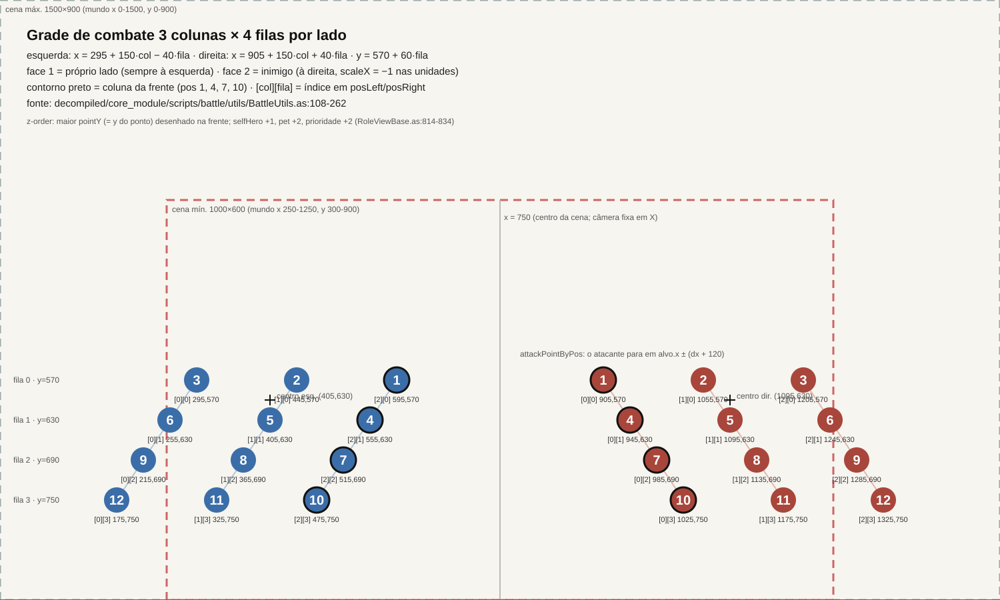

# Battle formation and position grid (Legend Online BR)

This document describes the 3×4 position grid of a battle (the "xadrez", or chess board) and everything that places
units on it: the `BattleUtils` grid formulas and the pos 1-12 coordinate table, which unit types occupy each position,
the client-side formation screens (the main LineUp screen and 20 mode-specific screens), how the grid maps to the screen
and camera, and how reinforcement, swap and revive add or remove units during a battle. Combat flow is covered in
[README.md](README.md), the HUD in [hud.md](hud.md), and rules and sequences in [rules.md](rules.md).

**Conventions.** Source is the decompiled AS3 client. Path prefixes: **CM** = `decompiled/core_module/scripts`,
**M10** = `decompiled/m10/scripts`, **M5** = `decompiled/m5/scripts` (§7 uses paths relative to `decompiled/`).
*(assumption)* = unconfirmed.

**Diagram.** [grid.svg](grid.svg) is generated by `tools/battle_grid_svg.py`, a line-by-line reimplementation of
`get9GridPos`/`rolePointByPos`/`getPosition`:

```bash
python3 tools/battle_grid_svg.py
```

`--table` prints the §2 table. The mechanics DB holds the same values in `game.battle_grid_positions`
(`db/migrations/0004_game_reference.sql:181`), where `side` means *face*.



## 1. The grid: `BattleUtils`

`CM/battle/utils/BattleUtils.as`

| item | value | line |
|---|---|---|
| init | `BattleManager` calls `BattleUtils.initRolePos()` when building the battle | `CM/battle/BattleManager.as:93` |
| left grid | `posLeft = get9GridPos(295, 570, 0, true)` | `BattleUtils.as:120` |
| right grid | `posRight = get9GridPos(905, 570, 0, false)` | `BattleUtils.as:121` |
| formula | `grid[col][row] = (col·150 + base + gap·col + offs[row]·s, row·60 + 570)`, `offs = [0,−40,−80,−120]`, `s = +1` (left) or `−1` (right), `gap = 0` | `BattleUtils.as:124-151` |
| dead constants | `gasRow = 60`, `gasColumn = 150` and array `[0,60,120,180]` (`_loc10_`) are unused | `BattleUtils.as:31-33,133` |

Effective formulas:
- **left:** `x = 295 + 150·col − 40·row`
- **right:** `x = 905 + 150·col + 40·row`
- **both:** `y = 570 + 60·row`; `col ∈ {0,1,2}`, `row ∈ {0..3}`

Each row is 60 px lower and 40 px farther from the center ("diamond" perspective). The geometric center between the
teams is x = 750, also the scene center (§5).

### 1.1 `rolePointByPos(pos, face)`: unit mapping (`BattleUtils.as:153-225`)

- **Array choice:** `selfSide == 1`: face 1 → `posLeft`, others → `posRight`. `selfSide ≠ 1`: face 2 → `posRight`,
  others → `posLeft`. For face ∈ {1,2} both branches agree, so **`selfSide` has no effect**: face 1 is always left,
  face 2 always right.
- **face 1:** `col = 2 − (pos−1) % 3`, `row = ⌊(pos−1)/3⌋`. Pos 1 → `[2][0]`, the rightmost column of the left side,
  nearest the enemy (`switch` at 170-195).
- **face 2:** `col = (pos−1) % 3`, `row = ⌊(pos−1)/3⌋`. Pos 1 → `[0][0]`, the leftmost column of the right side, also
  nearest the enemy (198-223).
- **Result:** on both sides **pos 1/4/7/10 = front column**, 2/5/8/11 = middle, 3/6/9/12 = back. Row = `⌈pos/3⌉ − 1`
  (pos 1-3 = row 0, top; 10-12 = row 3, bottom).
- **Outside 1-12:** returns `new Point()` = (0,0) (224).

### 1.2 Face (`face`)

| rule | where |
|---|---|
| `face = side == selfSide ? 1 : 2` when reading each unit | `CM/map/internals/utils/SocketGameReader.as:224,281,442,498,549` |
| `armyInfoLeft` gets units with `side == selfSide`; the rest go to `armyInfoRight` | `CM/yishi/datas/BattleModel.as:418-494` |
| `checkFace(model, false)`: `armyInfoLeft.face = 1`, `armyInfoRight.face = 2`, propagated to every unit of the army | `CM/battle/transaction/CreateGameTransaction.as:185,955-961`; `CM/yishi/datas/objects/BattleArmyInfo.as:47-54` |
| face 2: mirrored body (`_movieContainer.scaleX = −1`), direction `"left"` | `CM/battle/view/roles/HeroRoleView.as:155-162`, `RoleViewBase.as:766-778` |
| exception: `AwakenHandler` and `NoviceReinforceHandler` use `face = side == 1 ? 1 : 2` (ignore `selfSide`) | `CM/battle/handler/AwakenHandler.as:19`, `NoviceReinforceHandler.as:71` |

The local player is always face 1, so **the player's own army is always drawn on the left, facing right.**

### 1.3 Other grid functions

| function | behavior | line |
|---|---|---|
| `getLeftTeamCenterPoint()` / `getRightTeamCenterPoint()` | `posLeft[1][1]` = (405, 630) / `posRight[1][1]` = (1095, 630): team center (pos 5) | 241-249 |
| `getPosition(side, pos)` | `col = (pos−1)%3`, `row = ⌈pos/3⌉−1`, **left side not mirrored**. Side 1, pos 1 → (295, 570), the back column. Differs from `rolePointByPos` on the left (see column `getPosition(1,pos)` in §2) | 251-260 |
| `attackPointByPos(pos, face, dx=1)` | where the attacker stops in front of the target: face 1 → `x + dx + 120`; face 2 → `x − dx − 120`; same y | 262-274 |
| `ManagerDepth(container)` | sorts children by `pointY` (swaps index when a lower y sits above a higher y) | 276-300 |

**Callers of `getPosition` (inherit the inverted mirroring):**
- `RoleInfo.point`, only while `_point` is null; uses `getPosition(face==2 ? 1 : 2, pos)`, the **opposite** side
  (`CM/yishi/datas/objects/RoleInfo.as:460-467`).
- Frame effects with `effectData.type == 0`, placed at pos `target` on the attacker's **enemy side**, `target 0 → 5`
  (`CM/battle/skillsys/executer/SkillFrameExecuter.as:140-158`).

To match the original, keep this discrepancy: "enemy grid" effects on the left side land in the mirrored column.

## 2. Table: pos 1-12 → (col, row, x, y)

`[col][row]` indexes `posLeft`/`posRight`. Column `getPosition(1,pos)` = where `type 0` effects cast by a face 2 unit
on the left side land.

| pos | face 1 (left, own) col,row → (x, y) | face 2 (right, enemy) col,row → (x, y) | column | getPosition(1,pos) |
|---:|---|---|---|---|
| 1 | [2][0] → (595, 570) | [0][0] → (905, 570) | front | (295, 570) |
| 2 | [1][0] → (445, 570) | [1][0] → (1055, 570) | middle | (445, 570) |
| 3 | [0][0] → (295, 570) | [2][0] → (1205, 570) | back | (595, 570) |
| 4 | [2][1] → (555, 630) | [0][1] → (945, 630) | front | (255, 630) |
| 5 | [1][1] → (405, 630) | [1][1] → (1095, 630) | middle | (405, 630) |
| 6 | [0][1] → (255, 630) | [2][1] → (1245, 630) | back | (555, 630) |
| 7 | [2][2] → (515, 690) | [0][2] → (985, 690) | front | (215, 690) |
| 8 | [1][2] → (365, 690) | [1][2] → (1135, 690) | middle | (365, 690) |
| 9 | [0][2] → (215, 690) | [2][2] → (1285, 690) | back | (515, 690) |
| 10 | [2][3] → (475, 750) | [0][3] → (1025, 750) | front | (175, 750) |
| 11 | [1][3] → (325, 750) | [1][3] → (1175, 750) | middle | (325, 750) |
| 12 | [0][3] → (175, 750) | [2][3] → (1325, 750) | back | (475, 750) |

Visual (own side left, enemy right):

```
          back  mid  front  │ front  mid   back
row 0       3    2    1     │   1     2     3      y=570
row 1      6    5    4      │    4     5     6     y=630
row 2     9    8    7       │     7     8     9    y=690
row 3   12   11   10        │      10    11    12  y=750
```

## 3. What occupies each position

### 3.1 Unit types (`RoleInfo` → view)

| unit | info / view class | source in 157 `BattlePrepareMsg` | pos | drawing relative to the grid point |
|---|---|---|---|---|
| **soldier (pawn/troop)** | `PawnRoleInfo` / `PawnRoleView` | `soldiers[]` (`SoldierMsg`: living_id, temp_id, type, side, **pos**, hp…) | own (`SocketGameReader.as:211-231`) | at the point; one `PawnTemplate.Swf` SWF per pos (the squad is drawn inside the SWF) (`PawnRoleView.as:87-102`) |
| **player hero** | `HeroRoleInfo` (`type 1`) / `HeroRoleView` | `heros[]` (`HeroMsg`, field 10 `pos`) | own (`SocketGameReader.as:262-263`) | at the point; equipment avatar (`HeroMovieClip`) |
| **NPC hero / boss** | `HeroRoleInfo` with `type 3`, 7 or 8 / `HeroRoleView` | `heros[]` | own | at the point; SWF `resPath` (`HeroRoleView.as:114,147-152`). `type 3` = boss: `BossBottomStrip` bar and special rules (see [rules.md](rules.md)) |
| **pet** | `PetRoleInfo` / `PetRoleView` | `pets[]`, linked to the hero via `living_id2` (`findBattleRoleMsgForHero`) | **the hero's**: setter `heroRoleInfo` copies pos/face/side (`PetRoleInfo.as:55-63`) | `x = point.x − 60` (face 1) or `+ 60` (face 2); `y = point.y − 80` if `PetTemplate.Property1 == 0` (flying pet), else `y = point.y` (`PetRoleView.as:53-63,314-330`) |
| **"fake" pet (pet as hero)** | `HeroRoleInfo.isPetFake` / `isPetState` | pets with no owner hero | own | battleType 3844/3866/3864: `isPetState` (pet as fighter, `sexs = 2`); otherwise `isPetFake` (bar hidden) (`CreateGameTransaction.as:883-893`, `HeroRoleView.as:118-122`) |
| **pet battle (35)** | `HeroRoleInfo.isPetState` + `petRoleInfo` | `pets[]` only | own | `createPetRoleInfo` (`CreateGameTransaction.as:797-821`) |
| **goddess** | `GoddessRoleInfo` / `GoddessRoleView` | `goddesses[]`, linked to the hero | **the hero's** (`GoddessRoleInfo.as:51-59`) | at the hero's point but **invisible** (`delayInitView → visible = false`, `GoddessRoleView.as:88-94`); shown in the goddess animation (opcode 4102). A goddess without a hero becomes `HeroRoleInfo.isGoddess` with its own pos (`CreateGameTransaction.as:897-909`) |
| **child** | `HeroRoleInfo` read with `param4 = true` | `children[]` | own | `isFollowChild = true`, except battleTypes 3845/3847/3867/3868/3889, where the child fights as a main unit (`CreateGameTransaction.as:912-934`) |
| **"chess" child (349)** | `SelfChessRoleInfo` / `SelfChessRoleView` | `chessList[]` | own, if `hasPos` | `isChildFake = true` (`SocketGameReader.as:397-446`) |
| **monster** | `MonsterRoleInfo` / `MonsterRoleView` | `monsters[]` | own, if `hasPos` | SWF `MonsterTemplates.ResPath`; `isFollowHero = false` only in battleType 3884 (`CreateGameTransaction.as:936-950`) |

Read order in `createHeroAndPetRoleInfo`: heroes (with embedded pet and goddess) → remaining pets → remaining goddesses
→ children → monsters (`CreateGameTransaction.as:823-952`). Soldiers come first, in `createPawnRoleInfo` (730-747).
Per-`battleType` variants (`initBattleInfo`, 128-145):

| battleType | creation |
|---|---|
| 35 | `createPetRoleInfo` only |
| 307 | pawns + heroes with `param3 = true`: the user's own heroes are **skipped**; `isFinishNow = false` |
| 349 | pawns + `createSelfChessRoleInfo` |
| others | pawns + `createHeroAndPetRoleInfo` |

### 3.2 Occupancy rules in the model
- **One hero per row:** `BattleModel._heroList[(⌊(pos−1)/3⌋) + "_" + side]`, only for `isBattleHero` (`type 1`, not
  childFake/petFake/goddess) (`BattleModel.as:407-417`, `BattleFunctionHelper.as:82-99`). The HUD
  (TeamStrip/DragonTitan/goddess) reads rows 0-3 by this key (`M10/battle/view/ui/BattleUIView.as:1512-1517`,
  `DragonTitanTeamView.as:155-158`).
- **`selfHero`:** the logged-in user's own hero, excluding petFake/goddess/followChild. `childHero` = the non-slave
  following child. Rules differ in 307 and 349 (`BattleModel.as:423-470`).
- **Skipped unit:** `needShow == true` (field `is_show`) → unit is **not added to the scene**. In battleTypes 295 and
  3898, units with `bloodA <= 0` are also skipped (`M10/battle/view/BattleView.as:253-266`).
- **Initial placement:** `BattleView.initRoles` iterates the left side (heroes, pawns, pets, goddesses, monsters), then
  the right in the same order, calling `info.initPos(rolePointByPos(pos, face))` (`BattleView.as:216-249`).

### 3.3 Depth (z-order)
`RoleViewBase.updateDepthInfo` (`CM/battle/view/roles/RoleViewBase.as:814-834`): `pointY = point.y`, `+1` for
`selfHero`, `+2` for a pet, `+2` with `setArrangePriority(true)`. Every frame `BattleMapView.update` calls
`ManagerDepth(_rolesContainer)` (`M10/battle/view/map/BattleMapView.as:140`): **higher y = drawn in front**. Screen
position = `(point.x, point.y − pointZ)`, where `pointZ` = height (jump/flight) (`RoleViewBase.as:766-812`).

## 4. Client-side formation (pre-battle)

### 4.1 Army "LineUp" screen (M5 `armyII/viewII/lineUp/LineUpView.as`)
The only formation of the main mode (PvE/PvP with lord). The player **does not place units freely**: they pick one of 4
lord (*thane*) positions and everything else is derived.

- **Buttons** (`SelectedButtonGroup`): styles `army.LineUpView.fontBtn1`, `fontBtn2`, `backBtn1`, `backBtn2` (lines
  102-105). Texts in `army.LineUpView.*.text`. `heroPosArr = [4, 7, 6, 9]` (77): front 1 = 4, front 2 = 7, back 1 = 6,
  back 2 = 9.
- **Background:** bitmaps `asset.army.lineupBg` and `asset.army.lineupBack`. Left panel: `arrmy.LineupLeftView` (98-101).
- **Cells:** 8 `LineUpFormationItem(pos)`. Cell background `asset.army.lineUpBottom`; body
  `asset.avatar.DefaultAvatarMovieAsset` until loaded (`LineUpFormationItem.as:71,177`). The middle column (2/5/8/11)
  is **not shown**: the UI shows only 1/4/7/10 and 3/6/9/12.

  | index | pos | x | y |
  |---:|---:|---:|---:|
  | 0 | 3 | 312 | 142 |
  | 1 | 6 | 270 | 190 |
  | 2 | 9 | 227 | 247 |
  | 3 | 12 | 177 | 307 |
  | 4 | 1 | 506 | 142 |
  | 5 | 4 | 473 | 190 |
  | 6 | 7 | 432 | 247 |
  | 7 | 10 | 377 | 307 |

  (`LineUpView.as:114-148`; `getItemByPos` uses the same array `[3,6,9,12,1,4,7,10]`, 207-216)
- **Derivation** (`checkPos`, 233-274):

  | lord (`_thanePos`) | pawns (2 cells) | child | slave child | monster | `heroPos`/`pawnPos` sent |
  |---:|---|---:|---:|---:|---|
  | 4 (front, row 1) | 3 and 12 | 6 | 12 | 3 | 1 / 3 |
  | 7 (front, row 2) | 3 and 12 | 9 | 12 | 3 | 1 / 3 |
  | 6 (back, row 1) | 1 and 10 | 4 | 10 | 1 | 3 / 1 |
  | 9 (back, row 2) | 1 and 10 | 7 | 10 | 1 | 3 / 1 |

  The child sits in the lord's row, opposite column. Troops occupy rows 0 and 3, in the column opposite the lord.
- **Display** (`refreshView`, 276-311): lord always; child if `ChildManager.model.getEnterWar()`. **If** a slave child
  **or** a monster is in war (`MonsterManager.model.enterWarMonster`), it appears **in place of** the troops; otherwise
  the troops appear twice (pawnPos1 and pawnPos2), provided `armyPawn.ownPawns != 0`.
- **Persistence:** the server stores only "lord front or back". Initial pos comes from `initPos` (220-231):
  `thane.fightPos == 1 && armyPawn.fightPos == 3` → 4; `3 && 1` → 6; else 4. So **7 and 9 do not survive a reload**:
  they send the same `fightPos` as 4 and 6.
- **Send:** when the position string changes (`_currentPistion`), the client calls
  `ArmySocketOutManager.sendEditArmyPos(userId, heroPos, pawnPos)` → **8276** `ArmyFightPosEditMsg {user_id, hero_pos, pawn_pos, serverName}`
  (`LineUpView.as:180-194`, `CM/managers/ArmySocketOutManager.as:85-93`).

### 4.2 NPC formation (templates)
`HeroAis.Soldiers = "pawnTempId,pos|…"` (`data/tpl/tempinfos/HeroAis.xml`; DB: `game.hero_ai_soldiers`). Of 8,080
`HeroAi`, 144 have troops. Most common troop pos patterns:

| troop pos | count |
|---|---:|
| 1, 2, 7, 8 | 70 |
| 1, 7 | 27 |
| 3, 9 | 23 |
| 1, 3, 7, 9 | 11 |

NPCs use rows 0 and 2 around the hero in row 1. The server resolves the formation and only sends `pos` in each
`SoldierMsg`/`HeroMsg`.

### 4.3 Mode-specific formation screens
See §7: 20 screens (pets, children, monsters, goddesses, arenas, teams). All use the same 8-cell grid subset
`[3,6,9,12,1,4,7,10]` (no middle column).

### 4.4 Formation bonuses
The main army has **no formation types and no position bonuses**: `LineUpView` only sends heroPos/pawnPos. Only two
formation-related bonuses exist:
- **Goddess "Formação"** (united formation): 5 cards, no grid; bonus from
  `GoddessUnitedResiTemplates`/`GoddessUnitedSkillTemplates` (§7.20).
- **Auto chess:** job synergy of pieces (`AutoChessBuff*.xml`, §7.19; details in [chess-modes.md](chess-modes.md)).

## 5. Grid, camera and screen

- `BattleView` clips the scene with `scrollRect = (0, 0, w, h)`, `w = clamp(stageWidth, 1000, 1500)`,
  `h = clamp(stageHeight, 600, 900)` (`M10/battle/view/BattleView.as:50-55,102-120`).
- `BattleSceneView` centers `BattleView` on stage: `x = stageW/2 − 750` if `stageW ≥ 1500`, else 0;
  `y = stageH/2 − 450` if `stageH ≥ 900`, else 0 (`M10/battle/BattleSceneView.as:131-150`).
- `CAMERA_X = 650`, `CAMERA_Y = 900 − h/2` (`BattleView.as:46-48,90-91,109`).
- **Transform** (`M10/battle/view/map/BattleCameraScene.as:108-123,187-191`), with `c = (w/2, h)`:
  - layer: `layer.x = −(cameraX − w/2) · moveCoefficient`
  - scene: `scale = zoom`, `y = −(cameraY·zoom − h/2)`, `x = −(750 − w/2)`
- **Unit/effect layers have `moveCoefficient = 0`:** `addLayer(obj)` uses default 0 (`BattleCameraScene.as:41`,
  `M10/battle/view/map/BattleMap.as:64-67`). Only map scenery layers have their own coefficient.
- **At zoom 1, a grid point appears on screen at:**

  ```
  screen_x = world_x + w/2 − 750
  screen_y = world_y − 900 + h
  ```

  - Visible world: x from 750 − w/2 to 750 + w/2; y from 900 − h to 900.
  - **At 1000×600, left pos 12 (x 175) and right pos 12 (x 1325) have their centers 75 px off-screen**; pos 9 and 10
    sit at the edge. At 1500×900 everything fits.
- Skill camera: type 4 frames (zoom) call `map.setCamera(new Point(650, CAMERA_Y), backTime)` to return
  (`SkillFrameExecuter.as:326`). Details in [rules.md](rules.md) §5.2 (frame type 4).

## 6. Reinforcement, swap and revive

### 6.1 Reinforcement: 72 `U_B_USER_REINFORCE` (`ReinforceMsg`)
`ReinforceMsg`: `side, hero[], soldiers[], reinforceWave, pets[], children[], removeLivingIds[], heroTempId[], life[], frame_num, opType, goddesses[], monsters[]`.

1. **Filter** (`CM/battle/transaction/ReinfoTransaction.as`): ignored if `BattleManager.selfDie` or
   `battleModel.isFinishNow`.
2. **`ReinforceHandler.handle`** (`CM/battle/handler/ReinforceHandler.as:104-313`):
   - `selfDie` → return (125-128). `opType` is stored in `childArenaType` (132-136).
   - battleType **3870**: all right-side units get `isLiving = false` before the new wave (141-151).
   - battleType ≠ **295** with `hasReinforceWave` → `trialLayer = reinforceWave` (current trial layer/wave) (152-158).
   - Reads each group in this order and calls `addRole` (159-298):
     - soldiers;
     - heroes, with goddess and pet; with a pet, preloads skills 700001/700002; if `isChildFake`, 700003/700004;
     - children with `side ≠ 0`;
     - pets as heroes, only in 3866;
     - goddesses: **bug**, the loop calls `addRole(_loc6_)` (the last child/pawn) instead of the goddess read (277);
     - monsters (`isFollowHero = false` only in 3884).
   - **`type 3` heroes** (bosses) in the wave → `battleUIView.bossReinforce(list)` (216-219, 299-302).
   - Then `isOver = false`. If no non-boss hero arrived, `SKILL_ENABLE(true)`. Preloads skills and fires
     `BATTLE_REINFORCE_HANDLER` (303-312).
3. **Animated entry:** `ReinforceHandler.addRole` (37-59):
   - `face` recomputed;
   - `load()`, unless "hide others" is active for that unit (`isHideOtherInBattle`);
   - `addRole` on the model if not present yet;
   - the unit spawns **700 px outside** its side (face 1: `x − 700`; face 2: `x + 700`) and walks to its grid point
     with `MovePointAction(id, point, 25, …)`.
4. **Animated exit:** `ReinforceHandler.removeRole(info, isSelfSide, opType)` waits 600 ms and walks 700 px outward; on
   the left side, clears actions on arrival (61-102).
5. **Wave resources:** 4149 `U_B_LOAD_RES` (`ArmyResMsg`) → `ReinfoResTransaction` preloads pawn and hero skills. With
   `reinforceType == 1`, updates the wave counter: `battleUIView.setReinforceWaveInfo(reinforceCount, 1)` or
   `battleModel.reinforceWave` (`CM/battle/transaction/ReinfoResTransaction.as:24-102`).
6. **HUD counter:** `BattlePrepareMsg.reinforceCount` → `reinforceWave`, `currentReinforce` → `currentReinforceWave`
   (`CreateGameTransaction.as:113-114`). `RoleShowViewII` shows `ReinforceWavePane` when `reinforceWave > 0`, at wave
   `currentReinforceWave + 1` (`M10/battle/view/ui/RoleShowViewII.as:63-65,87-92`).
7. **Reinforcement load done:** with `useWay ≠ 0`, the client sends **10018** `B_REINFORCE_LOADOVER` instead of 10007
   (`CM/yishi/service/managers/SocketSendManager.as:304`; see [README.md](README.md) §1).
8. **Tutorial reinforcement** (`NoviceReinforceHandler`, `CM/battle/handler/NoviceReinforceHandler.as`):
   - waits 3 s;
   - moves the camera to `(650 + 550, CAMERA_Y)` over 2 s;
   - soldiers spawn at `point.x + 550 + 700 + offsetX(pos)` and walk (speed 15);
   - after 3 s, the camera returns over 1 s.
   Same pattern in `CM/managers/TailaFbManager.as:76-77`.

### 6.2 Swap: 4793 `U_B_MONSTER_EXCHANGE` (`ReinforceMsg`)
`SwapTransaction` → `SwapHandler.handle` (`CM/battle/handler/SwapHandler.as:32-171`):
1. `isOver = false`. Reads soldiers, heroes (with pet and goddess) and children → `join[]`; `removeLivingIds` →
   `back[]`. If `life[]` and `heroTempId[]` are present, updates `battleModel._life`/`_heroTempId` (76-80).
2. **`skipOverdueActions(frame_num)`:** in every queue (global and per unit), each unfinished skill with
   `liftTime < frame_num` gets `skipFun()` and leaves the queue (85-119).
3. **Leaving units:** current skill skipped, `isLiving = false`, HP cache cleared (`BloodHelper.removeCacheInfoById`)
   (131-143). **No exit animation**: the unit dies in place.
4. **Entering units:** `load()`, `addRole`, spawn at ±700 px (face 2: +700), walk to the grid at speed 25 (144-152).
5. battleType **311, 312, 313** → `battleUIView.updateMutilRoleShowView()` (now, or on scene entry) (153-170).

### 6.3 Revive: 4795 `U_B_RELIVE_LIVE` (`ReliveMsg {battle_id, living_id, skill_id, parm1..3}`)
`ReviveTransaction` → `ReviveHandler.handle` (`CM/battle/handler/ReviveHandler.as:25-115`), always on a `HeroRoleInfo`:
1. `isLiving = true`, `riveve = true`, `dying = false`, looping `Stand`, `bloodA = totalBloodA`, `needShow = false`,
   `BloodHelper.resetRoleBlood` (34-41).
2. View re-added to the map (`battleMap.addRole`, or `map.revierBoss` if already bound to a map). Bar restored
   (`setRoleInfoViewVisible(true)`; `BossBottomStrip.resetView()`) (42-68).
3. Event `bloodChange` with **bloodType 10**, `displayBlood = totalBloodA` (69-78).
4. battleType 311-313 → `updateMutilRoleShowView(true)` (79-96).
5. Effect `buff.action.cure2` (except with "hide others") and a system chat message, channel 3,
   `battle.actions.DannyAction.ChatDataMsg` (97-113). `isOver = false`.

There is also a *scheduled* revive inside an attack: `AttackOrderMsg.waitRevives` → `ReliveInfo`
(`CM/battle/data/ReliveInfo.as`), applied by `BloodHelper` and `DannyAction`. See [rules.md](rules.md) §2.1 and §2.3.

## 7. Mode-specific formations

Screens outside `LineUpView`. Paths are relative to `decompiled/` (AS3 in `decompiled/<module>/scripts`). battleTypes
per mode are inferred from names in `BattleType.as` and marked *(assumption)*. The main formation
(`m5/.../lineUp/LineUpView.as`, opcode 8276) is not covered here, except the Batalha de Athena variant (§7.13), which
writes to the same opcode.

Grid conventions (confirmed): pos 1-12; front column = 1,4,7,10; back column = 3,6,9,12; row = ceil(pos/3) (1-based). No secondary
screen uses the middle column (2,5,8,11), except the Equipe Livre/Salão de Jogo grid, which only draws it and disables
it (§7.17/§7.18).

### Summary

| # | Mode (pt-BR game name) | Units | Slots | Server format | Send | Receive | Likely battleType |
|---|---|---|---|---|---|---|---|
| 1 | Arena Einherjar (PetChallenge) | pets | 8 (max 3) | FS8 string `chaPos` | 8725 `PlayerPetMsg.chaPos` | 4540 `PlayerPetMsg` | 35 PET_PK *(assumption)* |
| 2 | Monopoly das Criaturas | lord (id 0) + pets | 8 (max 3 incl. lord) | FS8 `monopolyPos` | 8725 `monopolyPos`, operateType=2 | 4540 | 306/307/3850 *(assumption)* |
| 3 | Sonho Esmeralda (guild boss) | lord (id 0) + pets | 8 (max 3) | FS8 `consortiaPos` | 8725 `consortiaPos`, operateType=3 | 4540 | 309 *(assumption)* |
| 4 | Batalha de Ares/dos Deuses, Batalha de Vênus, "transfer" | pets | ? | `lordsPos`/`mateLordsPos`/`transferPos` | not decompiled | 4540 | 3859 / 308·315 / ? *(assumption)* |
| 5 | Expedição de Einherjar (RemotePet) | pets (3 own + 1 from a friend) | 8 (1 per row) | FS8 `RemotePetOpMsg.pos` + `pets[]` | 9544 op=2 | 4964 | 3844 *(assumption)* |
| 6 | Guardiões Procurados (Child PVE) | children | 8 (max 4) | `GuardPosMsg{childId,pos}` | 9548 opType=2 | 4979 | 3845 *(assumption)* |
| 7 | Arena do Guardião (Child Arena) | children | 8 (max 4) + order | `GuardPvpPosMsg{childId,attackPos,standPos}` | 9657 guardPvpOp=3 | 453 | 3847 *(assumption)* |
| 8 | Abismo / Abismo Infernal | children | 8 (max 4) + order | `GuardEndlessPosMsg{childId,attackPos,pos}` | 9644 opType=2 | 423 | 3867 / 3889 *(assumption)* |
| 9 | Expedição do Espírito de Proteção | children/spirits | 8 (max 3) | `"childId,pos\|..."` | 8661 op=3 | 4275 (and 4274) | 3895 or 3911 *(assumption)* |
| 10 | Labirinto Negro (DarkMaze) | children | 8 (max 3) | `"pos,childId\|..."` | 8662 op=4 | 4278 | 3898 *(assumption)* |
| 11 | Exploração de Monstros | monsters + captain | 8 (3 monsters) | `MonsterExploreEditMsg{index,monsterId,fightPos,isCaptain}` | 8653 opType=2 | 4576 | 3884 *(assumption)* |
| 12 | Arena dos Sonhos (DreamArena) | lord (+ derived child, slave) | 4 lord positions | `heroPos` (4/7/6/9) | 8654 op=10 | 4581 | 3885 *(assumption)* |
| 13 | Batalha de Athena (BraveLeg), main-formation variant | lord/pawns/children | 4 tabs | `heroPos`/`pawnPos` ∈ {1,3} | 8276 | n/a | 3861 *(assumption)* |
| 14 | Sala multiplayer (PVE/PVP/GloryGame/campaign) | players | 4 rows × front/back | `ArmyFightPosEditMsg{userId,heroPos,serverName}` | 8277 / 25160 (cross) | 4186 | 6/10/11/3848 *(assumption)* |
| 15 | Batalha de Vênus: room order | players + children | 4 (rows 1 and 3) | same as #14 | 8277 / 25160 | 4186 | 308 / 315 *(assumption)* |
| 16 | Missão de equipe (Groupfb) | players (2 teams) | 8 per team | `PropertyListMsg{userId,pos}` | 8972 opType=12 | 4786 | ? |
| 17 | Equipe Livre (FreedomTeam) | players | 8 | `MemberFightPos{memberId,pos}` | 8737 / 25137 | 4628 | ? |
| 18 | Salão de Jogo (GameHall) | players | 8 | same as #17 | 8647 | 4563 | ? |
| 19 | Xadrez automático (SelfChess) | hero pieces | 8 | `battleAry[8]` | 25031 op=5 (move) / 4 (sell) | 4216 | 349 / 3910 *(assumption)* |
| 20 | "Formação" das Deusas | goddesses | 5 cards (no grid) | `formationId`→`templateId` | 5191 op=6 (set) / op=7 (upgrade) | 177 | none (passive bonus) |

**FS8** = string `"a,b,c,d,e,f,g,h"` of 8 ids in order `[pos1,pos4,pos7,pos10,pos3,pos6,pos9,pos12]` (front rows 1-4,
then back rows 1-4); `-1` = empty.

---

### Common pattern of the 8-slot screens (pets, children, monsters)

- Slot creation order: `[3,6,9,12,1,4,7,10]` (4 back first, then 4 front). E.g.
  `m14/scripts/petchallenge/PetFormationFrame.as:131`, `core_module/scripts/monopoly/view/MonopolyPetFormationFrame.as:129`,
  `m14/scripts/childpve/ChildFormationFrame.as:127`, `m14/scripts/childformation/ChildCommonFormationFrame.as:142`,
  `m14/scripts/childabysm/ChildAbysmFormationFrame.as:122`, `m14/scripts/remotepet/views/RemotePetFormationView.as:64`,
  `m14/scripts/childspiritexpedition/formation/SpiritExpeditionFormationFrame.as:127`,
  `m11/scripts/darkmaze/DarkMazeShapeAdjustmentFrame.as:96`, `m14/scripts/monsterexplore/MonsterFormationFrame.as:44`,
  `m13/scripts/dreamarena/DreamArenaFormationFrame.as:128`.
- Coordinates (e.g. `SpiritExpeditionFormationFrame.as:102-126`): first 4 (back) on the left (x 141-276), last 4
  (front) on the right (x 351-485), stepping diagonally down rows 1→4.
- UI→FS8 encoding: `[p[1],p[4],p[7],p[10],p[3],p[6],p[9],p[12]]` (`PetFormationFrame.as:244`). FS8→pos decoding:
  `[-1,s0,-1,s4,s1,-1,s5,s2,-1,s6,s3,-1,s7]` indexed by pos (`PetFormationFrame.as:331`).
- "One unit per row" hint: `posArray = [[],[1,3],[4,6],[7,9],[10,12]]` + `getCanNotDrops()` (row = `Math.ceil(pos/3)`),
  `PetFormationFrame.as:68,249-262`. While dragging, only slots in free rows are highlighted (`__startDragHandler`,
  `PetFormationFrame.as:210-225`).
  - **Arena, Expedição and Monstros pet screens: visual only**; `dragBack` swaps without checking
    (`m14/scripts/petchallenge/views/PetFormationItemView.as:171-193`,
    `m14/scripts/remotepet/views/RemotePetFormationItemView.as:193-201`,
    `m14/scripts/monsterexplore/item/MonsterFormationItemView.as:166-174`).
  - Monopoly/Sonho Esmeralda: slot gets `dropEnable` and the drop is blocked
    (`core_module/scripts/monopoly/view/MonopolyPetFormationItemView.as:191,560-567`).
  - Guardiões Procurados, Arena do Guardião, Abismo, Labirinto Negro: `getCanNotDrops` is empty/`return []`
    (`ChildFormationFrame.as:249-257`, `ChildCommonFormationFrame.as:253-256`, `ChildAbysmFormationFrame.as:240-248`,
    `DarkMazeShapeAdjustmentFrame.as:291-299`): no row restriction. The server may validate *(assumption)*.
- Remove = drag the slot back to the list (VBox) (`PetFormationItemView.as:184-187`). Swap = drop onto another slot
  (both entries swap).

---

### 7.1 Arena Einherjar (PetChallenge): pets

- Screen: `m14/scripts/petchallenge/PetFormationFrame.as` (opened by
  `core_module/scripts/mvc/controler/PetChallengeController.as:40-44`); slot `views/PetFormationItemView.as`; list head
  `views/PetFormationPetHeadView.as`.
- Model: `core_module/scripts/mvc/module/petchallenge/PetChallengeModel.as:54` (`formationString`), `:96-100`
  (`petChallengeFormationOfArray` = split(",")); persisted in `playerInfo.petChallengeFormation`
  (`core_module/scripts/yishi/datas/playerinfo/SimplePlayerInfo.as:985-996`).
- Slots: 8, FS8 (see common pattern).
- Rules:
  - max 3 pets (`PetFormationPetHeadView.as:141-155`, message "Lugar Cheio");
  - closing with 0 pets warns `noPetInFormation`; fewer than 3 asks for confirmation (`PetFormationFrame.as:355-381`);
  - one per row, hint only (see common pattern);
  - pets in the formation cannot be sold on market/auction (`m3/scripts/map/campaign/view/market/MarketPetView.as:105`,
    `m7/scripts/auction/view/sell/PetSellView.as:120`).
- Send (on close, if changed): `PetFormationFrame.as:437-446` → `PetChallengeManager.sendPetFormation`
  (`core_module/scripts/managers/PetChallengeManager.as:217-223`) = **8725** `C_PET_CHALLENGE_FORMATION`
  (`core_module/scripts/yishi/datas/consant/ProtocolTypeTable.as:1269`), `PlayerPetMsg.chaPos`.
- Receive: **4540** `U_C_PLAYER_PETINFO` (`ProtocolTypeTable.as:436`) → `PlayerManager.__petInfoHandler`
  (`core_module/scripts/yishi/manager/PlayerManager.as:172,1474`), `chaPos` → `petChallengeFormation` (`:1490-1493`).
  In the rival list (`CrossPetInfoMsg`), pets carry `fightPos`
  (`core_module/scripts/com/road/yishi/proto/pet/CrossPetInfoMsg.as:530-536`).
- battleType: `PET_PK=35` / `PET__HUMAN_PK=36` (`core_module/scripts/yishi/datas/battle/BattleType.as:56-58`)
  *(assumption)*.
- Bonus: none found.

### 7.2 Monopoly das Criaturas: lord + pets

- Screen: `core_module/scripts/monopoly/view/MonopolyPetFormationFrame.as`, with `MonopolyPetFormationItemView.as` and
  `MonopolyPetFormationPetHeadView.as`. Opened by `core_module/scripts/mvc/controler/MonopolyController.as:78-81`.
  Reuses `PetChallengeModel` for the string.
- Persistence: `playerInfo.petMonopolyFormation` (`MonopolyPetFormationFrame.as:73`).
- Slots/conversion: identical to FS8 (`:129,:246,:334`).
- Specific rules:
  - **id 0 = the lord**: a slot with value 0 becomes a fake `PetData` with the thane's name (`:338-350`), drawn as a
    hero (`MonopolyPetFormationItemView.as:310`);
  - the lord cannot leave: dragging it to the list returns it (`MonopolyPetFormationItemView.as:196-203`); dropping a
    pet on the lord is refused (`MonopolyPetFormationPetHeadView.as:194-202`);
  - the count uses `>= 0`, so the lord counts: max 3 entries = lord + 2 pets
    (`MonopolyPetFormationPetHeadView.as:152-165`; `closeTip` says "máximo 2 Einherjar", text
    `WarlordsPetFormationFrame.closeTip`, `MonopolyPetFormationFrame.as:402`);
  - pets with `isEnterWar` (the pet already following the lord) are disabled in the list (`:205-208`);
  - drop restricted per row (`dropEnable`, see common pattern).
- Fusing, swallowing or composing a pet turns it into `-1` in the string, which is resent
  (`m14/scripts/pet/mix/PetMixView.as:741-755`; also `PetSwallowView.as:395-400`, `PetComposeView.as:389-394`,
  `PetShowView.as:602-607`).
- Send: `MonopolySocketOutManager.sendPetFormation` (`core_module/scripts/managers/MonopolySocketOutManager.as:81-88`)
  = **8725**, `PlayerPetMsg.monopolyPos`, `operateType=2`.
- Receive: 4540, `monopolyPos` (`PlayerManager.as:1498-1501`).
- battleType: `MONOPOLY_BATTLE_NORMAL=306`, `MONOPOLY_BATTLE_HELP=307`, `MONOPOLY_MIRROR_BATTLE=3850`
  (`BattleType.as:82,84,128`) *(assumption)*.

### 7.3 Sonho Esmeralda (guild boss): lord + pets

- Screen: `m6/scripts/consortia/view/myConsortia/emedream/ConsortiaEmeDreamPetFormationFrame.as`. Uses the Monopoly
  items (`:20,:138,:323`); entry point not found in AS3 *(probably via stylename)*. The map's "ajustar" button
  (`m3/scripts/map/campaign/view/ui/emedream/EmeDreamTeamView.as:234-238`) opens tab 3 (army/main formation) of
  `SkillFrame`, not this screen.
- Persistence: `playerInfo.petConsortiaBossFormation` (`:73,:452-457`).
- Slots: FS8 (`:134,:255,:343`).
- Rules: same as Monopoly. 0 = lord (`:348-353`), max 3 including the lord (`:383-394`), `isEnterWar` disabled (`:210`).
- Send: `ConsortiaSocketOutManager.sendPetFormation` (`core_module/scripts/managers/ConsortiaSocketOutManager.as:345-352`)
  = **8725**, `consortiaPos`, `operateType=3`.
- Receive: 4540, `consortiaPos` (`PlayerManager.as:1502-1505`).
- battleType: `CONSORTIA_EME_DREAM_BOSS_BATTLE=309` (`BattleType.as:80`) *(assumption)*.

### 7.4 Other pet formations without a decompiled screen

`PlayerPetMsg` (`core_module/scripts/com/road/yishi/proto/pet/PlayerPetMsg.as`) carries 3 more formation strings:

- `lordsPos` (switch index 8, `:494`): not read by the client. Batalha de Ares opens
  `warlords.room.WarlordsPetFormationFrame` (`core_module/scripts/mvc/controler/AresLordsController.as:70-73`), but that
  class is in no decompiled module (only in `web/public/layout/class-styles.json`). Text
  `WarlordsPetFormationFrame.closeTip` says "máximo 2 Einherjar". Probably the same FS8 + 8725 *(assumption)*. battleType
  `CROSS_ARESLORDS_BATTLE=3859` (`BattleType.as:150`) *(assumption)*.
- `mateLordsPos` (index 13) → `petMatelordsFormation` (`PlayerManager.as:1494-1497`), no decompiled edit screen (Batalha
  de Vênus) *(assumption: FS8)*.
- `transferPos` (index 14) → `petFlameFormation` (`PlayerManager.as:1506-1509`), no usage or screen found *(unknown
  mode)*.

### 7.5 Expedição de Einherjar (RemotePet): pets

- Screens: `m14/scripts/remotepet/RemotePetReadyFrame.as` contains `views/RemotePetFormationView.as` (grid) and
  `views/RemotePetListView.as` (sites).
- Model: `core_module/scripts/mvc/module/remotepet/RemotePetListInfo.as:13`
  (`formationString = "-1,-1,-1,-1,-1,-1,-1,-1"`), `:23-27`.
- Slots: 8, FS8 (`RemotePetFormationView.as:64,127,207`).
- Rules:
  - pets come from list "sites": 7 heads, of which 4-6 are hidden (`RemotePetListView.as:93-104`); site 7 is the pet
    borrowed from a friend (`:139-146`, `RemotePetInfoView.as:169-178`), so at most 4 pets on the grid;
  - picking a pet in a site puts it in the first slot of a free row (`RemotePetFormationView.as:166-180`);
  - changing a site's pet replaces it in the same slot (`:182-201`);
  - one-per-row is enforced on auto-placement; on drag it is visual only.
- Send (on screen close): `RemotePetReadyFrame.as:136-142` → `RemotePetManager.saveRemotePetInfo`
  (`core_module/scripts/managers/RemotePetManager.as:203-231`) = **9544** `C_REMOTE_PET_OP`, `op=2`, `pos=FS8`,
  `pets[]=PetSiteMsg{petId,site,skills}`; an empty string becomes 8×-1 (`:210-213`).
- Receive: **4964** `U_C_REMOTE_PET_MSG` (`:112,118-146`): `pos`→`formationString`; `pets`=`"site,petId|..."` (sites
  4/5/6 ignored, `:133-138`).
- battleType: `REMOTE_PET_BATLE=3844` (`BattleType.as:96`) *(assumption)*.

### 7.6 Guardiões Procurados (Child PVE / "Guard PVE"): children

- Screen: `m14/scripts/childpve/ChildFormationFrame.as` (`childpve.ChildFormationFrame`, opened by
  `core_module/scripts/mvc/controler/ChildPveController.as:250-254`, from `m14/scripts/childpve/ChildPveReadyFrame.as:292-300`
  or `childpatrol/ChildPatrolPointFrame.as:276`).
- Model: `core_module/scripts/mvc/module/children/ChildModel.as:94` (`formationString`), `:322-345`
  (`childpveFormationOfArray`, `getFightChildCount`); mirrored in `playerInfo.childPveFormation`
  (`ChildFormationFrame.as:446-456`).
- Slots: 8, FS8 (`:127,:244,:326`).
- Rules:
  - max 4 children (`ChildFormationHeadView.as:152-156`);
  - warning on close with 0 or fewer than 4 (`ChildFormationFrame.as:359-388`);
  - no row restriction (`getCanNotDrops` empty, `:249-257`).
- Send: `ChildPveController.sendChildFormation` (`:199-229`) = **9548** `C_GUARDPVE_REQ` (`ProtocolTypeTable.as:1439`),
  `GuardPVEReqMsg.opType=2`, `guardPos[] = GuardPosMsg{param1=childId, param2=pos}`. Every child in the list is sent;
  pos comes from the FS8→`[1,4,7,10,3,6,9,12]` map (`:210`); outside the formation it is `-1` (0 also becomes -1,
  `:224`).
- Receive: **4979** `U_C_GUARDPVE_OPRSP` (`ProtocolTypeTable.as:676`) with
  `GuardPVERspMsg.guardPos[]{param1=childId,param2=pos}`. Builds a 14-position array and converts to FS8
  (`core_module/scripts/managers/ChildManager.as:148,190-199`; `ChildPveController.as:141-151`).
- battleType: `CHILD_PVE_BATLE=3845` (`BattleType.as:102`) *(assumption)*.

### 7.7 Arena do Guardião (Child Arena): children, position + order

- Screen: `m14/scripts/childformation/ChildCommonFormationFrame.as` (stylename `child.commonFormationFrame`,
  `core_module/scripts/mvc/controler/ChildArenaController.as:36-38`), opened with `frameData=1` =
  `ChildModel.CHILD_ARENA_FORMATION` (`m14/scripts/childarena/ChildArenaLeftView.as:226`; `ChildModel.as:64`).
  `formationType` only takes effect when it is 1 (`ChildCommonFormationFrame.as:391-394,434-440`).
- Model: `core_module/scripts/mvc/module/children/ChildCommonFormationInfo.as` (`childId`, `attackPos`, `standPos`);
  list in `ChildArenaModel.childAreanFromationList`.
- Slots: 8. On drop, builds FS8 (`:248`) and converts to `attackPos` via `[1,4,7,10,3,6,9,12]` (`:366-395`).
- **`standPos`** = order 1..N: a new child enters with 9999 and `resetStandPos` renumbers (`:383,:397-407`). The order
  is shown as an image in the side panel (`m14/scripts/childarena/ChildArenaHeadItemView.as:82`) and changed by dragging
  one head onto another: `ChildArenaModel.changePos` swaps only `standPos`
  (`core_module/scripts/mvc/module/children/ChildArenaModel.as:192-206`), and `ChildArenaHeadItemView.as:150-163`
  resends. Exact meaning: entry/substitution order *(assumption)*.
- Rules:
  - max 4 (`ChildCommonFormationHeadView.as:130-147`);
  - no row restriction (`ChildCommonFormationFrame.as:253-256`);
  - the screen closes if the arena enters "agrupando" (`:191-195`).
- Send: `ChildSender.setChildArenaPos` (`core_module/scripts/mvc/module/children/ChildSender.as:619-645`) = **9657**
  `C_GUARDPVP_CLIENT_OP` (`ProtocolTypeTable.as:1535`), `GuardPvpListMsg.guardPvpOp=3`,
  `guardPos[]=GuardPvpPosMsg{param1=childId,param2=attackPos,param3=standPos}`.
- Receive: **453** `U_C_GUARDPVP` (`ProtocolTypeTable.as:889`). In `ChildManager.as:150,346`, when `guardPvpOp != 1`
  the handler reads the list and sorts by `standPos` (`:410-421`).
- battleType: `CHILD_ARENA_BATLE=3847` (`BattleType.as:104`) *(assumption)*.

### 7.8 Abismo / Abismo Infernal (Outyard "Guard Endless"): children, position + order

- Screen: `m14/scripts/childabysm/ChildAbysmFormationFrame.as` (`core_module/scripts/mvc/controler/OutyardControler.as:79-81`,
  openType 8).
- Model: `core_module/scripts/mvc/module/outyard/AbysmModel.as` + `AbysmChildInfo.as` (`childId`, `attackPos`, `pos`).
- Slots: 8. FS8 (`ChildAbysmFormationFrame.as:122,235`) → `attackPos` via `[1,4,7,10,3,6,9,12]` (`:379-406`).
- `pos` = order 1..N, renumbered by `getChildPos` (`:473-487`). The child with `pos==1` is `abysmChildFightId`, the one
  currently fighting (`AbysmModel.as:104-108`). Order is changed by dragging heads in
  `m11/scripts/abysm/view/item/AbysmChildItemHeadView.as:207-222` (`changePos(a,b,1)` swaps `pos`; mode 2 would swap
  `attackPos`, `AbysmModel.as:158-212`).
- Rules:
  - max 4 (`ChildAbysmFormationHeadView.as:144-146`, "Lugar ocupado");
  - no row restriction (`ChildAbysmFormationFrame.as:240-248`).
- Send: `OutyardManager.abysmSendInfo(2, list)` (`core_module/scripts/yishi/manager/OutyardManager.as:356-386`) =
  **9644** `C_GUARDENDLESS_OP` (`ProtocolTypeTable.as:1526`),
  `guardPos[]=GuardEndlessPosMsg{param1=childId,param2=attackPos,param3=pos}` + `isHorrible` (true = Abismo Infernal).
- Receive: **423** `U_C_GUARDENDLESS_INFO` (`ProtocolTypeTable.as:856`) → `OutyardManager.as:96,205-211` →
  `AbysmModel.abysmInfoHandler` (`AbysmModel.as:97-117`).
- battleType: `ABYSM_BATTLE=3867`, `HELL_ABYSM_BATTLE=3889` (`BattleType.as:160,208`) *(assumption)*.

### 7.9 Expedição do Espírito de Proteção (SpiritExpedition): children/spirits

- Screen: `m14/scripts/childspiritexpedition/formation/SpiritExpeditionFormationFrame.as`
  (`core_module/scripts/mvc/controler/SpiritExpeditionControl.as:44-46`). Uses `ChildCommonFormationItemView` with
  `formationType=2` = `EXPEDITION_FORMATION_TYPE` (`:145`; `ChildModel.as:66`). Heads are `SpiritExpeditionNSHeadItem`,
  one per spirit template/job (`:138-148`); 3 skill slots (`:150-158`).
- Model: `core_module/scripts/mvc/module/childspiritexpedition/SpiritExpeditionModel.as` (`childList`, `enterWarList`,
  `getChildDataByPos` at `:54-63`, which uses the battle pos directly).
- Slots: 8, coordinates and order `[3,6,9,12,1,4,7,10]` (`:102-137`).
- Rules:
  - max 3 in `enterWarList` (`SpiritExpeditionNSHeadItem.as:202-206`);
  - no row restriction: all slots light up on drag (`:198-205`, `SpiritExpeditionFormationFrame.as`).
- Format and send: `"childId,pos|childId,pos"`, only ids > 0 (`:289-307`) →
  `SpiritExpeditionManager.sendExpeditionEditFormation` (`core_module/scripts/managers/SpiritExpeditionManager.as:160-167`)
  = **8661** `C_EXPEDITION_CLIENT_OP`, `PlayerOpMsg.op=3`, `param1`=string.
- Receive: **4275** `U_C_EXPEDITION_EDIT` and **4274** `U_C_EXPEDITION_DATA` (`SpiritExpeditionManager.as:53-54`,
  `:114-141`): `ExpeditionMsg.edits[]{childId,energy,pos,skills,cdTime}`. Entries with `pos>0` go to `enterWarList`,
  sorted by `posSortAry=[3,1,6,4,9,7,12,10]` (`:26,128`; row 1 back→front, row 2...).
- battleType: `EXPEDITION_BATTLE=3895` or `CHILD_NS_WAR_BATTLE=3911` (`BattleType.as:220,254`) *(assumption)*.

### 7.10 Labirinto Negro (DarkMaze): children

- Screen: `m11/scripts/darkmaze/DarkMazeShapeAdjustmentFrame.as` + `DarkMazeShapAdjustmentHeadView.as`.
- Model: `DarkMazeModel.battleArray` of `DarkMazeChildPosInfo{pos,childId}`
  (`core_module/scripts/managers/DarkMazeManager.as:243-268`).
- Slots: 8 (`[3,6,9,12,1,4,7,10]`, `:96`).
- Rules:
  - max 3 children with id≠0 (`DarkMazeShapAdjustmentHeadView.as:195-209`);
  - no row restriction (`DarkMazeShapeAdjustmentFrame.as:291-299`);
  - dead-child marker (`hasDieTxt`, `HeadView:116`).
- Format: `"pos,childId|..."` with **all 8 positions**, 0 = empty (`:166-201`, `updateToPlayerInfo` at `:186`); field
  order reversed relative to §7.9.
- Send: `DarkMazeManager.darkMazeOperation(4,0,0,str)` (`DarkMazeManager.as:319-337`) = **8662** `C_DARK_MAZE_OP`,
  `PlayerOpMsg.op=4`, `param1`.
- Receive: **4278** `U_C_DARK_MAZE_DATA` (`DarkMazeManager.as:104,123-172`, `DarkMazeMsg.posInfo` with opType 1/3/4).
- battleType: `DARK_MAZE_BATTLE=3898` (`BattleType.as:226`) *(assumption)*.

### 7.11 Exploração de Monstros (MonsterExplore): monsters with captain

- Screen: `m14/scripts/monsterexplore/MonsterFormationFrame.as` (FORMATION_FRAME in
  `core_module/scripts/mvc/controler/MonsterExploreControler.as:45-47`; stylename
  `MonsterExplore.MonsterExploreFormationFrame` → this class *(assumption)*). Items: `item/MonsterFormationItemView.as`
  (grid) and `item/MonsterFormationSelectItem.as` (3 selectors).
- Model: `core_module/scripts/mvc/module/monsterexplore/MonsterExploreFormationInfo.as` (`monsterId`, `index` 1..3,
  `fightPos`, `isCaptain`). `MonsterExploreModel.formationDic` = editable copy, `exploreMonsterDic` = server original
  (`MonsterExploreModel.as:107-200`; diff in `checkFormationDicIsSame`, `:170-200`).
- Slots: 8 grid (`posAry=[3,6,9,12,1,4,7,10]`, `:44`) + 3 selectors (`monsterLen=3`, `:42,116-128`).
- Rules:
  - 3 monsters;
  - a new monster lands in the **back column** of a random free row (`randFightPos` returns `posArray[row][1]` =
    3/6/9/12, `MonsterFormationSelectItem.as:183-207`);
  - a replacing monster inherits `fightPos` and `isCaptain` (`:156-181`);
  - "Tornar líder" marks exactly 1 captain (`:219-237`);
  - one per row, hint only (`MonsterFormationFrame.as:195-208`);
  - dropping on the grid updates `fightPos` (`:177-193`).
- Send (on close, if changed): `MonsterFormationFrame.as:277-283` → `MonsterExploreManager.sendMonsterFormation`
  (`core_module/scripts/yishi/manager/MonsterExploreManager.as:220-236`) = **8653** `C_MONSTER_EXPLORE_CLIENT_OP`,
  `opType=2`, `edits[]=MonsterExploreEditMsg{index,monsterId,fightPos,isCaptain}`.
- Receive: **4576** `U_C_MONSTER_EXPLORE_EDIT_DATA` (`MonsterExploreManager.as:55,62-83`, `curEdits`).
- battleType: `MONSTER_EXPLORE_BATTLE=3884` (`BattleType.as:196`) *(assumption)*.
- Captain bonus: no value in the client *(server-side effect only, assumption)*.

### 7.12 Arena dos Sonhos (DreamArena): lord position

- Screen: `m13/scripts/dreamarena/DreamArenaFormationFrame.as` (`core_module/scripts/mvc/controler/DreamArenaController.as:51-53`;
  opened in `m13/scripts/dreamarena/DreamArenaFrame.as:339`).
- Model: `DreamArenaSelectRoleInfo.heroFightPos` (`core_module/scripts/mvc/module/dreamarena/DreamArenaSelectRoleInfo.as:77`).
  Local selection in `model.clientSelectDic[20]`, where 20 = `DreamArenaConstClass.FORMATION_SAVE`
  (`core_module/scripts/mvc/module/dreamarena/DreamArenaConstClass.as:34`).
- UI: 4 buttons (front 1/2, back 1/2) → `heroPosArr=[4,7,6,9]` (`:53,86-90,169-174`); 8 display-only slots.
- Derivation (`checkPos`, `:194-215`):

| lord | child | slave child |
|---|---|---|
| 4 | 6 | 12 |
| 7 | 9 | 12 |
| 6 | 4 | 10 |
| 9 | 7 | 10 |

- Send (save button): `DreamArenaManager.sendHeroPosSelect` (`core_module/scripts/managers/DreamArenaManager.as:283-290`)
  = **8654** `C_DREAM_ARENA_CLIENT_OP`, `PlayerOpMsg.op=10`, `id=heroPos`. Closing without saving asks for confirmation
  (`DreamArenaFormationFrame.as:274-285`).
- Receive: **4581** `DreamArenaUserMsg.heroPos` → `heroFightPos` (`DreamArenaManager.as:53,59-150`).
- battleType: `DREAM_ARENA_BATTLE=3885` (`BattleType.as:198`) *(assumption)*.

### 7.13 Batalha de Athena (BraveLeg): "Alteração da Formação"

- Screen: `m11/scripts/braveleg/BraveLegMatrixFrame.as`. Edits the **main formation** through another path.
- 4 tabs → `heroPosArr=[4,7,6,9]` (`:69`). `checkPos` (`:235-277`):

| lord | pawns | child | slave | `thane.fightPos` | `pawn.fightPos` |
|---|---|---|---|---|---|
| 4 | 3 and 12 | 6 | 12 | 1 | 3 |
| 7 | 3 and 12 | 9 | 12 | 1 | 3 |
| 6 | 1 and 10 | 4 | 10 | 3 | 1 |
| 9 | 1 and 10 | 7 | 10 | 3 | 1 |

- **Only the column is sent**: 4 and 7 send the same pair (1,3). On open, `initPos` shows 4 or 6 again (`:219-232`).
- Send: `ArmySocketOutManager.sendEditArmyPos(userId, heroPos, pawnPos)`
  (`core_module/scripts/managers/ArmySocketOutManager.as:85-93`) = **8276** (`:160-175`).
- battleType: `CROSS_BRAVE_BATTLE=3861` (`BattleType.as:154`) *(assumption)*.

### 7.14 Sala multiplayer (TeamSortFrame "Formação dos Soldados")

- Screen: `m5/scripts/teammanager/TeamSortFrame.as` + `TeamSortItem.as` + `TeamSortCell.as` (controller
  `core_module/scripts/mvc/controler/TeamSortControler.as:31-50`, default openType → `core.TeamSortFrame`). Opened in
  `m9/scripts/room/view/pve/RoomRightView.as:1270`, `m9/scripts/room/view/pvp/PVPRoomRightView.as:428`,
  `m9/scripts/gloryGame/GloryGameRoomRightView.as:56` and `core_module/scripts/map/campaign/view/frame/ArmyManageFrame.as:333`.
- Slots: 4 `TeamSortItem` rows (index 1..4 = row), with front/back buttons (`TeamSortFrame.as:60-81`;
  `TeamSortItem.as:71-83`, front = pos−2, back = pos+2).
- Mapping: front = 3·row−2, back = 3·row. Reading: `heroPos%3==0 ? heroPos/3 : (heroPos+2)/3`
  (`TeamSortFrame.as:137-176`).
- Rules:
  - only the room owner edits (`isHouseOwner`, `:72,112-128`);
  - dragging swaps rows and keeps the chosen column (`TeamSortCell.as:95-138`);
  - blocked if any player has `state==2` ("Jogador está em combate", `TeamSortCell.as:113-119`).
- Send: `ArmySocketSendManager.sendEditTeamPos` (`m5/scripts/army/net/ArmySocketSendManager.as:19-44`) = **8277**
  `C_CAMPIAGN_ARMYPOS_EDIT` or **25160** `CR_FIGHTPOS_EDIT` (cross),
  `ArmyFightPosEditListMsg{armyFightPos[]=ArmyFightPosEditMsg{serverName,userId,heroPos}, serverName}`.
- Request: **8278** / **25159** (`core_module/scripts/managers/RoomSocketOutManager.as:55-67`).
- Receive: **4186** `U_C_CAMPAIGN_ARMYPOS_SEND` (`core_module/scripts/managers/RoomManager.as:107,198-204`) →
  `RoomInfo.armyFightPos` + event `UPDATE_TEAM_FIGHT_POS` (`core_module/scripts/mvc/module/room/RoomInfo.as:38-48`).
- battleType: `CAMPAIGN_BATTLE=6`, `BATTLE_MATCHING=10`, `BATTLE_MULTIPLAYER=11`, `CROSS_MULTI_CAMPAIGN=3848`
  (`BattleType.as:16,24,26,126`) *(assumption)*.

### 7.15 Batalha de Vênus (Matelords): room order

- Screen: `m5/scripts/teammanager/MatelordsSortFrame.as` + `MatelordsTeamSortCell.as` (openType `MATELORDS_SORT_FRAME`,
  `m9/scripts/matelords/room/MatelordsRoomRightView.as:224`; also `MatelordsController.openFormationFrame`,
  `core_module/scripts/mvc/controler/MatelordsController.as:35-39`).
- Slots: 4, `_posList=[3,1,9,7]` (`:35,70-87`): rows 1 and 3, each with front and back. Each player takes a row: hero in
  one column, **their child in the other**, via `getChildOrHeroPos` 1↔3, 7↔9 (`:330-345`, `refreshView` `:153-175`).
  On swap, the hero/child pair moves together (`__updateView`, `:177-302`).
- Rules: only the leader drags (`isTeamLeader`, `:41,83`).
- Send: on close, `sendEditTeamPos` (`:304-320,368-373`) → same 8277/25160 as §7.14, heroes only (child implied).
- Receive: 4186, as in §7.14.
- battleType: `MULTILORDS=308`, `CROSS_MATELORDS_BATTLE=315` (`BattleType.as:86,148`) *(assumption)*.

### 7.16 Missão de equipe (Groupfb): 2 teams

- Screen: `m5/scripts/teammanager/GroupSortFrame.as` + `GroupSortCell.as` (openType `GROUP_SORT_FRAME`,
  `m9/scripts/groupfb/GroupfbTeamFrame.as:318`).
- Slots: 8 per tab; 2 tabs = team 1 and team 2 (`:41-45,75-110`; `GroupfbRoomInfo.getTeamList(team)` in
  `core_module/scripts/mvc/module/groupfb/GroupfbRoomInfo.as:44-55`).
- Mapping: `SERVER_POS_LIST=[3,1,6,4,9,7,12,10]` (`:45`); visual index i → row `int(i/2)`, column `i%2` (0 = back,
  1 = front) (`:101-110,262-270`).
- Rules:
  - only the captain drags (`isCaptain`, `:259`);
  - in a row occupied by someone else, the empty cell is blocked: one player per row (`startDragHandler`, `:147-196`).
- Send: on close, `GroupfbSender.editPos()` (`:295-302`; `core_module/scripts/mvc/module/groupfb/GroupfbSender.as:161-178`)
  = **8972** `C_TEAM_CAMPAIGN_OP`, `MarriageOpMsg.opType=12`, `properties[]=PropertyListMsg{property1=userId, property2=pos}`.
- Receive: **4786** `U_C_TEAM_CAMPAIGN_PLAYER_STATE` (`core_module/scripts/managers/GroupfbManager.as:63,179-240`):
  `TeamRoomMsg.infos[].fightPos` and `.team`.
- battleType: not inferred.

### 7.17 Equipe Livre (FreedomTeam)

- Screen: `m3/scripts/map/internals/view/team/FreedomTeamSortFrame.as` + `sort/FreedomTeamSortCell.as`
  (`core_module/scripts/mvc/controler/FreedomTeamFrameController.as:33`).
- Slots: 4×3 grid, visual indices 0..11 → `_posList=[3,2,1,6,5,4,9,8,7,12,11,10]`; only indices
  `[0,2,3,5,6,8,9,11]` are created (`:61-62`), i.e. pos 3,1,6,4,9,7,12,10. Back on the left, front on the right
  (`:68-95`).
- Rules:
  - only the captain drags (`:67,93`);
  - free swap, no row rule;
  - blocked if `state==2` (`FreedomTeamSortCell.as:376-401`).
- Send: `FreedomTeamSocketOutManager.sendEditTeamFightPos(isGet, list)`
  (`core_module/scripts/managers/FreedomTeamSocketOutManager.as:66-85`) = **8737** `C_EDIT_TEAM_FIGHT_POS`, or **25137**
  (cross, `:161-182`). Message: `MemberFightPosListMsg{isGet, memberPos[]=MemberFightPos{memberId,pos,serverName}}`. On
  open, sends `isGet=true` (request) (`FreedomTeamSortFrame.as:45`).
- Receive: **4628** `U_C_TEAM_FIGHT_POS_CHANGE` (`core_module/scripts/managers/FreedomTeamManager.as:70,410-420`) →
  `FreedomTeamModel.armyFightPos` (`core_module/scripts/mvc/module/team/FreedomTeamModel.as:139-142`).
- battleType: not inferred.

### 7.18 Salão de Jogo (GameHall)

- Screen: `m3/scripts/gamehall/room/GameHallSortFrame.as` (openType `GAME_HALL_SORT_FRAME`,
  `m3/scripts/gamehall/room/GameHallSceneBottomView.as:498-501`). Clone of §7.17, with identical `_posList` and
  `_legitPosList` (`:59-60`), captain as editor (`:65,91`).
- Send: `GameHallManager.teamPosEdit` (`core_module/scripts/managers/GameHallManager.as:1044-1063`) = **8647**
  `C_GAME_HALL_EDIT_POS` (`ProtocolType.as:1308`), `MemberFightPosListMsg`.
- Receive: **4563** `U_C_GAME_HALL_TEAM_POS` (`GameHallManager.as:127,576-583`; `AcceptProtocolType.as:1906`).
- battleType: not inferred.

### 7.19 Xadrez automático (SelfChess)

- Screen: `m3/scripts/chess/SelfChessHeroTeamView.as` + `item/SelfChessTeamItem.as`.
- Slots: 8 items, index 1..8 (`:57-66`), at the same coordinates as the pet grid (`:32-56`). Array
  `_standPos=[3,6,9,12,1,4,7,10]` (`:18`) exists but is unused: slot k → pos `_standPos[k-1]` *(assumption)*.
- Model: `SelfChessPlayerInfo.battleAry[8]` (templateIds; 0 = empty) and `isBattleFull`
  (`core_module/scripts/mvc/module/chess/SelfChessPlayerInfo.as:24,63-85`).
- Rules:
  - drag between slots → `sendOp(5, from, to)`; drag to the trash → `sendOp(4, slot)` (sell)
    (`SelfChessTeamItem.as:250-290`);
  - warning "Máximo de pessoas em batalha" (`:271-274`).
- Send: `SelfChessManager.sendOp` (`core_module/scripts/mvc/module/chess/SelfChessManager.as:198-214`) = **25031**
  `CR_SELF_PROPELLED_CHESS`, `PropertyMsg{param1=op, param3=from, param11=to, param2=userId, param4=serverName, param5=roomUuid}`.
- Receive: **4216** `U_C_SELF_PROPELLED_CHESS_DATA` (`SelfChessManager.as:77,92-137`).
- **Bonus ("阵" synergy)**: `SelfChessPlayZhenTip.as:100-170` counts, for each distinct `MasterType` in battle, the jobs
  (`SelfChessTempInfo.Job`, CSV) and matches against `SelfChessBuffTempInfo{Job, Amount, SkillId}`
  (`core_module/scripts/yishi/datas/templates/SelfChessBuffTempInfo.as:6-22`). Data in
  `data/tpl/tempinfos/AutoChessBuffInfos.xml` and `AutoChessHeroInfos.xml`.
- battleType: `SELF_PROPELLED_CHESS_BATTLE=349`, `CHESS_PVP=3910` (`BattleType.as:206,252`) *(assumption)*.

### 7.20 "Formação" das Deusas (Goddess United / 阵法): passive bonus, no grid

- Screen: `m5/scripts/goddess/page/GoddessFormationPage.as` + `item/GoddessFormationCard.as` +
  `item/GoddessFormationSelectList.as`.
- Model: `GodDessModel.formationMap` (HashMap formationId 1..5 →
  `GoddessFormationInfo{userId, formationId, templateId, grade, gradeGp}`)
  (`core_module/scripts/mvc/module/goddess/GodDessModel.as:28,118-126`;
  `core_module/scripts/mvc/module/goddess/GoddessFormationInfo.as`).
- Slots: 5 cards at fixed screen positions (`cardsPos`, `GoddessFormationPage.as:132`). **Not battle positions.**
- Rules:
  - activated goddesses only (`goddess.array.text14`, `GoddessFormationSelectList.as:94-106`);
  - empty item = remove (templateId 0);
  - each card has its own level (max 50, `GoddessFormationPage.as:482`), raised with item 212034 (`:255,404,509`).
- Send: `GodDessManager.requestFormationSet(formationId, templateId)` = **5191** `op=6`;
  `requestFormationUpgrade(formationId, qty)` = 5191 `op=7` (`core_module/scripts/managers/GodDessManager.as:174-192`).
- Receive: **177** (`GodDessManager.as:63`), `formations[]=GoddessFormationIdInfoMsg` (`:122-135`).
- **Bonuses**, computed in `GoddessFormationPage.as:431-447`:
  - "Anti-resistência das Deusas" = Σ `ReduceResi` of each card's level;
  - player attributes += Σ `Permillage/1000` × (attack, defense, magic defense, HP) of the card's goddess;
  - table `data/tpl/tempinfos/GoddessUnitedResiTemplates.xml`
    (`GoddessFormationTemp{TemplateId,Level,ReduceResi,NeedGp,Permillage}`, 50 levels): level 1 = 400/0‰,
    10 = 4000/20‰, 20 = 8000/40‰, 30 = 12000/60‰, 50 = 20000/100‰. Loaded in
    `core_module/scripts/yishi/manager/TempleteManager.as:1274`;
  - skills unlocked by the **lowest level among the 5 cards** (`_loc1_=min(grade)`,
    `GoddessFormationPage.as:439,511,260-283`): `GoddessUnitedSkillTemplates.xml` (`TempleteManager.as:1275`) =
    MinLevel 5 → 8000001, 15 → 8000002, 30 → 8000003, 50 → 8000004.
- Flags: `FunnyType.GODDESS_FORMATION=243` (`core_module/scripts/funny/datas/FunnyType.as:396`),
  `VersionSwitch.GODDESS_FORMATION` (`core_module/scripts/yishi/datas/VersionSwitch.as:170`).

---

### Items checked that are not formations

- **BattleGuard** (`core_module/scripts/yishi/datas/playerinfo/BattleGuardInfo.as`, `m5/scripts/armyII/viewII/battleGuard/*`):
  6 "notches" (type 2) with 3 holes each, summing elemental resistances Fire/Water/Wind/Elect/Light/Dark
  (`getAllPoint`), + 1 "battle will power" (type 1) summing `ReduceResi` (`battleWillPoint`). Unlocks at level 55
  (`OPEN_GRADE`). Send 8742 (`PlayerManager.as:1903-1961`). Resistances only, no positions.
- `GodArriveData.Formation` (`core_module/scripts/yishi/datas/templates/GodArriveData.as:32`): NPC template field loaded
  from `CampaignData` (`TempleteManager.as:1189`). The exported `data/tpl/tempinfos/CampaignData.xml` is empty
  (`<CampaignData/>`), so no values.
- `ArmyMsg.formation` (battle proto, `core_module/scripts/com/road/yishi/proto/battle/ArmyMsg.as:23,202-216`): only set
  by the debug battle creator (`core_module/scripts/battle/logsys/DebugBattleCreater.as:158-168`, values 0/1). Meaning
  unknown *(assumption: NPC formation id)*.
- `PetFormationGameView`/`PetFormationMovieClip` (`core_module/scripts/yishi/view/tools/`): avatar/animation loaders used
  by the slots and by `m9/scripts/gloryroad/component/GloryRoadPassNode.as:114` and
  `m11/scripts/landmine/LandMineHeroView.as:144`. Not formations.
- `SortController`, `PerkinLabManager`, `standPos` of `Avatar`/`CampaignMapModel`/4126: equipment or map position, not
  battle.
- Tables: searching `data/tpl/tempinfos/*.xml` for `formation|united|lineup` finds only the 2 goddess tables and an
  irrelevant `ConfigInfo` (`Bonfire_Transformation_Percent`). **There is no grid formation bonus/type table**: no screen
  grants position bonuses in the client. The only "formation bonuses" are the Goddess one (§7.20) and the Chess synergy
  (§7.19).
