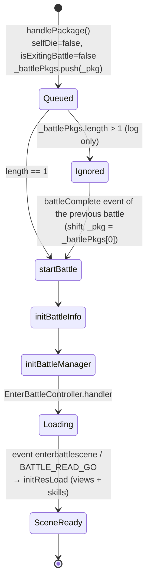
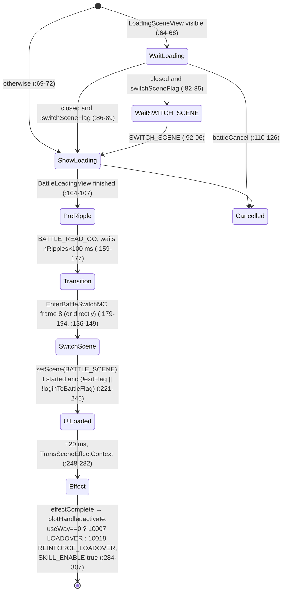
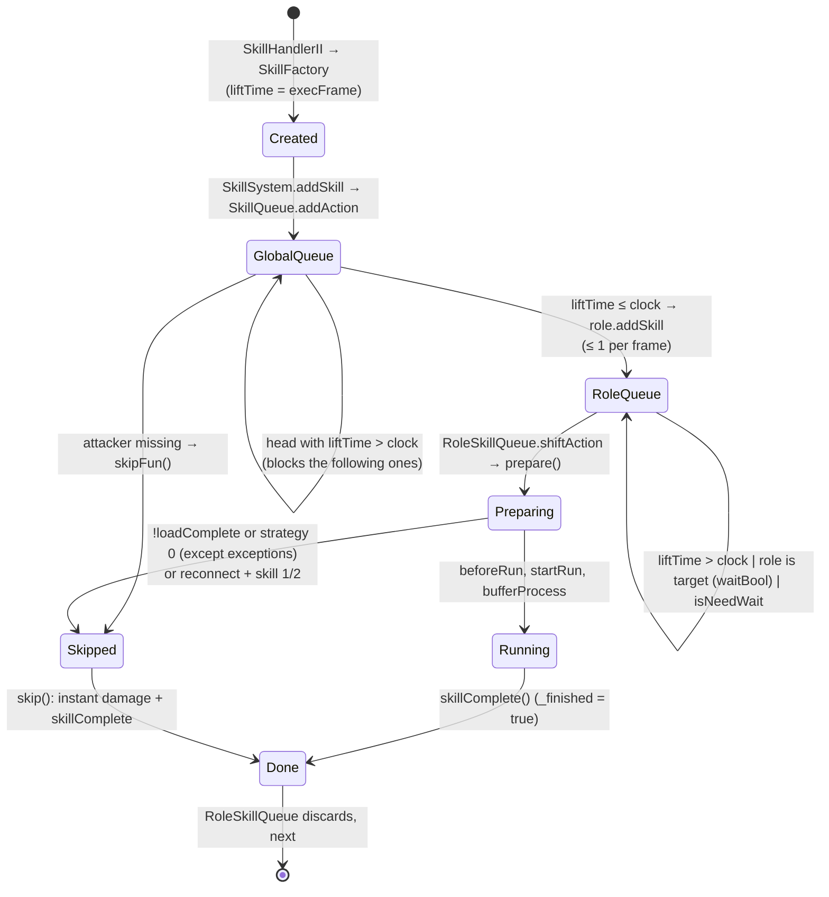
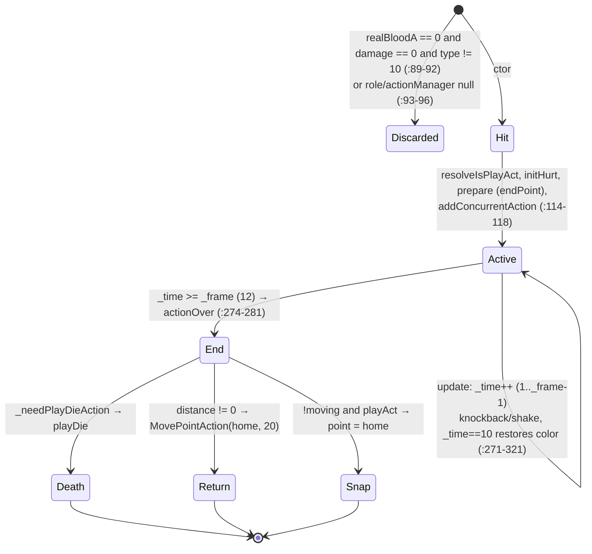
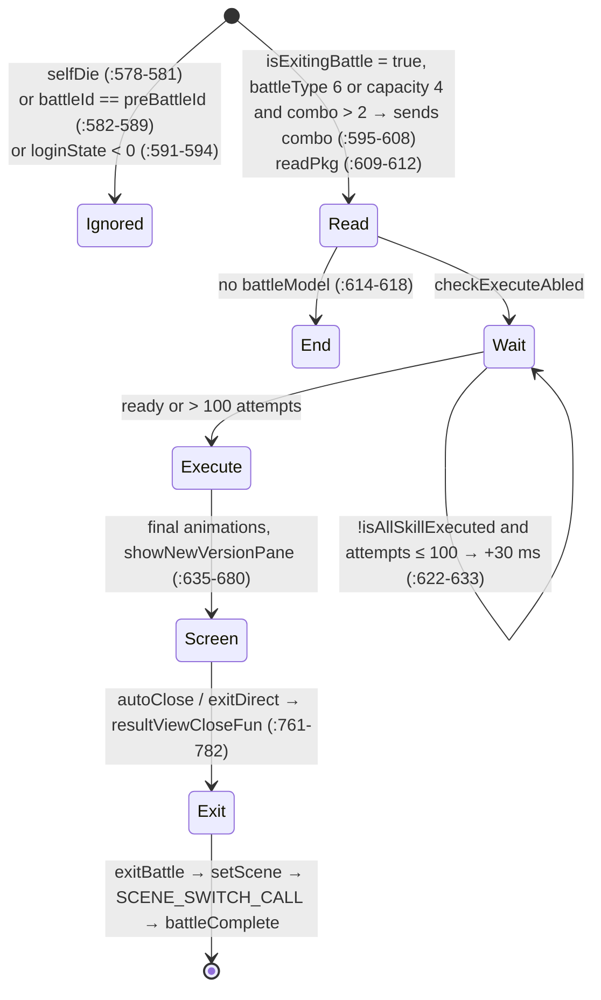

# Battle rules, conditions and sequences (Legend Online BR)

This is the technical reference for how the Legend Online BR Flash client runs a battle, reconstructed from the
decompiled AS3. It follows a battle from the network packet to the transaction queues, skills, skill frames, damage,
death and battle end, and covers clock synchronization, animation acceleration, every `battleType` value and its
client effects, the special combat systems and per-turn buffs. Each rule is stated as the code behaves (including
bugs and dead code) and is backed by a `file:line` reference, so the document can drive a reimplementation. Server
logic is out of scope except where the client exposes it.

Related documents:
- [docs/battle/README.md](README.md): battle overview (flow, model, scene, end).
- [docs/battle/formation.md](formation.md): grid, formations, camera, reinforce, swap and revive placement.
- [docs/battle/hud.md](hud.md): HUD, result screen and renderer preview.
- [docs/battle/server-engine.md](server-engine.md): mock battle server that reproduces the behavior described here.
- [docs/battle/chess-modes.md](chess-modes.md): chess modes (battleType 349 and 3910).
- [docs/mechanics/README.md](../mechanics/README.md): game mechanics, templates and data model.

## Contents

- [Conventions](#conventions)
- [0. Frame loop overview](#0-frame-loop-overview)
- [1. Network routing and transaction queues](#1-network-routing-and-transaction-queues)
- [2. Attack parsing and data model](#2-attack-parsing-and-data-model)
- [3. Synchronization and skill queues](#3-synchronization-and-skill-queues)
- [4. Skills](#4-skills)
- [5. Skill frames](#5-skill-frames)
- [6. Damage, floating numbers, death and buffs](#6-damage-floating-numbers-death-and-buffs)
- [7. Battle end](#7-battle-end)
- [8. Clock and animation acceleration](#8-clock-and-animation-acceleration)
- [9. Reinforce, swap, revive, awaken and plot](#9-reinforce-swap-revive-awaken-and-plot)
- [10. Pipeline verification against README.md](#10-pipeline-verification-against-readmemd)
- [11. battleType: values and effects](#11-battletype-values-and-effects)
- [12. Special combat systems](#12-special-combat-systems)
- [13. Per-turn buffs](#13-per-turn-buffs)
- [14. Findings, bugs and gaps (battleType and systems)](#14-findings-bugs-and-gaps-battletype-and-systems)

## Conventions

### References

- All `file:line` references are relative to `decompiled/`. §0 to §10 cite full paths, for example
  `core_module/scripts/battle/BattleManager.as:138-142`.
- §11 to §14 use shorter forms:
  - **CM** = `core_module/scripts` and **M10** = `m10/scripts`, for example `CM/battle/BattleManager.as:164`;
  - the file abbreviations in the table below, for example `BRH:93-554`;
  - a bare file name, for example `DannyAction.as:146`, names the only file with that name under CM or M10.
- `:N` or `:N-M` without a file refers to lines of the last fully named file in the same table or paragraph. In
  §11 to §14, a bare number or range in parentheses after a cited file, such as `(52)`, means the same. The table in
  §5.2 states its own rule.
- Template data comes from `data/tpl/tempinfos/` (`ActionInfos.xml`, `SkillTempInfos.xml`,
  `SkillBufferTempInfos.xml`, `ConfigInfos.xml`), outside `decompiled/`, and serves as evidence only. `language.txt`
  is `raw/ui/zh_cn/decoded/language.txt`; game strings from it are quoted verbatim in pt-BR.

| abbreviation | file |
|---|---|
| BM | `CM/yishi/datas/BattleModel.as` |
| CGT | `CM/battle/transaction/CreateGameTransaction.as` |
| BRH | `CM/battle/handler/BattleResultHandler.as` |
| RH | `CM/battle/handler/ReinforceHandler.as` |
| UI | `M10/battle/view/ui/BattleUIView.as` |
| BV | `M10/battle/view/BattleView.as` |
| BMV | `M10/battle/view/map/BattleMapView.as` |
| SILC | `CM/battle/view/ui/SkillItemListController.as` |
| SILV | `CM/battle/view/ui/SkillItemListView.as` |
| BSI | `CM/battle/view/ui/BattleSkillItemII.as` |
| ASILC | `CM/battle/view/ui/AvengerSkillItemListController.as` |
| SWV | `CM/battle/view/ui/SkillWarsoulView.as` |
| RVB | `CM/battle/view/roles/RoleViewBase.as` |
| BFH | `CM/battle/utils/BattleFunctionHelper.as` |
| BS | `CM/battle/skillsys/skills/BaseSkill.as` |
| DTT | `M10/battle/view/ui/DragonTitanTeamView.as` |
| RSV2 | `M10/battle/view/ui/RoleShowViewII.as` |
| HRI | `CM/yishi/datas/objects/HeroRoleInfo.as` |
| RI | `CM/yishi/datas/objects/RoleInfo.as` |
| SGR | `CM/map/internals/utils/SocketGameReader.as` |

### Terminology

| term | meaning |
|---|---|
| clock | `BattleManager._liftTime`, read through `BattleFrameCount`. Advances by 1 per frame (§8) and is repositioned by synchronization (§3.1). In prose, *clock* always means this value. |
| frame | One tick of the 25 fps `enterFrame` loop (40 ms). A *server frame* is a clock value sent by the server (`extend2`, `execFrame`, `msg.frame`). A *skill frame* is a row of an action template (`SkillFrameData`, §5) whose `Frame` field is the tick within the attack action. |
| order | A server skill order: one `AttackOrderMsg` (opcode 153, or one entry of the 4102 list). Its `orderId` becomes `skillId`. |
| living | A battle unit as the server identifies it: `livingId` (`fId` for the attacker, `roleId`/`target` for targets). `isLiving` is the client alive flag. |
| role | The client unit object, `RoleInfo` and its subclasses (Hero, Pawn, Monster, Pet, Goddess). |
| side | The server team number (`BattlePrepareMsg.side`, `RoleInfo.side`); `selfSide` is the own side. `face` is the screen side derived from it: 1 = own side (left), 2 = opponent (right). |
| skill | A `BaseSkill` instance built from one order (`SkillData`); `skillId` is a `SkillTempInfo` id. |
| hit | The first index of `SkillData.data[hit][target]`. Type-3 frame counts and buff `damageCount` refer to it. |
| buff | A `BufferDamageData` built from a `BufferMsg` (§2.2, §13). |
| battleType | `BattleModel.battleType` (§11). |
| *(assumption)* | Not confirmed in code. |

---

## 0. Frame loop overview

The client runs at 25 fps (`Loading/scripts/Loading.as:40`). `EnterFrameManager.__enterFrameHandler` calls `enterFrame()` on every registered object
(`core_module/scripts/yishi/manager/EnterFrameManager.as:54-60`). Items live in a `Dictionary`
(`core_module/scripts/yishi/manager/EnterFrameManager.as:49,87`), so **order between them is undefined**
*(reimplementation: fix an order; creation order below is suggested)*.

| suggested order | object | per frame | ref |
|---:|---|---|---|
| 1 | `BattleTransactionManager` | clock += 1; releases ≤ 1 packet from the battle queue | `core_module/scripts/battle/transaction/BattleTransactionManager.as:75-114` |
| 2 | `SkillQueue` (global skill queue) | dispatches ≤ 1 ready skill to the role's queue | `core_module/scripts/battle/skillsys/control/SkillQueue.as:23-41` |
| 3 | `BattleSceneView` → `BattleView` → `BattleMapView` | z-order, shadows, `RoleInfo.update()` per role | `m10/scripts/battle/BattleSceneView.as:190-193`, `m10/scripts/battle/view/BattleView.as:122-128`, `m10/scripts/battle/view/map/BattleMapView.as:126-150` |
| 4 | `BattleQuickenControl` | measures FPS, sets animation step | `core_module/scripts/battle/quicken/BattleQuickenControl.as:46-59` |
| 5 | each `QuickenMovieClip` | advances `step` animation frames | `core_module/scripts/yishi/view/tools/QuickenMovieClip.as:79-97` |
| 6 | `BattlePlotHandler` (only after `activate`) | plot dialogs (opcode 171) | `core_module/scripts/battle/handler/BattlePlotHandler.as:32-57` |
| n/a | `CoreTransactionManager` | non-battle packet queue (own clock) | `core_module/scripts/yishi/manager/CoreTransactionManager.as:77-113` |

`RoleInfo.update()` (per role, per frame), internal order
(`core_module/scripts/yishi/datas/objects/RoleInfo.as:572-607`):
1. `_actionManager.update()` (visual action queue: move, attack, die…), `:575-578`;
2. `_skillQueue.update()` (`RoleSkillQueue`), `:579-582`;
3. each concurrent action (`DannyAction`, `DisplacementAction`, `HideRoleAction`): remove if `finished`, else `update()`, `:583-593`;
4. delayed HP queue (`_bloodUpdateBuffer`, §6.4), `:594-606`.

`ActionQueueManager.update()` (base of all queues), `core_module/scripts/yishi/manager/ActionQueueManager.as:20-52`:

```text
if !current: shiftAction()            // subclass decides whether the first can be taken
if !current: end
if current.finished: dispose; current=null; if queue empty → event "action_all_complete"
else: current.update(); if now finished: dispose; current=null (same event)
```
`addAction(a, priority)` (`:87-135`): `filter`/`replace` (all battle actions return
`false`, except `MovePointAction.replace = _canReplace` and `DannyAction.replace = (other is DannyAction)`),
then `unshift` if `priority`, else `push`. `BaseAction.cancel()` only sets `finished = true`
(`core_module/scripts/battle/actions/common/BaseAction.as:58-61`).

---

## 1. Network routing and transaction queues

### 1.1 Routing in `SocketManager`

Pre-filter: with `acceptData == false` only opcode 3 passes; the rest are dropped
(`core_module/scripts/yishi/service/managers/SocketManager.as:107-118`).

| opcode | destination | queued? | ref |
|---:|---|---|---|
| 154 U_B_PREPARE_OVER | `VictoryFailTransaction.handle` (static) | **no**, straight to `SkillSystem` | `core_module/scripts/yishi/service/managers/SocketManager.as:136-147` |
| 171 | `BattleManager.plotHandler.handler` | `BattlePlotHandler`'s own queue | `core_module/scripts/yishi/service/managers/SocketManager.as:148-150` |
| 157 U_B_PREPARE | `CoreTransactionManager.handlerPackage` | no (processed immediately) | `core_module/scripts/yishi/service/managers/SocketManager.as:151-153` |
| 4102, 153, 156, 159, 72, 69, 77, 4149, 4361, 4600, 4752, 4793, 4795, 4849, 4589, 4311, 4591 | event `GAME_CMD` → `BattleTransactionManager.addQueue` | yes | `core_module/scripts/yishi/service/managers/SocketManager.as:154-171`, `core_module/scripts/battle/transaction/BattleTransactionManager.as:62-65,116-119` |
| 4103 U_BATTLE_REPORT | `BaseManager.__battleInfoResultHandler` → `new BattleResultHandler().handler` | no | `core_module/scripts/yishi/manager/BaseManager.as:291,2785-2795` |
| 4166 U_B_FIGHT_CANCELED | `BaseManager.onFightCanceled` → `BattleManager.onFightCanceled` | no | `core_module/scripts/yishi/manager/BaseManager.as:253-257,303` |
| 4680 | `BattleMapView.clearDiedRole` (battleType 295/3854/3911 only) | no | `m10/scripts/battle/view/map/BattleMapView.as:62,200-290` |
| others | `"SLGSocketEvent"+code` | n/a | `core_module/scripts/yishi/service/managers/SocketManager.as:176-177` |

Packet header (20 bytes): `short`, `short len`, `short checksum`, `short code`, `int clientId`,
`int extend1`, `int extend2` (`core_module/scripts/yishi/comm/PackageIn.as:78-87`). **`extend2` is the release frame** used by the queues.

### 1.2 Opcode 157: `CoreTransactionManager.handlerPackage` (paging)

`core_module/scripts/yishi/manager/CoreTransactionManager.as:127-177`

| condition | action | ref |
|---|---|---|
| `code != 157` | ignore | `:133` |
| `totalPage <= 1` | `handlerPreparePkg(pkg, msg)` directly | `:162-165` |
| `totalPage > 1` | `clientPkgCount++` (**global** counter, not per battleId) | `:138-140` |
| ↳ battleId already cached | concatenates **new page + cache** (new first): heros, children, pets, soldiers, chessList; `goddesses = page.soldiers + cache.goddesses` (**bug**) | `:141-150` |
| ↳ battleId not cached | stores the page | `:151-154` |
| ↳ `clientPkgCount >= totalPage` | resets counter, clears cache, `handlerPreparePkg(pkg, accumulated message)` | `:155-160` |
| `handlerPreparePkg` | `CreateGameTransaction.msgPkg(msg)` + `handlePackage()` (never `configure`) | `:169-177` |

`CoreTransactionManager`'s own queue (`enterFrame`, `:77-113`) uses a different clock
(`_liftTime + 1` per frame, `:83`), walks the queue **back to front** and releases **all** packets
with `extend2 <= _liftTime` (`:86-96`); a missing handler throws (`:104-107`). 157 does not go through it.

### 1.3 `CreateGameTransaction` (battle creation)


Refs: `core_module/scripts/battle/transaction/CreateGameTransaction.as:62-73` (battle queue),
`:75-88`, `:90-97`, `:963-968`. When a queued battle is reprocessed, `initBattleInfo`
reads `_msgPkg`, which is always the **last** message received (`:108`), and `_pkg` is never set on the
157 path (`CoreTransactionManager` only calls `msgPkg`) *(effect: the battle queue is effectively useless)*.

`initBattleInfo` decisions (`core_module/scripts/battle/transaction/CreateGameTransaction.as:99-188`):

| condition | action | ref |
|---|---|---|
| always | `new BattleModel`, `new ResourceModel`; copies battleId, mapTempId, useWay, battleType, reinforceCount, currentReinforce, battleCapity; `hurtUpStart(countDown, damageImprove)`; mapResId = `mapTemplate.BattleGround`; `isSelfCharge = needAnimation`; `isNoCharge = !hasAssault`; selfSide; trialLayer; `initAutoFight(attackModel)` | `:104-124` |
| battleType 35 | pets only (`createPetRoleInfo`) | `:127-129` |
| battleType 307 | soldiers + heroes(+flag); `isFinishNow = false` | `:130-134` |
| battleType 349 | soldiers + chess pieces | `:135-138` |
| others | soldiers + heroes/pets/goddesses/children/monsters | `:139-141` |
| battleType 295 | `battleStartTimePoint = getTimer()` | `:143-146` |
| battleType 3845 | `preScene = "SPACE_SCENE"` | `:147-150` |
| `battleFrom == 0` and no `selfHero` | **return** (skips cooldowns, face, `initAfterRolesAdded`; `initBattleManager` still runs) | `:152-160` |
| `coolDown.length > 0` | creates `BattleCooldownModel` (ms → s) and `start()` | `:164-179` |
| `loginToBattleFlag` (reconnect) | `isNoCharge = true` | `:180-183` |
| always | `checkFace`: left side = `selfSide`, face 1; right = `3 − selfSide`, face 2 | `:185`, `:955-961` |

`initBattleManager` (`:190-201`): `BattleTransactionManager.setup()` (creates **new** transaction instances and registers `enterFrame` → **the clock starts here**), `initSkillSystem()`,
`BattleManager.started = true`, `BattleManager.setup()` (creates `BatterModel`, `ResistModel`,
`BattleQuickenModel/Control`, `BattleMapSoundControl`; battleType 3911 locks `isLockChildnswar`,
`core_module/scripts/battle/BattleManager.as:162-173`), loads resources, `EnterBattleController.handler`.

### 1.4 `EnterBattleController` (entry and LOADOVER)

`core_module/scripts/battle/control/EnterBattleController.as`


In a maze with `MazeModel.isAuto`, auto-fight is enabled (`:255-258`).

### 1.5 `BattleTransactionManager`: battle opcode queue

`core_module/scripts/battle/transaction/BattleTransactionManager.as:75-114`, run **once per frame**:

```text
BattleManager.battleNextFrame()            // clock += _addFrame (=1)          :82
for i in 0.._waitlist.length-1:             // arrival order                    :84
   pkg = _waitlist[i]
   if pkg.extend2 > 0 and pkg.code == 5: throw  // sanity                      :87-91
   if pkg.extend2 <= clock:                                                     :92
       _executable.push(pkg); _waitlist.splice(i,1); break   // AT MOST 1      :94-96
for each pkg in _executable (0 or 1):                                           :101-111
   h = _handlerList[pkg.code]; if h: h.configure(pkg); h.handlePackage()
_executable = []                                                                :113
```
Implications:
- **≤ 1 battle packet per frame**: the **first in arrival order whose frame is due**.
  Packets with a future `extend2` **do not block** later ones (not strict FIFO).
- Opcode without handler (159, 4849) is removed and silently dropped (`:104-109`).
- `maxWaitTime = 125` is declared, never used (`:17`).
- `addHandler` registers only the first handler per code (`:67-73`). Registration: `:129-146`
  (table in §1.6). `BattleRestoreHpTransaction` (4849) exists but is not registered.
- `dispose()` (on scene `leaving`, `m10/scripts/battle/BattleSceneView.as:162`) stops `enterFrame`
  and nulls the queues (`core_module/scripts/battle/transaction/BattleTransactionManager.as:121-127`).
- The clock is **not reset** between battles (singleton); only 156 and synchronization reposition it.

### 1.6 Battle transactions

Almost all transaction work happens in `configure`; the exceptions are noted per row.

| opcode | class | conditions → action | ref |
|---:|---|---|---|
| 153 | `BattleAttackTransaction` | parse error → ignore; `battleId` ≠ model → log, ignore; `readSkill`; if attacker (`fId`) exists: titan (below), `buffers = readBufferII`, `awakens = readAwakenData` (+`cacheAwakenRoles`), `BloodHelper.processBlood`, `new SkillHandlerII`, `processSynchronization(msg.frame, skill)` → `processStrategy`, `handler()` (enters `SkillSystem`); MasterType 80/81 → `goddessMoiveViewHandler`; `sealTitanSkillHandler` always. Attacker missing → packet dropped | `core_module/scripts/battle/transaction/BattleAttackTransaction.as:75-172` |
| ↳ titan | `coexist == 1`: for each `titanSkill[i] == orderId`: in a titan battle, if not the first non-zero slot and that slot is still unused → `break`; else `titanSkillUsed[i] = 1` + event. skillId 41101001 resets `titanSkillUsed` | `core_module/scripts/battle/transaction/BattleAttackTransaction.as:112-153` |
| 4102 | `BattleGoddessMovieTransaction` | for each `AttackOrderMsg` in the list: `readSkill`; attacker exists **and** battleId matches → same pipeline as 153; `sealTitanSkillHandler` only if MasterType 80/81; accumulates `{skillId, livingId}`; at the end notifies `GODDESS_GUARD_SKILL` with all | `core_module/scripts/battle/transaction/BattleGoddessMovieTransaction.as:26-68` |
| 156 | `BattleStartTransaction` | `synchronization = frame` (clock = server frame), `battleType = mainType`, `battleModel.started = true`, `hurtUpStart(countDown)` | `core_module/scripts/battle/transaction/BattleStartTransaction.as:19-30` |
| 69 | `BattleStopTransaction` | reads `UserStopMsg` (type, order) in `handlePackage`, does nothing | `core_module/scripts/battle/transaction/BattleStopTransaction.as:14-31` |
| 77 | `AttackModeTransaction` | role by userId exists → `setAttackModelById(livingId, mode)`; if `selfHero`: `actionCount = fmTurn`; `heroSp > 0` → `updateSp(sp + heroSp)` | `core_module/scripts/battle/transaction/AttackModeTransaction.as:17-36` |
| 4600 | `BattleAwakenTransaction` | no model / `isChildBattle` / battleType 3845 → ignore; for each `AwakeInfoMsg` with awake+hero livingId: `updateAwaken`; if `selfHero`, `awaken == 0` and `isPetState` → `SKILL_ENABLE false` | `core_module/scripts/battle/transaction/BattleAwakenTransaction.as:22-61` |
| 4589 | `BattleAvengerSpTransaction` | ignore if 3845 / child / monster; else `updateAvengerSp` | `core_module/scripts/battle/transaction/BattleAvengerSpTransaction.as:21-60` |
| 4311 | `BattleWarsoulSpTransaction` | ignore if 3845 / child / monster; else `updateWarsoulSp` | `core_module/scripts/battle/transaction/BattleWarsoulSpTransaction.as:21-60` |
| 4752 | `BattleChildChangeTransaction` | hero `isChildFake` → `updateChildAwaken`; `selfHero` + awaken 0 + child battle → `SKILL_ENABLE false`; own child in child battle → `updateChildChangeValue(childAwake)` + `CHILD_AWAKE_SKILL` | `core_module/scripts/battle/transaction/BattleChildChangeTransaction.as:19-55` |
| 4591 | `BattleAvengerSkillChangeTransaction` | `selfHero` exists → copies avenger skills/CD, fires `AVENGER_SKILL_CHANGE` | `core_module/scripts/battle/transaction/BattleAvengerSkillChangeTransaction.as:16-28` |
| 4361 | `BattleNoticeTransaction` | battleId matches → `hurtUpStart(countDown, damageImprove, damageAddition)` | `core_module/scripts/battle/transaction/BattleNoticeTransaction.as:15-24` |
| 72 | `ReinfoTransaction` | `selfDie` or `isFinishNow` → ignore; else `ReinforceHandler.handle` (§9) | `core_module/scripts/battle/transaction/ReinfoTransaction.as:15-28` |
| 4793 | `SwapTransaction` | `SwapHandler.handle` (§9) | `core_module/scripts/battle/transaction/SwapTransaction.as:13-17` |
| 4795 | `ReviveTransaction` | `ReviveHandler.handle` (§9) | `core_module/scripts/battle/transaction/ReviveTransaction.as:13-17` |
| 4149 | `ReinfoResTransaction` | `selfDie` → ignore; merges soldierTempId/heroSkill/soldierSkill without duplicates; `reinforceType == 1` → `setReinforceWaveInfo(count,1)` on the UI or `reinforceWave` on the model; queues preload: soldier skills (type 2) and full hero skills (type 3) | `core_module/scripts/battle/transaction/ReinfoResTransaction.as:17-102` |
| 4849 | `BattleRestoreHpTransaction` (not registered) | if registered: local `readSkill` + `processBlood` + `updateBlood(-dmg, -display, false)` directly on the hero, no animation | `core_module/scripts/battle/transaction/BattleRestoreHpTransaction.as:29-78` |
| 154 | `VictoryFailTransaction.handle` | see §7.1 | `core_module/scripts/battle/transaction/VictoryFailTransaction.as:21-87` |

Note: `BattleAwaken/AvengerSp/WarsoulSp` store `battleModel` in the constructor
(`core_module/scripts/battle/transaction/BattleAwakenTransaction.as:16-20`); this works because
`setup()` recreates the instances after `initBattleInfo`
(`core_module/scripts/battle/transaction/CreateGameTransaction.as:95-96,192`).
The 173 listener (`__specialBufferHandler`, permanent buffs) would only be attached by `addHandler()`, which
is never called (`core_module/scripts/battle/transaction/BattleAttackTransaction.as:35-68`).

---

## 2. Attack parsing and data model

### 2.1 `BattleFunctionHelper.readSkill`

`core_module/scripts/battle/utils/BattleFunctionHelper.as:151-249`

| `SkillData` field | source (`AttackOrderMsg`) | ref |
|---|---|---|
| `skillId` | `orderId`; **0 → −1** | `:154-157,170` |
| `fId` | `livingId` (attacker) | `:171` |
| `sp`, `spAdded`, `hitPoint` | same; `hitPointAdded = 0` | `:172-175` |
| `attackMillis` | `attackMillis` "YYYY-MM-DD hh:mm:ss" → ms | `:176` |
| `battleId`, `passive` | `battleId`, `isPassive` | `:177-178` |
| **`liftTime`** | **`execFrame`** (frame at which the skill may start) | `:179` |
| `coexistType` | `coexist` (1 = titan skill) | `:180` |
| `data` | matrix `data[hit][target]` of `AttackData` | `:181-217` |
| `reliveList` | `waitRevives` → `ReliveInfo` (hp, sp; `hitPoint` not copied) | `:218-222`, `core_module/scripts/battle/data/ReliveInfo.as:23-31` |

`AttackOrderMsg` fields **not used** here: `frameNum`, `attackOrderSeq`, `cdTime`, `awake`,
`awakeAdd`, `curturn` (`core_module/scripts/com/road/yishi/proto/battle/AttackOrderMsg.as:244-407`).
`frame` (≠ `execFrame`) is used only for synchronization (§3.1).

`AttackData` per `DamageMsg` (`core_module/scripts/battle/utils/BattleFunctionHelper.as:187-215`): `bloodType = damageType`, `roleId = livingId` (target),
`fId` = attacker, `damageValue = displayBlood = damageValue` (int64), `hpMaxAdd = hpLimit` if present,
`extraData`, `parry`, `leftHp = leftValue`, `resistValue/resistType/resiPercent`, `dropList`.

**Matrix assembly** (`dataFormatConversion`, `core_module/scripts/battle/utils/BattleFunctionHelper.as:226-249`):
- `targets` = unique livingIds in first-appearance order (`core_module/scripts/battle/utils/BattleFunctionHelper.as:210-213`);
- `hits = int(damages.length / targets.length)` (`core_module/scripts/battle/utils/BattleFunctionHelper.as:233`; 0 targets → 0 hits);
- `data[h][t] = damages[h + t·hits]` (`core_module/scripts/battle/utils/BattleFunctionHelper.as:241`) ⇒ **the server sends damages grouped by target**
  (all hits of target 0, then target 1…). Remainders of an inexact division are dropped.

### 2.2 Buffs and awaken (`SocketGameReader`)

`readBufferII` (`core_module/scripts/map/internals/utils/SocketGameReader.as:122-169`) → `BufferDamageData`:

| field | `BufferMsg` source | note |
|---|---|---|
| `id`, `templateId` | `bufferId`, `templateId` | `templateId` pulls `AttackType`, `Icon`, `CountWay`, `AttackWay` from the template (`core_module/scripts/battle/data/BufferDamageData.as:89-100`) |
| `bufferUser`, `target` | `sourceId`, `targetId` | |
| `currentTurn` | `curTurn` | 0 = expires |
| `countWay` | `curRound` | **overrides** the template `CountWay` |
| `processType` | `seeType` | 0 ADD, 1 EFFECTIVE, 2 REMOVE (`core_module/scripts/battle/data/BufferProcessType.as:6-12`) |
| `effectiveType` | `exeWay` | 1 action, 2 take damage, 3 deal damage, 4 parry (`core_module/scripts/battle/data/BufferEffectiveType.as:6-12`) |
| `curMaxTurn` | `maxTurn` only if `processType == 0` | `core_module/scripts/map/internals/utils/SocketGameReader.as:150-153` |
| `layerCount`, `unAblesSillIds`, `isPermanent`, `targetSkillId`, `execFrameTime` | same | |
| `damages[]` | `readDamage`: bloodType, damageValue, hpMaxAdd, `displayBlood = damageValue`, leftValue, extraData, `target`, **`damageCount = order`** (hit index at which the buff damage appears) | `core_module/scripts/map/internals/utils/SocketGameReader.as:171-190` |

`readAwakenData` → `PawnRoleInfo` from `awakenSoldiers` (`core_module/scripts/map/internals/utils/SocketGameReader.as:192-209`); added to the map when the
skill is prepared (§4.2, `AwakenHandler`).

### 2.3 Predicted HP before animation: `BloodHelper.processBlood`

`core_module/scripts/battle/skillsys/helper/BloodHelper.as:38-42`. Keeps one `TempRoleBloodInfo` per
role in `bloodDic` (built from `realBloodA`, `bloodB`, `totalBloodA/B`, `:221-229`) that **anticipates** server HP,
independent of displayed HP.

Order: **buff damages first, then `data`** (`:40-41`).

```text
for each buff, for each DamageData d:                                 :58-92
   d.buffId = templateId
   dmg = updateBlood(temp[d.target], d)  → recordHurtData; temp.bloodA<=0 → willKillSomeBody
for each data[h][t] = a with a role:                                  :103-140
   same with a
for each ReliveInfo of the same battleId: temp.bloodA = hp; role.reliveInfo = info   :141-153
```

`updateBlood` (`:156-202`) by `bloodType`:

| bloodType | effect on temp | value stored in `damageValue` |
|---|---|---|
| 6 HP, 21 max HP | `maxBloodA −= hpMaxAdd`; `bloodA −= clamp` | `clamp(bloodA, display, maxBloodA)` |
| 7 troops | `bloodB −= clamp` | `clamp(bloodB, display, maxBloodB)` |
| 10 revive (`AttackData` only) | `bloodA −= damageValue` (no clamp) | unchanged |
| others | nothing | unchanged |

`updateDamageValue(hp, d, max, sync)` (`:204-219`): `sync` (world boss already synced after
`attackMillis`) → 0; `hp − d > max` → `hp − max` (heal capped at max); `hp − d < 0` → `hp`
(damage capped at remaining HP); else `d`. **Positive = damage, negative = heal.** `displayBlood` keeps the
original server value (the number shown). Matters for death (§6.3): applied damage is
clipped to bring HP exactly to zero.

---

## 3. Synchronization and skill queues

### 3.1 `SkillProcessStrategy.processSynchronization(serverFrame, skill)`

`core_module/scripts/battle/handler/SkillProcessStrategy.as:18-37`. Called **before** the new skill
enters `SkillSystem` (`core_module/scripts/battle/transaction/BattleAttackTransaction.as:161-164`),
with `msg.frame` (not `execFrame`). `diff = serverFrame − clock`.

| condition | clock | new skill strategy | ref |
|---|---|---|---|
| `diff < −20` (client ahead > 20 frames) | `= serverFrame` | 1 (NORMAL) | `core_module/scripts/battle/handler/SkillProcessStrategy.as:23-26` |
| `diff > 5` (client behind > 5) | `processWhenClientSlower`; then `= serverFrame` | 1 | `core_module/scripts/battle/handler/SkillProcessStrategy.as:27-31` |
| `−20 ≤ diff ≤ 5` | `= int(clock + diff·0.2)` (truncates toward zero) | 1 | `core_module/scripts/battle/handler/SkillProcessStrategy.as:32-35` |

`processWhenClientSlower` (`core_module/scripts/battle/handler/SkillProcessStrategy.as:39-68`) walks `BattleManager.getWaitSkillList()` = skills **in role
queues (not executing)** + global queue (`core_module/scripts/battle/BattleManager.as:293-301`,
`core_module/scripts/yishi/datas/BattleModel.as:772-783`) and sets `processStrategy = 0` (SKIP) when:

| skillId ∈ {1,2,3,4}? | attacker is `selfHero`? | default skill (`UseWay == 3` or −1)? | SKIP |
|---|---|---|---|
| yes | any | any | no |
| no | yes | yes | **yes** |
| no | yes | no | no (player active skills are never skipped) |
| no | no | any | **yes** |

Always returns 1: the skill just received is never skipped. `SKIP = 0`, `NORMAL = 1`
(`core_module/scripts/battle/handler/SkillProcessStrategy.as:9-11`). Caveat: `SkillData.processStrategy` **defaults to 0** (`core_module/scripts/battle/data/SkillData.as:56`),
so any `SkillData` created outside opcodes 153/4102 starts as SKIP (§4.2).

`BattleEvent "synchronization"` fires on every adjustment (`core_module/scripts/battle/BattleManager.as:138-142`)
but has no listener. `BaseAction.synchronization()` exists (overridden by `DieAction`/`DannyAction`,
`core_module/scripts/battle/actions/DieAction.as:111-115`, `core_module/scripts/battle/actions/DannyAction.as:339-343`)
and is never called either *(search for callers found none)*.

### 3.2 Skill state machine



**Global queue**, `SkillQueue.enterFrame` (`core_module/scripts/battle/skillsys/control/SkillQueue.as:23-41`):
1. looks only at `_actions[0]`; `liftTime > clock` → waits (`:28-32`);
2. takes it; null attacker → `skipFun()` and ends the frame (`:33-38`);
3. `role.addSkill(skill)` (`:39`; `core_module/scripts/yishi/datas/objects/RoleInfo.as:619-626`).
`isKillableSkill` / `isPreviousSkillsStarded` (`core_module/scripts/battle/skillsys/control/SkillQueue.as:68-119`) are dead code.

`SkillSystem.addSkill` only logs when the single target is already in `_waitSkillDic`
(`core_module/scripts/battle/skillsys/SkillSystem.as:27-40`).

**Role queue**, `RoleSkillQueue.shiftAction` (`core_module/scripts/battle/queue/RoleSkillQueue.as:20-47`),
only when there is no current skill:

| step | condition | result | ref |
|---|---|---|---|
| 1 | head is `BaseSkill` and `liftTime > clock` | wait | `:26-32` |
| 2 | always | `role.readyFlag = true` | `:33` |
| 3 | `role.waitBool` (`affectedSkill != null`: role is the target of a running skill) | wait | `:34-37`, `core_module/scripts/yishi/datas/objects/RoleInfo.as:1053-1056` |
| 4 | `SkillSystem.isNeedWait(role)` | wait | `core_module/scripts/battle/queue/RoleSkillQueue.as:38-41` |
| 5 | always | `current = shift(); current.prepare(); BufferHandler.excuteCount = 0; readyFlag = false` | `core_module/scripts/battle/queue/RoleSkillQueue.as:42-45` |

`isNeedWait` (`core_module/scripts/battle/skillsys/SkillSystem.as:47-75`): if the role's next skill is
**single-target** (`data[0].length == 1`) and the target is running a `CommonActionSkill`
(`target.getSkillQueue().current is CommonActionSkill`):
- `resetWaitSkill(target)`: **+1 to `liftTime`** of every single-target skill aimed at that target: the head
  of each role's queue and all in the global queue (`:104-144`);
- creates/updates `SkillWaitInfo` (count++, 300 ms timer that only clears the record; `core_module/scripts/battle/skillsys/mode/SkillWaitInfo.as:22-35`);
- returns `true` (wait). Since `liftTime` rises 1 per frame with the clock, the skill stays
  "ready" and is re-evaluated every frame until the target finishes.

`readyFlag` and `affectedSkill` prevent mutual deadlock: `setAimRoleWait` only marks as "waiting" the
targets whose skill is **not** ready yet (`core_module/scripts/battle/skillsys/skills/BaseSkill.as:303-321`).
The mark is removed in `skillComplete → cancelAimRoleWait` (`:323-341`, `:517`).

Role visual action queue (`BattleActionQueue.shiftAction`): takes the head only when
`action.ready(clock)` (`core_module/scripts/battle/queue/BattleActionQueue.as:16-29`), with
`GameBaseAction.ready = liftTime <= clock` (`core_module/scripts/battle/actions/GameBaseAction.as:31-34`).
`isOver = queue empty and no current` (`core_module/scripts/battle/queue/BattleActionQueue.as:51-58`).

---

## 4. Skills

### 4.1 Skill class selection: `SkillFactory`

`core_module/scripts/battle/skillsys/skills/SkillFactory.as:16-94`

| # | condition | class | ref |
|---:|---|---|---|
| 1 | `skillId == −1` (orderId 0) | `EmptyActionSkill` | `:19-22` |
| 2 | no `SkillTempInfo` for the skillId | `BaseSkill` (does nothing and **never finishes** unless skipped) | `:34-38` |
| 3 | no `ActionTemplateData` for `SkillTempInfo.ActionId` | `BaseSkill` | `:48-53` |
| 4 | `SkillTempInfo.TemplateId == 105` | `SpecialActionSkill105` | `:54`, `:87-94` |
| 5 | `ActionId == 3` | `SuccessSkill` | `:57-61` |
| 6 | `ActionId == 4` | `FailedSkill` | `:62-64` |
| 7 | `presentType == 1` | `CommonActionSkill` | `:76-80` |
| 8 | `presentType == 2` | `ShootActionSkill` | `:81-82` |
| 9 | other `presentType` (template without frames → −1) | `null` → error in `setTemplate` | `:73-85,69` |

`presentType` = 2 if **any** frame is type 11/12, else 1 (`core_module/scripts/battle/skillsys/mode/ActionTemplateData.as:26-41`).
Then: `setTemplate` (`_addBufferFrame` = `Frame` of the **first** type-3 frame,
`core_module/scripts/battle/skillsys/skills/BaseSkill.as:89-100`), `actionId = SkillTempInfo.ActionId`
(`core_module/scripts/battle/skillsys/skills/SkillFactory.as:41`) and `setData`
(`_liftTime = liftTime`, `_currentRole = role(fId)`, `_isPlayer = hero with type ≠ 3`,
`core_module/scripts/battle/skillsys/skills/BaseSkill.as:73-87`).

Local templates have `SkillTempInfo` 3 ("Vitória", ActionId 3) but **not** 4,
nor 1/2; there is also no `ActionInfo` with ActionId 4. So with this data skill 4 becomes
`BaseSkill` (rule 2) and **`FailedSkill` is never instantiated** *(unless the real server has another template)*.

### 4.2 Execution start: `BaseSkill.prepare`

`core_module/scripts/battle/skillsys/skills/BaseSkill.as:107-130`

```text
can = role exists AND isLoadComplete(role)           // goddess counts as loaded
      AND (processStrategy == 1 OR goddess skill (MasterType 80/81) OR skillId ∈ {1,2,3,4})
if can:
   if loginToBattleFlag and skillId ∈ {1,2}: skipFun()
   else: beforeRun(); startRun(); bufferProcess()
else: skipFun()
role.refreshBufferTurn()                               // :128
role.addAction(SimpleScriptAction(0, awakenSoldiers, 1))    // :129 → AwakenHandler.addRole for each awakened
```
`isLoadComplete`: `core_module/scripts/battle/utils/BattleFunctionHelper.as:268-279`.

`skipFun` (`core_module/scripts/battle/skillsys/skills/BaseSkill.as:132-138`) = `beforeRun(); skip(); bufferProcess(true); started = true`.
`skip()` (`:280-297`): for **each hit** `h`: `addSingleDanny(data[h], 12, true, 0, 0, 0, true, 0x666666, attackerIsSelf)`
(all hits at once, no knockback or shake); `updataSp()`; `onSkip()`; `skillComplete()`.

`beforeRun` (`core_module/scripts/battle/skillsys/skills/BaseSkill.as:227-274`):

| condition | action | ref |
|---|---|---|
| attacker is `selfHero` | notifies `RESET_ACTION_TIME_BattleNotic`; skillId 700002 → `SKILL_ENABLE false` | `:232-242` |
| other attacker | removes the "charge" effect and the skill mark from the view | `:243-251` |
| skillId ∉ {1,2} | `setAimRoleWait()` | `:252-255` |
| always | `chkShadowSkill()` (ghosts if `OwnRequirements` and option enabled) | `:256`, `:354-383` |
| attacker is hero, skillId ∉ {1..4}, non-default skill and (own hero outside 35/3844, or same side in 3844/35) | `SHOW_SKILL_NAME_BattleNotic(skillId)` (skill name on screen) | `:257-273` |

`skillComplete` (`core_module/scripts/battle/skillsys/skills/BaseSkill.as:414-520`): skill button release and state:

| condition | action | ref |
|---|---|---|
| battleType 3844 and MasterType 200 | `SKILL_ENABLE true` + `skillCd` | `:426-434` |
| battleType 3845 and child PvE boss skill | same | `:435-444` |
| child battle and attacker is own child | same | `:445-458` |
| else, skillId ∉ {1,2} and attacker is `selfHero` | clears `currentReadySkillId` if it is this one (or its `Parameter3`); non-default and non-titan → `SKILL_ENABLE true` + `skillCd`; default → `defaultSkillCount++` and, if > 1 and non-titan, `SKILL_ENABLE true` | `:459-486` |
| hero + skillId 700002 / 700001 / 650493 / 700003 / 700004 | `isPetState` false / true / switch to `boss032a` + reload / true / false | `:487-512` |
| role is not goddess | stops the ghost | `:513-516` |
| always | `cancelAimRoleWait`, normal draw priority, **`_finished = true`** | `:517-519` |

`sendCDEvent`: `waitTime = 0` if strategy 1; else `Frame(99) × 40 ms` (`core_module/scripts/battle/skillsys/skills/BaseSkill.as:527-543`).

`bufferProcess(skipped)` (`core_module/scripts/battle/skillsys/skills/BaseSkill.as:555-602`; lifecycle in §13.3); skills 3/4 do not process buffs:

| buff | condition | when applied |
|---|---|---|
| `processType == 0` | first: `effectiveType = template.AddWay` | n/a |
| `effectiveType == 1` (on action) | any | **now**, all damage indices (`executeBufferAffectives`, `:604-620`) |
| other | skill has `data` and was not skipped | stored in `skillBuffers`; applied at hit `n` by `addBuffer(n)` (`effectiveType ≠ 4`, `:622-634`) and, on the first hit, `addParryBuffer(0)` (`effectiveType == 4`) |
| other | no `data` or skipped | **now** |

`EmptyActionSkill` (`core_module/scripts/battle/skillsys/skills/EmptyActionSkill.as:13-33`): `startRun` =
`skillComplete(); started = true`; `bufferProcess` applies **all** buffs immediately, no filter,
no 3/4 exception. The `data` of a −1 skill is **not** displayed on the normal path (only in `skip`).

`actionAttackLeft(n)` (`core_module/scripts/battle/skillsys/skills/BaseSkill.as:754-805`), used when
the attacker dies mid-skill: if damage not yet released, for each hit `h ≥ n`: `DannyAction` per target
(knockback 50, shake 4) + `ResistModel` + `addBuffer(h)`; then `updataSp` if pending and `skillComplete`.

`updataSp` → `BattleUtils.skillUpdateSp` + `skillUpdateHitPoint`
(`core_module/scripts/battle/skillsys/skills/BaseSkill.as:343-352`). Affect **own hero only**:
`sp = sp + spAdded`; if ≠ `skillData.sp`, corrects to the server value after 300 ms (same for hitPoint,
with ball animation when `hitPointAdded > 0`); skills 3/4 ignored
(`core_module/scripts/battle/utils/BattleUtils.as:406-507`).

`addPassiveEffectAction` (`core_module/scripts/battle/skillsys/skills/BaseSkill.as:161-225`):

| condition | `needFlash` |
|---|---|
| skillId 700002 | exits with no effect |
| attacker is **not** a player hero (type ≠ 3) | true |
| battleType 35 | true |
| `needFlash` or attacker is self | `needFlash = !defaultSkill` |
| `needFlash` or own buff 28/29 with `Random < 100` | adds `SimpleScriptAction(liftTime, null, 8)` (8 frames) showing `battle.resource.PassiveEffectAsset` at special pos. 2 (and `fateEffect` visible if it is the buff); if own hero, `backGroundToColor2(0.2, 500)` |

`addProfoundEffect` (Priority 3) / `addProfoundEffect2` (Priority 4): wait action in the role queue
ending on the effect callback (`:640-697`). `ProfoundEffect`: non-self → 800 ms; self → body
`profound.RoleBodyEffect<sex>_<job>`, scale 1.5, hides top UI, inverted white background
(0.1 s / 0.7 s), shake (1, 7), action `Ready`, waits `(totalFrames − 1) × 40 ms`
(`core_module/scripts/battle/skillsys/effect/ProfoundEffect.as:35-69`). `ProfoundEffectII`: 1000 ms
(`core_module/scripts/battle/skillsys/effect/ProfoundEffectII.as:38`).

### 4.3 `CommonActionSkill` (melee and in-place effects)

`core_module/scripts/battle/skillsys/skills/CommonActionSkill.as:23-35` enqueues on the **attacker's action queue**, in this order:

| # | action | `liftTime` | ends | ref |
|---:|---|---|---|---|
| 0 | attacker dead and skillId ≠ 103 → `actionAttackLeft(0)` and exit | n/a | n/a | `:25-29` |
| 1 | passive effect (if any) | `liftTime` | 8 frames | `core_module/scripts/battle/skillsys/skills/BaseSkill.as:190` |
| 2 | advance (`MoveForwardContext`, §4.6), or only `endMoveFun` if the role is hidden | `liftTime` | arrived | `core_module/scripts/battle/skillsys/skills/CommonActionSkill.as:50-62` |
| 3 | Profound wait (Priority 3/4) | 0 | callback | `core_module/scripts/battle/skillsys/skills/CommonActionSkill.as:37-48` |
| 4 | **attack action** `SimpleScriptAction(liftTime, skillComplete)` | `liftTime` | frame 99 or death | `core_module/scripts/battle/skillsys/skills/CommonActionSkill.as:70-135` |
| 5 | return (`MoveBackContext`) | `liftTime + 5` | arrived | `core_module/scripts/battle/skillsys/skills/CommonActionSkill.as:64-68` |
| 6 | (from `prepare`) `awakenSoldiers` | 0 | 1 frame | `core_module/scripts/battle/skillsys/skills/BaseSkill.as:129` |

Attack action:
- **`onPrepare`** (`core_module/scripts/battle/skillsys/skills/CommonActionSkill.as:73-97`): attacker dead → finish and `actionAttackLeft(0)`. Else runs all
  frames with `Frame == 0` matching the sex; if `!_bufferAdded` and `_addBufferFrame == 0` → `updataSp(); addBuffer(0)`.
  Draws on top (`setArrangePriority(true)`).
- **`onUpdate`** (every frame; `frameCount` starts at 1, `core_module/scripts/battle/actions/common/SimpleScriptAction.as:34-48`)
  (`core_module/scripts/battle/skillsys/skills/CommonActionSkill.as:98-133`): `started = true`; attacker dead → finish and `actionAttackLeft(_dannyCount + 1)`.
  For each template frame with `Frame == frameCount` and matching sex:
  type 3/11/12 → `addParryBuffer(count)` (acts only at `count == 0`), run the frame,
  `addBuffer(count)`, `_dannyCount = count`; others → run. If `!_bufferAdded` and
  `frameCount == _addBufferFrame` → `updataSp()`.
- Frames with `Frame = −1` (types 0 and 100 in the data) are never run by the loop; movement contexts read them.
- The action ends **only** at frame 99 (`SkillFrameExecuter.finish → action.finish() → skillComplete`) or
  on attacker death. Template without 99 = stuck skill (in the data only ActionId 3 lacks 99).
- Hits beyond the number of type-3 frames are **never shown nor applied to the role's HP** (`BloodHelper`
  already counted them). Type-3 frames with `count ≥ data.length` do nothing
  (`core_module/scripts/battle/utils/BattleUtils.as:331-334`).

`isFrameSexFit` (`core_module/scripts/battle/skillsys/skills/BaseSkill.as:734-752`): for player heroes,
a frame with `Sex ≠ 2` and ≠ hero sex is ignored. In the data all frames have `Sex = 2`.

`SpecialActionSkill105` = `CommonActionSkill` + "charge" effect on the **own hero** for 2000 ms
before everything (`core_module/scripts/battle/skillsys/skills/SpecialActionSkill105.as:15-30`).

### 4.4 `ShootActionSkill` (projectiles)

`core_module/scripts/battle/skillsys/skills/ShootActionSkill.as`

- `startRun` (`:26-37`): attacker dead → `actionAttackLeft(0)`. Else `createCopyFrameData`,
  passive effect, Profound, shoot action. **No advance or return.**
- `createCopyFrameData` (`:52-74`): if `shootTime < data.length` (more hits than shots), clones **once**
  each shoot frame with `Frame + 8`. `shootTime` = number of 11/12 frames (`Sex == 0` excluded,
  `core_module/scripts/battle/skillsys/mode/ActionTemplateData.as:104-111`). Hits beyond `2 × shootTime` are lost.
- `onPrepare` (`core_module/scripts/battle/skillsys/skills/ShootActionSkill.as:93-112`): same as common (frames 0).
- `onUpdate` (`core_module/scripts/battle/skillsys/skills/ShootActionSkill.as:113-156`): attacker dead → `actionAttackLeft(_damageIndex)`. Frames with `Frame == frameCount`:
  with `shootData` → `shootFrameExecute(frame, _damageIndex++, shootComplete)`; else `SkillFrameExecuter`.
  Then the cloned frames (same rule).
- `shootComplete` (per shot, when all targets of that hit were hit) (`core_module/scripts/battle/skillsys/skills/ShootActionSkill.as:78-91`):
  `addParryBuffer(n)`, `addBuffer(n)`, `n++`; on the first → `updataSp()`; `n >= shootTime + copies` → `action.finish()`.
- Type 12 → `BundleShootFrameExecuter`; type 11 → `ShootFrameExecuter` (`core_module/scripts/battle/skillsys/skills/ShootActionSkill.as:160-170`).
- All 34 shoot templates also have frame 99 → the action ends on the **first** of the two events
  (99 or last shot); `dispose` nulls the callback, so the second is harmless
  (`core_module/scripts/battle/actions/common/SimpleScriptAction.as:50-65`). Projectiles in flight continue
  and apply damage on arrival.

### 4.5 `SuccessSkill` / `FailedSkill`

| class | `startRun` | ref |
|---|---|---|
| `SuccessSkill` | `started = true`; action: pet → `Stand STOP`; role → `Victory STOP`; `updataSp()` (ignores 3); ends at frame 20; skill `_finished = true` immediately | `core_module/scripts/battle/skillsys/skills/SuccessSkill.as:14-41` |
| `FailedSkill` | `started = true`; `updataSp()`; action: `isPetState = false`; pet and role → `Failed STOP`; ends at frame 20 | `core_module/scripts/battle/skillsys/skills/FailedSkill.as:14-42` |

`SuccessSkill` does **not** check whether the role is alive (dead heroes on the winning side also play
`Victory`, §7.1).

### 4.6 Movement (`skills/move/*`)

`MoveForwardContext.createStrategy` (`core_module/scripts/battle/skillsys/skills/move/MoveForwardContext.as:17-38`)
uses `ActionTemplateData.getMoveForwardData(sex)` = first frame with `moveForwardData` and `Sex == sex`,
falling back to `Sex == 2` (`core_module/scripts/battle/skillsys/mode/ActionTemplateData.as:43-57`).
`moveForwardData` is created only by types **0 and 21**, `moveBackData` only by types **100 and 22**
(`core_module/scripts/battle/skillsys/transform/SkillFrameDataTransform.as:30-39,125-137,172-179`). Therefore:

| context | frame ActionType | strategy | effect |
|---|---|---|---|
| advance | 0 | `RunMFStrategy` | `MovePointAction(fId, point, speed, liftTime, …, start=startMoveFun, walk, dust, moveForward=true)` (`core_module/scripts/battle/skillsys/skills/move/RunMFStrategy.as:17-28`) |
| advance | 21 | `JumpMFStrategy` | `JumpMoveAction(…, speed 0, liftTime)` (`core_module/scripts/battle/skillsys/skills/move/JumpMFStrategy.as:18-30`) |
| advance | 23 | `StraightMFStrategy` | empty, **unreachable** (type 23 creates no `moveForwardData`) |
| advance | none | n/a | no movement |
| return | 100 | `RunMBStrategy` | `MovePointAction(fId, home, speed, liftTime + 5, …, end=endMoveFun, walk, dust)` (`core_module/scripts/battle/skillsys/skills/move/RunMBStrategy.as:16-21`) |
| return | 22 | `JumpMBStrategy` | `JumpMoveAction(…, liftTime + 5, end=endMoveFun)` (`core_module/scripts/battle/skillsys/skills/move/JumpMBStrategy.as:17-23`) |
| return | 24 | `StraightMBStrategy` | empty, unreachable |

Without a target (`data[0][0]` missing) there is no advance (`core_module/scripts/battle/skillsys/skills/move/BaseMoveStrategy.as:35-44`).
Advance point (`:46-69`): `pos = MoveFrameData.target` if ≠ 0, else `pos` of the first target;
`p = rolePointByPos(pos, TARGET face)`; attacker face 1 → `x −= distance`, else `x += distance`.
Return point = attacker's `rolePointByPos(pos, face)` (`:71-74`). `startMoveFun` hides the attacker's
HP bar (called **in the `MovePointAction` constructor**, i.e. already at preparation); `endMoveFun`
shows it again (`core_module/scripts/battle/skillsys/skills/BaseSkill.as:385-401`,
`core_module/scripts/battle/actions/MovePointAction.as:62-66`).

`MovePointAction` (`core_module/scripts/battle/actions/MovePointAction.as`):

| moment | condition | action | ref |
|---|---|---|---|
| ctor | `dustRes` and `dustGap < 0` | `dustGap = 100` | `:58-61` |
| ctor | always | `startFun()`; enters the role's action queue | `:62-66` |
| `prepare` | role dead | finish | `:140-144` |
| `prepare` | not an advance and current label `Ready` | finish (does not return while "charging") | `:145-149` |
| `prepare` | otherwise | `Walk REPEAT` (if `playWalkAct`), `moving = true`, `selfMoveStart` if self | `:150-158` |
| `update` | role dead | finish | `:71-75` |
| `update` | label `Stand` | plays `Walk` again | `:76-79` |
| `update` | `n = int(|dist / speed|) < 1` | finish, `point = target`, `Stand` if `autoStand` | `:80-91` |
| `update` | otherwise | `point += (target − point)/n` (≈ `speed` px/frame) + dust every `dustGap` px | `:92-93,96-115` |
| `finish` | always | `moving = false`, `endFun()`, `finished` | `:169-177` |

`JumpMoveAction`: `speed = ceil(dist / frame count of the Walk label)` (arrives at end of animation),
`Walk STOP` (plays once), no dust (`core_module/scripts/battle/actions/JumpMoveAction.as:13-30`).

---

## 5. Skill frames

### 5.1 Template loading

`ActionInfos` → one `SkillFrameData` per row, in XML order: `ActionType`, `Frame`, `Frame2 = Frame`,
`Sex`, `Para` (`core_module/scripts/yishi/resolve/ActionTemplateInfoResolveII.as:17-42`).
`Para.split(",")` → `createFrameData<ActionType>` via reflection; `ActionType = −1` is ignored
(`core_module/scripts/battle/skillsys/transform/SkillFrameDataTransform.as:21-28`). A type without a
`createFrameData<N>` function (8, 9, 10, 13-20, 26-98) would throw *(none appear in the data)*.

`refreshMembers` (after loading, `core_module/scripts/yishi/manager/TempleteManager.as:1465-1468`) numbers
type-3 frames (`effectData.count` = hit index) with two counters: `Sex 2` uses counter A and
increments A and B; `Sex 0` uses and increments A; `Sex 1` uses and increments B
(`core_module/scripts/battle/skillsys/mode/ActionTemplateData.as:75-115`).

### 5.2 Frame type reference

Executor = `SkillFrameExecuter.run` (`core_module/scripts/battle/skillsys/executer/SkillFrameExecuter.as:54-91`)
unless stated. Count = number of rows in local `ActionInfos.xml`.
In this table: `:N` in the **constant** column = `core_module/scripts/battle/skillsys/constants/SkillFrameType.as:N`;
`:N` in the **Para** column = `core_module/scripts/battle/skillsys/transform/SkillFrameDataTransform.as:N`.

| type | constant (`SkillFrameType`) | data class | `Para` fields (index: meaning) | executor behavior | rows |
|---:|---|---|---|---|---:|
| −1 | n/a | n/a | ignored | nothing (only ActionId 3) | 1 |
| 0 | `MOVE_FORWARD` (`core_module/scripts/battle/skillsys/constants/SkillFrameType.as:6`) | `MoveFrameData` | 0: `target` (fixed pos; 0 = pos of 1st target) · 1: `distance` (px before target) · 2: `type` (not read) · 3: `speed` (px/frame) · 4: `dustRes` (opt.) · 5: `dustGap` (opt., 0); `core_module/scripts/battle/skillsys/transform/SkillFrameDataTransform.as:30-39` | not in the `switch`; used by `RunMFStrategy` (§4.6). `Frame = −1` in the data | 143 |
| 1 | `PLAY_ATTACK_ACTION` (`:8`) | `SkillFrameData.attackLabel` | 0: label (`Attack01..04`, `Victory`, `Walk`, `Stand`); `:41-44` | `role.action(label, WAIT_AND_GOTO, "Stand", 12)`: plays once, waits 12 frames, returns to `Stand` (`core_module/scripts/battle/skillsys/executer/SkillFrameExecuter.as:93-97`, `core_module/scripts/yishi/view/tools/ActionMovie.as:208-221`) | 608 |
| 2 | `ADD_RELEASE_EFFECT` (`:10`) | `EffectFrameData` | 0: `type` (0 grid, 1 role, 2 targets) · 1: `target` (grid pos; 0 → 5) · 2: `posX` · 3: `posY` · 4: `effectRes` · 5: `arrange` (1 = front, other = behind; default 1); `:46-55` | `addEffect(false)`, table 5.3 | 420 |
| 3 | `ADD_DANNY` (`:12`) | `EffectFrameData` | 0: `type` (read, **unused**) · 1: `posX` · 2: `posY` · 3: `effectRes` (impact effect; empty or 1 char = none) · 4: `backDistance` (knockback px; opt., 0) · 5: `delayBleed` (frames ×40 ms; opt., 0); `count` comes from `refreshMembers`; `:57-66` | `addDanny()`: morph 700001/2/3/4 by `actionId`; with `effectRes` and role visible → `addSingleDannyTakeEffect(data[count], {effect, x, y, isPlayEffect = attacker not on my team}, 12, true, backDistance, 0, 4, true, 0x666666, true, attackerIsSelf, delayBleed, skillId)`; else `addSingleDanny(...)` same without effect (`core_module/scripts/battle/skillsys/executer/SkillFrameExecuter.as:207-246`) | 734 |
| 4 | `ZOOM` (`:14`) | `ZoomFrameData` | 0: `zoom` · 1: `zoomType` (1 = center on attacker) · 2: `zoomTime` s · 3: `stopTime` s · 4: `backTime` s · 5: `posX` · 6: `posY`; `:68-78` | tween `map.zoom` over `zoomTime`; type 1 → camera at `attacker + (posX,posY)`; when done waits `stopTime`, returns to zoom 1 and camera `(650, NoviceReinforceHandler.CAMERA_Y = 480)` over `backTime` (`core_module/scripts/battle/skillsys/executer/SkillFrameExecuter.as:306-340`) | 0 |
| 5 | `GAS_EFFECT` (`:16`) | `EffectFrameData` | same as 2 (`:80-83`) | `addEffect(true)`: map gas layer (table 5.3) | 0 |
| 6 | `BG_COLOR` (`:18`) | `ColorTransformFrameData` | 0: `color` (`uint`, accepts `0x…`) · 1: `tweenTime` s · 2: `stopTime` s · 3: `atOnceBool` (≠0) · 4: `isReduce` (**== 0 → true**); `:85-93` | `map.backGroundToColor(color, tween, stop, atOnce, isReduce)`: color offset on layers (except effects/roles/profound), negative if `isReduce`; goes in `tween`, holds `stop`, returns in `tween` (`m10/scripts/battle/view/map/BattleMap.as:73-125`). Ignored if attacker is hidden | 2 |
| 7 | `BG_SHOCK` (`:20`) | `ShockFrameData` | 0: `time` · 1: `range`; `:95-100` | `map.shakeScreen(time, range)`: `Shaker` lasts `time × 4` frames; camera ±`range` alternating with ×0.95 (`m10/scripts/yishi/utils/Shaker.as:34-68`) | 10 |
| 11 | `SHOOT` (`:22`) | `ShootFrameData` | 0: `arrowRes` · 1: `flyType` (1 straight, other curved) · 2: `speed` (px/frame) · 3: `dannyRes` (opt.) · 4: `rippleRes` (opt.) · 5: `rippleGap` (opt.) · 6: `curve` (opt.; **missing → 0**, despite class default 300); `:102-112` | `ShootFrameExecuter` (table 5.4) | 17 |
| 12 | `SHOOT2` (`:24`) | `ShootFrameData` | 0: `arrowRes` · 1: `startX` · 2: `startY` · 3: `arrowWidth` (0 = no stretch) · 4: `dannyRes` · 5: `dannyFrame` (opt., 0); `:114-123` | `BundleShootFrameExecuter` (beam; table 5.4) | 17 |
| 21 | none (no constant) | `MoveFrameData` (advance) | 0: `target` · 1: `distance` · 2: `dustRes` (opt.); `:125-131` | `JumpMFStrategy` | 0 |
| 22 | none | `MoveFrameData` (return) | 0: `dustRes` (opt.); `:133-137` | `JumpMBStrategy` | 0 |
| 23 | `DISPLACEMENT_FORWARD` (`:26`) | `DisplacementFrameData` | 0: `target` (0 = 1st target) · 1: `offsetX` · 2: `offsetY` · 3: `disappearEffect` · 4: `persistentFrames` · 5: `appearEffect` (opt.); `:139-149` | `DisplacementAction` (table 5.5) | 23 |
| 24 | `DISPLACEMENT_BACK` (`:28`) | `DisplacementFrameData` | 0: `disappearEffect` · 1: `persistentFrames` · 2: `appearEffect` (opt.); `:151-157` | `DisplacementAction` back home | 23 |
| 25 | `HIDE` (`:30`) | `HideFrameData` | 0: `target` (0 = targets of hit 0, other = attacker) · 1: `disappearEffect` · 2: `persistentFrame` · 3: `appearEffect`; `:159-166` | `HideRoleAction` (table 5.5) | 4 |
| 99 | `FINISH` (`:32`) | n/a | ignored (`:168-170`) | `action.finish()` → `skillComplete` (`core_module/scripts/battle/skillsys/executer/SkillFrameExecuter.as:379-385`) | 593 |
| 100 | `MOVE_BACK` (`:34`) | `MoveFrameData` (return) | 0: `type` (not read) · 1: `speed` · 2: `dustRes` (opt.) · 3: `dustGap` (opt.); `:172-179` | not in the `switch`; `RunMBStrategy`. `Frame = −1` | 145 |

### 5.3 `addEffect` (types 2 and 5)

`core_module/scripts/battle/skillsys/executer/SkillFrameExecuter.as:109-186`. Attacker hidden
(`isHideOtherInBattle`) → nothing.

| `effectData.type` | gas (5)? | position | layer |
|---:|---|---|---|
| 1 (role) | yes | `attacker.point + (posX,posY)` | map gas |
| 1 | no | `(posX,posY)` relative to the role | `view.addEffect(ef, 1, arrange)`: 1 → front, other → behind the body (`core_module/scripts/battle/view/roles/RoleViewBase.as:930-952`) |
| 0 (grid) | either | `target` (0 → 5); attacker face 2 → `getPosition(1, target)` (left grid), else `getPosition(2, target)`; `scaleX = −1` if face 2 | gas or `map.addEffect(ef,1,arrange)` (1 = effects, other = `roleBack`, `m10/scripts/battle/view/map/BattleMap.as:326-340`) |
| 2 (targets) | yes | `target.point + (posX,posY)`, for each target of **hit 0**, with "attack effect" enabled | gas |
| 2 | no | `(posX,posY)` on the target | target view |

Caveat: the same `SkillEffect` object is reused for all type-2 targets (ends up only on the last)
(`core_module/scripts/battle/skillsys/executer/SkillFrameExecuter.as:123,162-185`). `getPosition(side, pos)` uses `col = (pos−1)%3`, `row = ceil(pos/3)−1` over
`posLeft/posRight[col][row]` (`core_module/scripts/battle/utils/BattleUtils.as:251-260`), a mapping
**different** from `rolePointByPos` (§6.6): on the left side column 0 is the back one.

### 5.4 Projectiles (types 11 and 12)

`ShootFrameExecuter` (`core_module/scripts/battle/skillsys/executer/ShootFrameExecuter.as:41-242`), for
each `AttackData` of hit `n` with an existing role:

| condition | action |
|---|---|
| attacker hidden | immediate `onHit` |
| otherwise | `ArrowSkillEffect(arrowRes)` at `attacker.point + (0, −85)`; duration `t = dist / (speed × 25)` s; `flyType 1`: bezier to `(target.x, target.y − 70)`; other: bezier through `(mid.x, mid.y − dist/1000·curve)` to `(target.x, target.y − 100)`; linear, oriented; `rippleRes` → trail every `rippleGap` px |
| `onHit` | kills the tween; `SkillEffect(dannyRes)` on the target (y −70) if visible; `DannyAction(target, a, 12, true, 50, 0, 4, true, 0x666666, true, attackerIsSelf, skillId)`; `ResistModel`; removes the arrow; `_shootCount++`; `== targets in hit` → `completeFun()` |

Missing target (`getRoleById` null) is not counted → `completeFun` is never called for that hit
(`:68,231-241`). Hit index without data → empty loop, same result.

`BundleShootFrameExecuter` (`core_module/scripts/battle/skillsys/executer/BundleShootFrameExecuter.as:36-167`):
target/point/map missing or attacker hidden → direct `onHit`; else `SkillEffect(arrowRes)` at
`attacker.point + (startX, startY)`, pointed at `(target.x, target.y − 80)`, width `× dist/arrowWidth`
(if `arrowWidth ≠ 0`); damage at animation frame `dannyFrame` (if ≠ 0 and ≠ last) or at animation end.
`onHit` same as above (no `DannyAction` if the target is null, but the shot counts).

### 5.5 Displacement and hide (types 23 to 25, concurrent actions)

`DisplacementAction` (`core_module/scripts/battle/actions/DisplacementAction.as:21-120`):
ctor → concurrent, `hideBody()`, disappear effect at current position. `update`: `count++`;
`count >= persistentFrames` → appears: advance → `target == 0`: `rolePointByPos(pos of 1st target, face opposite to attacker's)`
with `x −= offsetX` if that face is 2, else `x += offsetX`; `target ≠ 0`: `rolePointByPos(target, opposite face)`;
`y += offsetY`; `setAttactDirection()`. Return → home. `showBody()` + appear effect.
(The ctor calls `addConcurrentAction` before the null check, `:27-32`.)

`HideRoleAction` (`core_module/scripts/battle/actions/HideRoleAction.as:14-72`): hides in the ctor
(+ effect); after `persistentFrame` frames shows (+ effect).

---

## 6. Damage, floating numbers, death and buffs

### 6.1 Damage dispatch: `BattleUtils.addSingleDanny` and `addSingleDannyTakeEffect`

`core_module/scripts/battle/utils/BattleUtils.as:302-404`

```text
addSingleDanny(arr, frame=12, checkDie, distance, flyUp, shake, flash, flashColor, playAct, selfCause, delayBleed, skillId)
   delayBleed > 0 ? setTimeout(executeBleed, 40·delayBleed ms) : executeBleed()
executeBleed:
   no model/ResistModel/arr → exit
   resist.attackOver = false
   for each a in arr (target order):
      role exists → new DannyAction(role, a, ...)
                    resist.currentResistSide = role on my side ? 1 : 2
                    resist.resistTotal = a.resiPercent, zeroed if neither attacker nor target is selfHero
   resist.attackOver = (resistTotal != 0)       // only the LAST target counts
addSingleDannyTakeEffect: for each a: role missing → exits with no damage at all;
   attack effect enabled → role.showDannyEffect(effect); then addSingleDanny(...)
```
`ResistModel.attackOver = true` → shows the resist total (`SET_RESIST_TOTAL_DAMAGE`/`VISIBLE`)
or, if same side as before, queues `ResistDelayAction(…, 15)`; `false` zeroes the total
(`core_module/scripts/yishi/datas/battle/ResistModel.as:48-74`). `resistType`, `resistValue` and `leftHp` are unused by the client.

Parameters per caller:

| source | frame | distance | shake | flash | playAct | selfCause | ref |
|---|---:|---:|---:|---|---|---|---|
| type-3 frame | 12 | `backDistance` | 4 | yes | yes | attacker is self | `core_module/scripts/battle/skillsys/executer/SkillFrameExecuter.as:239,243` |
| shot (11/12) and `actionAttackLeft` | 12 | 50 | 4 | yes | yes | attacker is self | `core_module/scripts/battle/skillsys/executer/ShootFrameExecuter.as:215`, `core_module/scripts/battle/skillsys/skills/BaseSkill.as:779` |
| `skip()` | 12 | 0 | 0 | yes | attacker is self (9th arg.) | no | `core_module/scripts/battle/skillsys/skills/BaseSkill.as:291` |
| buff damage | 12 | 0 | 6 | **no** | **no** | no | `core_module/scripts/battle/handler/BufferHandler.as:109` |

### 6.2 Hit reaction: `DannyAction`

`core_module/scripts/battle/actions/DannyAction.as`



Constructor (`:84-119`): if the role is in a `MovePointAction`, `_isMoving = true` and `distance = 0`
(`:99-103`). `playAct = playActBool && damage ≠ 0` (`:111`), cleared if the current label ≠ `Stand` or
damage ≤ 0 (`resolveIsPlayAct`, `:232-245`).

`initHurt` (`:121-183`):

| condition | action | ref |
|---|---|---|
| `flash` and damage > 0 and view exists | `ColorTransform` with offset = `flashColor` (0x666666 → +102 on R,G,B) | `:125-135` |
| `playAct` | `action("Danny", STOP)` | `:136-139` |
| always | `crit = extraData & 1` (**only bit used**) | `:140` |
| skill without template or `UseWay == 3` | `isDefault = true` | `:141-145` |
| not (battleType 17 + invincible world boss + type 3 + face 2) | `totalBloodA −= hpMaxAdd`; `updateBlood(−damageValue, −displayBlood, crit, bloodType, selfCause, isDefault, parry, fire)` | `:146-150` |
| `realBloodA == 0` and damage ≠ 0 | `_needPlayDieAction = true` | `:152-155` |
| target side 1 / other | combo: `lock = true; isStart = false` / `isStart = true` | `:156-164` |
| damage ≠ 0 and bloodType 6 or 7 | `batterCount++` | `:165-168` |
| bloodType 10 | revive: hero type 3 → `revierBoss` (alive, Stand, chat, `isOver = false`); else `revierRole` (alive, Stand, pet Stand, `isOver = false`, `SKILL_ENABLE true` if self) | `:169-180`, `:185-230` |
| always | `BUFFER_SKILL_ENABLE`; `damageTotal += displayBlood` | `:181-182` |

`prepare` (knockback, `:251-269`): `face = −1` if role face 1, else +1; `endX = x + distance·face`,
capped at 80 px from home (`home.x − 80` for face 1, `home.x + 80` for face 2).

`update` (`:271-321`), while `_time < _frame` and not moving: `toX = x + 0.5·(endX − x)`;
`z` with `flyUpPower` (always 0 in callers); with `playAct` and remaining shake: `x ± 2` alternating,
decrementing when the offset goes negative; only moves the role if `playAct`.

`actionOver` (`:350-386`): `playAct` and current label does not contain "attack" → `Stand REPEAT`;
restores color; then **(1)** death, **(2)** return home at 20 px/frame without walking, **(3)** snap to home;
`playDrop` (trial items won by own hero, `:612-637`).

### 6.3 Death

Decided in `initHurt` (`realBloodA == 0` after applying/queuing the damage; since `BloodHelper`
clipped the damage to zero HP exactly, no overkill) and executed at the end of `DannyAction`
(12 frames after the hit). `playDie` (`core_module/scripts/battle/actions/DannyAction.as:388-457`):

| role | condition | action |
|---|---|---|
| `MonsterRoleInfo` | any | `playMonsteDie`: hides bar/name, `Die STOP`, `cleanBuffers`, `isLiving = false` (`:515-536`) |
| player hero (type ≠ 3, not a chess piece) | label ≠ `Failed` and transformed (not fake pet) | `updateAwaken(0)` (+ child), `pet.changeback` animation and after 640 ms `isPetState = false` + `playHeroDie`; if hidden, only the delay |
| same | not transformed | `playHeroDie`: `Failed STOP`, `cleanBuffers`, **`isLiving = false`**, pet `Stand STOP`; if all of the owner's units died, owner's monster `Die STOP`; with `reliveInfo` → `reliveRole` (`:464-513`) |
| others (soldier, type-3 boss, pet, goddess, chess) | not the invincible world boss and still alive | `new DieAction(role)` |

`DieAction` (`core_module/scripts/battle/actions/DieAction.as:25-122`) goes to the **front** of the action queue
(`addAction(this, true)`). `prepare`: already dying → finish; `dying = true`; own hero (outside
3844) → `SKILL_ENABLE false`; `_frame` = frame count of the `Die` label. `update` at time 0:
soldier/chess → static `Stand`, `CrushUtils.crush` effect (particles), hides the body; tween end
→ `actionOver`; others → `action("Die")` and `actionOver` when `_timer == _frame`.
`actionOver`: clears the action queue, **`isLiving = false`**.

`isLiving = false` → stops animation, event `die` (`core_module/scripts/yishi/datas/objects/RoleInfo.as:428-437`)
→ `BattleMapView.onRoleDie` (`m10/scripts/battle/view/map/BattleMapView.as:168-198`):

| dead role | action |
|---|---|
| hero type ∉ {3,7,8} | hides the bar (stays on the map, fallen) |
| hero type 3 in battleType 310/311 (`REVIVE_BATTLE_TYPE`, `:40`) | `Die`, hides bar, removes from screen (may revive) |
| others, except pet | removes the view and the role from the model |

`reliveRole` (`core_module/scripts/battle/actions/DannyAction.as:538-610`): priority action of 50 frames:
f5 zeroes SP/hitPoint/belief; f15 effect `buff.action.cure3`; f24 `updateBlood(hp, hp, false, 6)`, SP,
hitPoint, belief 0, `revierRole`.

### 6.4 Role HP and the HP update queue

`RoleInfo.updateBlood(v, display, crit, type, selfCause, isDefault, parry, fire)`
(`core_module/scripts/yishi/datas/objects/RoleInfo.as:318-338`): if `_bloodUpdateCD > 0` → queue;
else apply (`realUpdateBlood`) and `CD = 2`. In `update()` (`:594-606`): `CD <= 0` and queue not empty →
apply one and `CD = 2`; else `CD−−`. Result: **queued updates are released one every 3 `update` calls**.
`realBloodA = _bloodA + sum of pending bloodTypes 6/21/10` (`:180-191`); this decides
death. `PetRoleInfo` and `GoddessRoleInfo` **ignore** `updateBlood`
(`core_module/scripts/yishi/datas/objects/PetRoleInfo.as:96-98`, `core_module/scripts/yishi/datas/objects/GoddessRoleInfo.as:99-101`).

`realUpdateBlood` (`core_module/scripts/yishi/datas/objects/RoleInfo.as:346-379`) + `RoleViewBase.__blood`
(`core_module/scripts/battle/view/roles/RoleViewBase.as:1058-1144`). In the view, `display` arrives sign-inverted
(negative = damage, positive = heal):

| bloodType (`core_module/scripts/battle/data/BloodType.as:6-22`) | model | number | bar |
|---:|---|---|---|
| 6 `BLOOD_TYPE_SELF` (HP) | `_bloodA += v` | `display < 0` → damage (abs); `> 0` → green heal; `== 0` → nothing | updates |
| 21 `BLOOD_MAXHP` | `_bloodA += v` (max already changed via `hpMaxAdd` in `DannyAction`) | none | updates |
| 10 `REVIVE` | `_bloodA += v` | none | updates (boss 310 resets `BossBottomStrip`) |
| 7 `BLOOD_TYPE_ARMY` (troops) | `bloodB += v` (min 0) | `DamageNumView(0, …)`: shows "0" (also when `display == 0`) | updates |
| 8 `BLOOD_TYPE_THIRD` | nothing | "0" (except `display == 0`) | updates |
| 9 `SP`, 11 `UNENABLE_SKILL`, 24 `HITPOINT`, 26 `BELIEF` | nothing | none | no |

bloodTypes 9/24/26 only take effect in **buff damage** (`BufferHandler.addDanny`, §6.5). Bar:
`max = totalBloodA`, `current = bloodA` (`bloodA` never < 0 on read); invincible world boss stays full
(`core_module/scripts/battle/view/roles/RoleViewBase.as:1151-1164`).

Floating number (`DamageNumView`, `core_module/scripts/battle/view/ui/DamageNumView.as:62-281`):

| crit | heal | selfCause | parry | style | extra |
|---|---|---|---|---|---|
| any | yes | any | any | `battle.GreenNumberAssetSp.text` | 20 px higher |
| no | no | yes | yes | `battle.SelfCauseNumberAssetSp.text` | scale 0.6 |
| no | no | yes | no | `battle.DamageNumberAssetSp.text` | |
| no | no | no | yes | `battle.SelfCauseNumberAssetSp.text` | scale 0.6 |
| no | no | no | no | `battle.RedNumberAssetSp.text` | |
| yes | no | any | any | `battle.CriticalDamageNumAssetSp` + `asset.battle.CriticalDamageAsset` | animation `asset.battle.BloodUpdateRage`; multiple crits → random offset ±120/±60 |

`fire` (buff `AttackType 316`) adds `asset.battle.fireImg`. `asset.battle.ParryAsset` is created and
positioned but **never added to the display** (`:79,227-228,263-264`). Position: `(0, −130)` from the role,
−50 more if crit (`core_module/scripts/battle/view/roles/RoleViewBase.as:1133-1142`). Screen effects
(`:1115-1132`): `selfCause` and non-default skill → shake (4, 24) if crit, (4, 12) otherwise; crit
on own hero → red screen.

### 6.5 Buff processing: `BufferHandler.processBuffer(buff, attackerFId, nHit)`

`core_module/scripts/battle/handler/BufferHandler.as:146-179`. The full buff lifecycle, from parsing to removal, is in §13.3.

| condition | action |
|---|---|
| no model | exit |
| `processType == 2` (REMOVE) or `currentTurn == 0` | removes icon/effect from the view (`removeBuffer → info.removeBufferById`) and `addDanny(buff, fId, nHit)` |
| target missing | exit |
| `processType == 0` (ADD) | `role.addBuffer`; with damages → `refreshBufferTurnForDanny` |
| `processType == 1` (EFFECTIVE) | `refreshBufferTurnForDanny` |
| after 0/1 | `refreshBuffer`; `addDanny(buff, fId, nHit)`; effect `addBufferActionEffect(templateId)` on the view |

`addDanny` (`:56-115`): only if `damages.length > nHit`; takes `DamageData` with `damageCount == nHit`
not yet used (sets `isUpdated`); converts to `AttackData` (`fire = AttackType 316`):

| bloodType | condition | action |
|---|---|---|
| 9 | target ≠ attacker and is hero | `updateSp(sp + value, …, buffCause = true)` |
| 24 | target ≠ attacker and is hero | `updateHitPoint(hitPoint + value, …)` |
| 26 | target is `GoddessRoleInfo` | `updateBelief(belief + value)` |
| other | any | `addSingleDanny([a], 12, true, 0, 0, 6, flash = false, 0x666666, playAct = false)` |

`RoleInfo.addBuffer` (`core_module/scripts/yishi/datas/objects/RoleInfo.as:796-836`): same `templateId`
**and** `targetSkillId` → copies data into the existing one; else adds (`SHOW_BUFFER`). `AttackType 19` →
`restricted` (silence) + `restrictChanged` if self. `refreshBuffer` matches by `templateId` only
(`:838-861`). `cleanOutTurnBuffer`: removes buffs with `currentTurn == 0` or `countWay == 0` (`:959-979`).
`bufferAffectAction` (`core_module/scripts/battle/handler/BufferHandler.as:24-40`) is dead code.

### 6.6 Positions and layers

Full position table and formation rules: [formation.md](formation.md) §1 and §2.

`initRolePos` / `get9GridPos` (`core_module/scripts/battle/utils/BattleUtils.as:108-151`):
`posX[col][row] = 150·col + base + offset[row]·sign`, `offset = [0, −40, −80, −120]`,
`y = 570 + 60·row`; left base 295 sign +1, right base 905 sign −1. `rolePointByPos(pos, face)`
(`:153-225`): face 1 → left grid with `pos 1,2,3 → col 2,1,0` (pos 1 = front); face 2 → right
grid with `pos 1,2,3 → col 0,1,2`; row = `ceil(pos/3) − 1`. Depth: children re-sorted by `pointY`
every frame (`:276-300`).

Application order within a common skill (summary): `effectiveType 1` buffs at preparation →
for each type-3 frame in `Frame`/XML order: parry buffs (hit 0 only) → `DannyAction` for all targets
of hit `count` (same frame, target order) → buffs of hit `count` → (first type-3 frame) SP →
frame 99 → `skillComplete`. Deaths happen 12 frames after each lethal hit.

---

## 7. Battle end

### 7.1 Opcode 154: `VictoryFailTransaction.handle`

`core_module/scripts/battle/transaction/VictoryFailTransaction.as:21-87`, **outside** the transaction queue.

```text
msg = PrepareOverMsg; no SkillSystem or model → exit                       :30-37
for each PrepareOverLiving:                                                :41-65
   sd = SkillData{liftTime = msg.frame, skillId = calcType, fId = livingId, sp}
   calcType == 3: stores fId; the FIRST sets 'winning side' (role side)
   SkillHandlerII(sd).handler()             // processStrategy = 0 (default), but skillId 3/4 pass in prepare
deadPlayerPlayVictory(side, firstSkill3, idList)                           :66
   for each winning-side hero not in the list: SkillData(liftTime, skillId 3, sp) → SkillHandlerII  :69-87
```
Effect with local templates: calcType 3 → `SuccessSkill` (`Victory`); calcType 4 → empty `BaseSkill`
(no defeat animation; the skill stays as the role's `current` forever). If no calcType 3
arrives, `deadPlayerPlayVictory` receives `null` and crashes if there is a hero on side 0 *(side 0 is normally empty)*.

### 7.2 Opcode 4103: `BattleResultHandler`

Result screen layout and assets: [hud.md](hud.md) §10.



`readPkg` (`core_module/scripts/battle/handler/BattleResultHandler.as:796-825`): `combat = battleResult` (1 win, 2 loss); screen data =
`[gpBonus, max(petGpBonus,0), param1, param2]`; `goods` from `baseItem`; with items: `signId`, `(posX,posY)`.

Readiness (`core_module/scripts/battle/BattleManager.as:280-291`, `core_module/scripts/yishi/datas/BattleModel.as:656-685`):
global queue empty **and**, for each living role with a non-empty action queue, current label is empty or
`Victory`; in battleType 35/307 also all skill queues empty (`isRolesStatic`).

`execute` (`core_module/scripts/battle/handler/BattleResultHandler.as:635-680`):

| condition | action |
|---|---|
| `combat ≠ 1` | `winningSide` = opposite of `selfHero` side (else own side) |
| `isAllDead()` | `playVictoryAction(winningSide)`: `SkillData` without skillId (0) → skipped `BaseSkill` (strategy 0) → **no animation** (`core_module/scripts/yishi/datas/BattleModel.as:725-742`) |
| battleType 35 | `playDefeatedAction(loser)`: living heroes → hide bar, `Failed STOP` (`:744-758`) |
| battleType 307 or 313 | `monopolyPlayDefeatedAction(loser)`: type-3 heroes → `DieAction`; others → `Failed`; living soldiers → `DieAction` (`:687-723`) |
| always | `showNewVersionPane`; `isOver = true`; `SKILL_ENABLE false` |

`showNewVersionPane` (`core_module/scripts/battle/handler/BattleResultHandler.as:682-747`): stores `preScene`,
stops music.

| `combat` | battle scene exists | battleType | screen |
|---:|---|---|---|
| 1 | yes | 3855 | `VicotyOutyardBattleResultView` (sound "033", `BATTLE_RESULT true`) |
| 1 | yes | 16 or 10 | `VicotyBattleResultView` |
| 1 | yes | other | `VicotyBattleResultViewSimple` |
| 2 | yes | 3855 | `FailedOutyardBattleResultView` (`BATTLE_RESULT false`) |
| 2 | yes | 16 or 10 | `FailedBattleResultView` |
| 2 | yes | other | `FailedBattleResultViewSimple` |
| other, or no scene, or exception on creation | any | any | `exitDirect` (`resultViewCloseFun` + `battleCancel`) |

`resultViewCloseFun` (`:767-782`): `exitBattle(preScene || returnScene, combat, msg)`, clears the screen,
`exitFlag = true`, `loginToBattleFlag = false`; loss with `failCount > 4` (and option unchecked) →
consecutive-defeats alert.

`exitBattle(scene, combat, msg)` (`:93-551`): `BloodHelper.setup()`; `"default"` → `preScene`; maze +
loss → disables auto; `plotHandler.inactive()`; with a battle scene, waits `SCENE_SWITCH_CALL` to
fire `battleComplete` (`:553-563`), else fires immediately. Destination by battleType:

| battleType | destination | ref |
|---|---|---|
| no model | `""` (no switch) | `:123-126` |
| 293 / 3893 | requests data; returns `SKYBOX_ROAD_SCENE` / `INCREASINGLY_ROAD_SCENE` **without `setScene`** | `:127-136` |
| 3898 | `SPACE_SCENE` if passed/finished or reset in < 30 min; else enters the dark maze | `:140-167` |
| 1-5, 3841 | `OUTER_CITY_SCENE` (with `MapInitData`: army position × 20) | `:172-178,211-213,528-545` |
| 16, 35, 3844 | `SwitchPageHelp.returnScene` (16: challenge room or space, returns early) | `:179-183,332-343` |
| 291 | falls through (no `break`) into case 17 → always `CAMPAIGN_MAP_SCENE` | `:193-210` |
| 17, 19, 20, 22, 23, 306, 307 | `CAMPAIGN_MAP_SCENE` (no `mapModel` → `returnScene`) | `:202-210,344-347` |
| 3843 | `CASTLE_SCENE` / `PLANES_WAR_SCENE` | `:214-223` |
| 3876, 3877, 3886, 296, 3892, 3904, 3908 | conditional on the activity manager | `:224-322` |
| 3881, 3890 | deferred guild action; scene = previous | `:271-276` |
| 349, 3907, 3912 | `SELF_CHESS_SCENE`, `THESE_PVP_SCENE`, `THESE_Double_PVP_SCENE` | `:293-311` |
| 3911 | falls through to the next case → `SPACE_SCENE` | `:323-327` |
| 3913, 3915 | `SPACE_SCENE` | `:325-327` |
| `SPACE_SCENE` with `SpaceManager.exit` | `""` | `:352-355` |
| still in `BATTLE_SCENE` | flags to reopen the activity window (`isOpenColosseum`, `isOpenPetChallenge`, … 30 types) | `:356-526` |

Case 3886 appears twice; the second is unreachable (`:251-260,287-292`).

### 7.3 Other exits

| trigger | action | ref |
|---|---|---|
| 4166 or own death in 295/3854 (after 1500 ms, if not already exiting) | `onFightCanceled`: `exitBattle()` + `battleCancel` + `battleComplete` | `core_module/scripts/battle/BattleManager.as:106-121`, `m10/scripts/battle/view/map/BattleMapView.as:232-243` |
| 4680 (295/3854/3911) | removes dead heroes/pets/children after 1500 ms; self in 295/3854 → `selfDie = true` | `m10/scripts/battle/view/map/BattleMapView.as:200-290` |
| spectator (`BattleViewManager`) | `isOver = true`, `battleCancel`, scene switch, `battleComplete` | `core_module/scripts/managers/BattleViewManager.as:185-210` |
| scene exit | `BattleTransactionManager.dispose`, `started = false`, clears resources, `disposeBattle` | `m10/scripts/battle/BattleSceneView.as:153-183`, `core_module/scripts/battle/BattleManager.as:233-273` |

`exitBattle` called by `onFightCanceled` without `param3` crashes in a maze (`param3.battleResult`,
`core_module/scripts/battle/handler/BattleResultHandler.as:110`).

---

## 8. Clock and animation acceleration

The mock server keeps the matching server clock: [server-engine.md](server-engine.md) §2.

| item | value | ref |
|---|---|---|
| `_standardFrame` | 25 (unused) | `core_module/scripts/battle/BattleManager.as:28` |
| `_addFrame` | 1; `setBattleFrameRate(fps)` would set `round(25/fps)` but is **never called** | `core_module/scripts/battle/BattleManager.as:58,175-178` |
| advance | `battleNextFrame()`: `_liftTime += _addFrame`, only in `BattleTransactionManager.enterFrame` | `core_module/scripts/battle/BattleManager.as:180-183`, `core_module/scripts/battle/transaction/BattleTransactionManager.as:82` |
| adjustment | `synchronization` setter (156 and §3.1) | `core_module/scripts/battle/BattleManager.as:138-142` |
| read | `BattleFrameCount` | `core_module/scripts/battle/BattleManager.as:185-188` |
| `isOver` (model) | `true` in `BattleResultHandler.execute`, spectator and some UIs; `false` in revive/reinforce/swap | `core_module/scripts/battle/handler/BattleResultHandler.as:677`, `core_module/scripts/battle/actions/DannyAction.as:209,225`, `core_module/scripts/battle/handler/ReinforceHandler.as:303`, `core_module/scripts/battle/handler/SwapHandler.as:41`, `core_module/scripts/battle/handler/ReviveHandler.as:114` |

**`BattleQuickenControl`** (`core_module/scripts/battle/quicken/BattleQuickenControl.as`): created in
`BattleManager.setup`. Every 10 frames: `fps = 10000 / (elapsed ms)`;
`speed = clamp(5 − ceil(fps/5), 1, 5)` (`:46-73`); then sleeps 500 ms and restarts measuring
(`:75-89`):

| measured FPS | speed (`step`) |
|---|---:|
| ≥ 16 | 1 |
| 11-15 | 2 |
| 6-10 | 3 |
| 1-5 | 4 |
| 0 | 5 |

Application (`setSpeed` only on change, `:101-111`): `step` of registered `QuickenMovieClip`s: effects
`MovieClipEffect` (skills, dust; `core_module/scripts/battle/skillsys/effect/MovieClipEffect.as:17-33,54-57`)
and hero bodies `QuickenHeroMovieClip` (`m10/scripts/battle/view/roles/QuickenHeroMovieClip.as:14-28`).
With `step = k`, the animation skips `k` frames per frame, running the scripts of intermediate frames
(`core_module/scripts/yishi/view/tools/QuickenMovieClip.as:79-97`). **Does not change the battle clock
or actions** (movement, `DannyAction` etc.). `SkillItemCDEffect` uses the measured FPS, clamped to
±15 of the stage `frameRate`, to correct button CDs
(`core_module/scripts/battle/view/ui/SkillItemCDEffect.as:182-196`). `BattleModel.isOver` does not
affect the clock.

---

## 9. Reinforce, swap, revive, awaken and plot

Grid placement, entry paths and camera for these events: [formation.md](formation.md).

### 9.1 Reinforce (opcode 72): `ReinforceHandler.handle`

`core_module/scripts/battle/handler/ReinforceHandler.as:104-313`

| step | condition | action |
|---|---|---|
| 1 | `selfDie` | exit (`:125-128`) |
| 2 | `hasOpType` | `childArenaType = opType` (else −1) (`:132-136`) |
| 3 | battleType 3870 | kills (`isLiving = false`) all living right-side roles (`:141-151`) |
| 4 | battleType ≠ 295 and `hasReinforceWave` | `trialLayer = reinforceWave` (`:152-158`) |
| 5 | soldiers | `addRole` (`:163-169`) |
| 6 | heroes | reads pet/goddess (removes the used goddess from the list); `addRole` hero, goddess, pet; pet → preloads 700001/2; fake child → 700003/4; type 3 → boss list; other → `hasNormalHero = true` (`:170-225`) |
| 7 | children | `addRole` if `side ≠ 0` (`:226-241`) |
| 8 | battleType 3866 | pets as heroes in `isPetState`, sex 2 (`:242-266`) |
| 9 | remaining goddesses | reads them but calls `addRole(_loc6_)`: **adds the last role read, not the goddess** (bug, `:267-280`) |
| 10 | monsters | `isFollowHero = (battleType ≠ 3884)`; `addRole` (`:281-298`) |
| 11 | bosses and UI exists | `bossReinforce(bosses)` (`:299-302`) |
| 12 | always | `isOver = false`; UI exists and **no** normal hero → `SKILL_ENABLE true`; preload; `BATTLE_REINFORCE_HANDLER` (`:303-312`) |

`addRole` (`:37-59`): face = 1 if `side == selfSide`; loads if visible; adds to the model if new;
starts 700 px off-screen (right for face 2, left for face 1) and walks home at 25 px/frame.
`removeRole` (600 ms later) exits 700 px off-screen and clears the queue (`:61-102`).

### 9.2 Tutorial reinforce: `NoviceReinforceHandler`

Never instantiated (only the constant `CAMERA_Y = 480` is used by zoom). If used: after 3 s, camera +550 px,
soldiers (+2 test clones, ids 100/101) enter at 15 px/frame, after 3 s camera returns, after another 3 s fades out
and fires `BEFORE_BATTLE_END` (`core_module/scripts/battle/handler/NoviceReinforceHandler.as:35-100`).

### 9.3 Swap (opcode 4793): `SwapHandler.handle`

`core_module/scripts/battle/handler/SwapHandler.as:32-171`: `isOver = false`; incoming = soldiers +
heroes (+pet) + children; outgoing = existing `removeLivingIds`; updates `_life`/`_heroTempId` if present;
`skipOverdueActions(frameNum)`: every **queued** skill (global and per role) with `liftTime < frameNum`
not finished → `skipFun()` and removed from the queue (`:85-119`); outgoing: current unfinished skill →
`skipFun()`, `isLiving = false`, clears the `BloodHelper` cache; incoming: load, add, enter from
±700 px at 25 px/frame (`:121-152`); battleType 311-313 → updates the boss showcase (`:153-170`).

### 9.4 Revive (opcode 4795): `ReviveHandler.handle`

`core_module/scripts/battle/handler/ReviveHandler.as:25-115`: target hero: alive, `riveve` (Stand),
`dying = false`, **full HP** (`bloodA = totalBloodA`), `needShow = false`, `resetRoleBlood`;
view off the map → add (or wait `enterbattlescene`); else `revierBoss`; shows info, resets
boss bar; fires `bloodChange` type 10; 311-313 → showcase; effect `buff.action.cure2` if visible;
chat message; `isOver = false`. Does not check for a null target.

### 9.5 Soldier awaken and plot dialogs

Soldier awaken (system overview in §12.4). `AwakenHandler.addRole` (`core_module/scripts/battle/handler/AwakenHandler.as:17-25`): face = 1 if
**`side == 1`** (ignores `selfSide`), loads, adds, places at home, `AwakenAppearAction` (view
invisible; effect `awaken.AwakenAppearEffect`; visible after 12 frames,
`core_module/scripts/battle/actions/AwakenAppearAction.as:16-56`).

`BattlePlotHandler` (171): queues `BattleDialogAction`; only after `activate()` (end of the entry
transition); with no current and a non-empty queue, every 100 ms checks: all skill queues empty, or battleType
311-313 → opens the next dialog; on dispose sends "plot completed"
(`core_module/scripts/battle/handler/BattlePlotHandler.as:27-103`,
`core_module/scripts/battle/actions/BattleDialogAction.as:15-20`).

---

## 10. Pipeline verification against README.md

Each row compares a statement of the battle overview, [README.md](README.md), with the code. The current README
already incorporates most of these corrections; the table is kept as the evidence trail. System-level differences
(battleType, QTE, client sends, buffs) are in §14.1.

| docs/battle/README.md says | code shows | ref |
|---|---|---|
| queue releases ≤ 1 packet when `extend2 <= BattleFrameCount` | correct, but not FIFO: releases the first **in arrival order** that is due; due packets overtake future ones; `code 5` with `extend2 > 0` throws | `core_module/scripts/battle/transaction/BattleTransactionManager.as:84-98` |
| `BattleStart`: `synchronization = frame`, `started = true` | it is `battleModel.started`; also `battleType = mainType` and `hurtUpStart(countDown)`. `BattleManager.started` is set on 157 | `core_module/scripts/battle/transaction/BattleStartTransaction.as:25-29`, `core_module/scripts/battle/transaction/CreateGameTransaction.as:194` |
| `diff > 5`: waiting skills are skipped | only those with skillId ∉ 1..4 from other roles, or the **default** ones of own hero; the new skill is never skipped; the frame used is `msg.frame`, not `execFrame` | `core_module/scripts/battle/handler/SkillProcessStrategy.as:39-82` |
| otherwise the clock approaches by 20% | applies to `−20 ≤ diff ≤ 5`, with integer truncation | `core_module/scripts/battle/handler/SkillProcessStrategy.as:32-35` |
| ActionId 4 → `FailedSkill` | code exists, but no skill-4 template nor ActionId 4 in local data → empty `BaseSkill` | `core_module/scripts/battle/skillsys/skills/SkillFactory.as:34-38,62-64` |
| "template 105 → SpecialActionSkill105" | it is `SkillTempInfo.TemplateId == 105` (skill id), tested before ActionId 3/4 and `presentType` | `core_module/scripts/battle/skillsys/skills/SkillFactory.as:54,87-94` |
| VictoryFail: calcType 3 = Victory, 4 = Failed | calcType becomes `skillId`; dead heroes on the winning side also get skill 3; defeat has no animation (above) | `core_module/scripts/battle/transaction/VictoryFailTransaction.as:44-87` |
| if the target is still attacking, liftTime +1 | only for a **single-target** skill whose target runs a `CommonActionSkill`; the +1 applies to all single-target skills against that target (role and global queues), every waiting frame | `core_module/scripts/battle/skillsys/SkillSystem.as:47-75,104-144` |
| `updateBlood` applies at most 1 update every 2 frames | `CD = 2` after applying; pending ones are released one every **3** `update()` | `core_module/scripts/yishi/datas/objects/RoleInfo.as:329-337,594-606` |
| frame types 0…100 | 21/22 missing (gap); 0 and 100 are not run by `SkillFrameExecuter` (movement, `Frame = −1`); 23/24 never act as advance/return; 4, 5, 21, 22 do not appear in the data | §5.2 |
| `DannyAction`: flash + plays "Danny" | "Danny" only if current label is `Stand` and damage > 0; flash only with damage > 0; buff damage has no flash nor animation | `core_module/scripts/battle/actions/DannyAction.as:125-139,232-245`, `core_module/scripts/battle/handler/BufferHandler.as:109` |
| assets include `ParryAsset` | created but never shown | `core_module/scripts/battle/view/ui/DamageNumView.as:79,227,263` |
| bloodType 6/7/8/9/10/21/24/26 | 11 `UNENABLE_SKILL` missing; 9/24/26 only take effect in buff damage | `core_module/scripts/battle/data/BloodType.as:16`, §6.4 |
| screens `VicotyBattleResultView` / `FailedBattleResultView` | only for battleType 16/10; normal is `…Simple`; 3855 uses `…Outyard…` | `core_module/scripts/battle/handler/BattleResultHandler.as:695-735` |
| `BattleQuickenControl` accelerates 1×-5× by FPS | only animation step (effects and hero body); thresholds in §8; does not touch the clock | `core_module/scripts/battle/quicken/BattleQuickenControl.as:61-73` |
| `extraData` (bit 1 = crit) | confirmed; no other bit is read; `leftHp`, `resistType`, `resistValue` unused | `core_module/scripts/battle/actions/DannyAction.as:140` |

### 10.1 Open gaps (pipeline)

- Real order between `IEnterFrame`s (Dictionary): pick a deterministic order in the reimplementation (§0).
- Skill 4 behavior depends on the server template (local data has none).
- `HeroRoleInfo.type` 3 = boss/NPC, 7/8 unidentified *(assumption based on `BossBottomStrip`/`revierBoss`)*.
- `ResistDelayAction` and the combo UI (`BatterModel`) are not detailed; `HurtUpMode` (damage increase over time) is
  covered in §12.10.

---

## 11. battleType: values and effects

File abbreviations (BM, CGT, BRH and others) are listed in [References](#references). HUD consequences per
battleType are detailed in [hud.md](hud.md) §0 and §11.

### 11.1 Origin, lifecycle and related fields

| field | source | client use |
|---|---|---|
| `battleType` | **157** `BattlePrepareMsg.battleType` → `BattleModel.battleType` (`CGT:112`) | all branches in §11.3-§11.5 |
| `mainType` | **156** `BattleStartMsg.mainType` | **overrides** `battleModel.battleType` (`CM/battle/transaction/BattleStartTransaction.as:26-27`). Then `hurtUpStart(countDown)` restarts the HurtUp counter (`BattleStartTransaction.as:29`) |
| `battleFrom` | `BattlePrepareMsg.battleFrom` | copied to `BattleManager._curJoinType` (`CGT:152-153`). Constants `NORMAL_BATTLE_TYPE = 0` and `VIEW_BATTLE_TYPE = 1` (`CM/battle/BattleManager.as:34-36`). With 0 and no `selfHero`, model creation aborts (`CGT:154-160`). With 1 (spectator) battle chat does not use `initChatData` routing (`CM/chat/ChatSocketOutManager.as:85-92`) |
| `useWay` | `BattlePrepareMsg.useWay` (`CGT:111`) | `0` → sends **10007** `U_B_USER_LOADOVER`; `≠0` → **10018** `B_REINFORCE_LOADOVER` (`CM/battle/control/EnterBattleController.as:297-304`; `CM/yishi/service/managers/SocketSendManager.as:297-305`) |
| `side` | `BattlePrepareMsg.side` → `selfSide` (`CGT:120`) | `face = side == selfSide ? 1 : 2` (`SGR:279-282`); `armyInfoLeft.site = selfSide`, `armyInfoRight.site = 3 - selfSide` (`CGT:955-960`). `checkFace` is always called with `false` (`CGT:151, 185`), so own side is always `face 1` |
| `viewSide` | `BattlePrepareMsg.viewSide` | no consumer outside the proto (grep) |
| `battleCapity` | `BattlePrepareMsg.battleCapity` (`CGT:115`) | `>1` → `_isMultiPlayer` (`BM:184-187`); goddess top (`BFH:359-375`); `DragonTitanTeamView.isSingleBattle` (`DTT:180`); `== 4` fires 8282 at the end (`BRH:597`) |
| `countDown`, `damageImprove` | 157 | `hurtUpStart(countDown, damageImprove)` (`CGT:116`) |
| `attackModel` | 157 | `initAutoFight` (`CGT:122`; `BM:311-323`) |
| `needAnimation` / `hasAssault` | 157 | `isSelfCharge` / `isNoCharge` (`CGT:118-119`); `isNoCharge` forced by `loginToBattleFlag` (`CGT:180-183`); used in `RI:553` |
| `currentWave` | 157 | `trialLayer` (`CGT:121`) → event `TRAIL_LAYER_CHANGE` (`BM:1090-1097`) |

**Lifecycle:** 157 creates the model with the prepare type; 156 may change it. All UI created before 156 (BattleUIView,
bars, controllers) uses the 157 type; code run afterwards (handlers 75, 153, result 4103) uses
`mainType`. *(assumption: the server sends the same value in both.)*

### 11.2 Constants (`CM/yishi/datas/battle/BattleType.as`)

128 constants, **123 distinct values**. Aliases (same value): 295 (`MOLONG_BATTLE`, `DROAGON_BATTLE`), 296
(`CROSS_CONSORTIA`, `CROSS_GUILD_BATTLE`), 305 (`PETISLAND_BOSS_BATTLE`, `PETISLAND_RAGE_BATTLE`), 307
(`MONOPOLY_BATTLE_HELP`, `MONOPOLY_BATTLE_FIREND`), 3842 (`RANDOM_BOSS`, `RANDOM_BOSS_NPC`). No value 24.
Compiled code always uses the **numeric literal** (no `BattleType.XXX` in grep).

Declared and **never referenced** by any comparison/switch: 14 `USER_DEFINE_BATTLE`, 15
`SPECIAL_BOSS_BATTLE`, 21 `ALTAR_BATTLE`, 328 `TIMEARREST_BATTLE`, 3840 `DUNGEON_MONSTER_BATTLE`, 3882 `APEX`
(verified by script over all lines with `battleType` and the `switch`es listed in §11.3).

`MonopolyModel.NORMAL_BATTLE_TYPE/REINFROCE_BATTLE_TYPE/BOSS_BATTLE_TYPE` (`CM/mvc/module/monopoly/MonopolyModel.as:13-17`)
and `GodArriveData.BattleType` (`CM/yishi/datas/templates/GodArriveData.as:28`) are another domain (not compared with
`battleModel.battleType`). `ReqBattleOrderMsg.battleType` exists in the proto but the client does not use it.

### 11.3 Predicates and groups

Each predicate or group is defined once here and referenced by its id (P-...) in §11.4.

| id | definition | values | effect |
|---|---|---|---|
| **P-CHILD** `isChildBattle` | `BM:514-549` | 3867, 3868, 3847, 3889, 3895, 3896, 3898, 3911 | `selfHero` = manual child (`BM:1272-1275, 1212-1228`); bar `ChildCommonBottomBar` (`UI:1179-1182`); 4600/4589/4311 ignored (`CM/battle/transaction/BattleAwakenTransaction.as:37-40`; `BattleAvengerSpTransaction.as:40-43`; `BattleWarsoulSpTransaction.as:40-43`); `SKILL_ENABLE` when a child skill ends (`BS:445-458`); hotkeys only for items `numCount≥100` (`BSI:419-422`); blood view ignores hero HP (`M10/battle/view/bottom/SelfBloodView.as:97-100`); auto-fight hidden (`UI:991`) |
| **P-MONSTER** `isMonsterBattle` | `BM:551-558` | 3884 | `selfHero` = captain monster (`BM:1268-1271, 1230-1244`); `MonsterCommonBottomBar` (`UI:1183-1186`); 4589/4311 ignored; monster talent buffs (`CM/yishi/datas/templates/SkillTempInfo.as:334-337`); skill via 10520 (`CM/battle/view/ui/MonsterCommonSkillItemListController.as:146`) |
| **P-PVP** `isPvP()` | `BM:947-1023` | `false`: 291, 39, 3844, 3847, 3867, 3868, 3870, 3872, 3873, 3875, 3845, 3889; `true`: 35, 349, 3907; others: `true` if there is a non-boss hero (type≠3,≠2) on the side opposite `selfHero` | `HurtUpView` is created only with `true` (`UI:1329-1332`) |
| **P-NOHERO** `isNoHeroBattleType` | `UI:1527-1530` | 3847, 3845, 3844, 35, 3867, 3889, 3895, 3868, 3898, 3907 | no `DragonTitanTeamView` (`UI:481, 1197, 1318`) |
| **P-SKUSE** hero skill use blocked | `SILC:647-670`; `ASILC:135-158`; `SWV:320-343` | 3844, 3845, 3847, 16, 3868 + P-CHILD | `ACTION_SKILL_BattleNotic` / `Warsoul.skillUse` sends nothing |
| **P-75** ignores response 75 | `SILC:863-894`; `ASILC:176-207`; `SWV:199-230` | 3844, 3845, 3847, 3867, 3868, 3866, 3864, 3889 | hero handlers do not process `HeroOrderMsg` |
| **P-WATCH** `isWatchOnly` | `SILC:514-524`, used at 538 | 35, 307 | hero skill list always disabled (watch). Also defined, unused, in `CM/battle/view/ui/PetSkillItemListController.as:105-115` and `ChildPveSkillItemListController.as:110-120` |
| **P-BUFFICON** `checkCanshowBuffIcon` | `RVB:475-482` | 35, 3844, 3845, 3847, 3864, 3866, 3867, 3868, 3889, 3869, 349 | in these types the **own** hero also shows `BufferContainer` over the head and listens to `REFRESH_BUFFER(_TURN)` (`RVB:352-374, 468-472`); otherwise only other roles |
| **P-GODDESS** `showGoddessTopAry` | `BFH:281-376` | `[true,true]`: 11, 10, 3891; `[true,false]`: 13, 25, 3852, 3853, 3854, 3870, 3877, 3878, 3848, 3872, 3894; `[false,false]`: 1-7, 9, 12, 16, 17, 18, 23, 32, 293, 3843, 3851, 3855, 3857, 3858, 3859, 3862, 3863, 3864, 3865, 3869, 3871, 3873, 3875, 3876, 3879, 3880, 3887, 3847, 3845, 3844, 35, 3867, 3868, 3874, 3860, 330, 3850, 19, 3885, 3889, 3890, 3897; others: depends on `battleCapity>1` and a goddess being present | creates own/enemy `BattleGoddessTopView` (`UI:513-527, 1211-1225`). Without `VersionSwitch.GODDESS_OPEN` always `[false,false]` (`BFH:283-286`) |
| **P-SINGLE** `isSingleBattle` (titan) | `DTT:173-218` | fixed `false`: 3842, 3854 (switch `type-3842`, cases 0 and 12); `battleCapity==1` → `true`; `false`: 18, 25, 3870, 13, 10, 290, 295, 310, 291, 3841, 3842, 314, 305, 3852, 3853, 3877, 3878, 3891, 3894; `true`: 306, 307, 293, 3871, 3893; others: `true` if only 1 attacker | "solo" mode: hides background/collapse button and empty icons of the titan panel (`DTT:62-66, 159-169`) |
| **P-TEAMSTRIP** `checkBattleType` | `BV:288-305` | 16, 19, 32, 35, 36, 38, 306, 307 → **no** `TeamStrip` | ally/enemy side bars (`BV:269-272`); 3907 also excluded in `UI:1676-1679` |
| **P-SERVER** `isShowServiceNameBattleType` | `RVB:435-448` | 10, 32, 308, 296, 3848 | shows `[server]` above the name (`RVB:418-431`) |
| **P-SHOW** top panel (switch) | `UI:1365-1400` | 310, 3852 → `RoleShowViewIII` (resist y 265/215); 311, 312 → `MutilBossShowView` with 2 bars (`asset.battle.BossShowRightAsset`, `asset.battle.LiteBossBloodBar_0`); 313 → 3 bars (`LiteBossBloodBar_1` ×2); 295 → `RoleShowViewII` (resist y 250/250); 3855 → `OutyardShowView`; 349, 3867, 3889 → none; others → `RoleShowViewII` | boss/enemy HUD |
| **P-BAR** bottom bar | `UI:1165-1196` and 1272-1320 | 3844 `PetBattleBar`; 3866/3864 `PetSacristyBar`; 3845 `ChildpveBattleBar`; 3895/3898 no bar (config button only); P-CHILD `ChildCommonBottomBar`; P-MONSTER `MonsterCommonBottomBar`; 3870 `BattleSpaceTimeView` + `BottomBar`; 35, 3896, 349 no `BottomBar`; others `BottomBar` | 35/307/16 get the "Encerrar" strip + config (`UI:1272-1276`); 3896 config only (`UI:1293-1296`) |
| **P-AUTO** auto-fight button hidden | `UI:790-823, 824-842, 850-881, 882-921, 922-953, 954-992, 993-1024, 1121-1124, 1743-1746` | 35, 307, 16, 3895, 3896, 3898, 349, 3844, 3866, 3864, 3845, P-CHILD, 3884, 295, 3846 | `_autoFightBtn.visible = false` |
| **P-MULTI** auto-fight blocked | `BM:182-220, 882-889`; `UI:719-751, 1742-1751, 1764-1770` | `_isMultiPlayer` = `battleCapity>1` or >1 player hero; forced `true` in 3886, `false` in 306, 3850, 3900 | button disabled with tooltip "Essa batalha não pode entrar em combate automático" (`language.txt:323`); 3886 is the exception (can enable even if multi) |
| **P-25** "tower" | `SILC:1216`; `ASILC:312`; `CM/battle/view/ui/PetSacristyItemListController.as:359`; `CM/battle/view/ui/PropSkillBattleItem.as:55` | 25 | `BUFFER_SKILL_ENABLE` handler never re-enables buttons |
| **P-WB** world boss | `BM:861-878` | 17, 297, 305, 3865, 313, 3881, 3903 | `getWorldBoss()` (server-synced HP, BloodHelper, `RSV2:272`) |

### 11.4 Master table: battleType to client effects

Mode name: when a `language.txt` key exists, its line/key is cited and the pt-BR string kept verbatim in quotes; other names are inferred from the constant *(assumption)*.
"Exit" = destination scene in `BattleResultHandler.exitBattle` (`BRH:93-554`) and flag passed to the scene (`BRH:356-523`).

| value | constant(s) | mode | client effects |
|---:|---|---|---|
| 1 | `RES_WILDLAND_BATTLE` | world-map resource fight *(assumption)* | Exit `OUTER_CITY_SCENE` with `MapInitData` at the army position (`BRH:172-177, 527-541`); P-GODDESS [F,F] |
| 2 | `NPC_WILDLAND_BATTLE` | world-map NPC *(assumption)* | same as 1 |
| 3 | `TRE_WILDLAND_BATTLE` | world-map treasure *(assumption)* | same as 1 |
| 4 | `CASTLE_BATTLE` | castle attack *(assumption)* | same as 1; `isNeedShowRightView` (`RSV2:200-207`; `M10/battle/view/ui/RoleShowViewIII.as:92-99`), function **never called** |
| 5 | `WILD_QUEUE_BATTLE` | world-map queue *(assumption)* | same as 4 |
| 6 | `CAMPAIGN_BATTLE` | campaign/PvE instance *(assumption)* | End: if `maxBatterCount > 2` sends **8282** `C_BATTER_COUNT` (`BRH:597-606`, also with `battleCapity == 4`); chests: `gotoChest` sends `sendCampaignFinish(1)` (`CM/map/internals/transaction/OpenChestTransaction.as:75-78`); P-GODDESS [F,F] |
| 7 | `BATTLE_DEBUG_BOSS` | debug | P-GODDESS [F,F]; `isNeedShowRightView` (unused) |
| 8 | `BATTLE_DEBUG_MODE` | debug | `isNeedShowRightView` (unused) |
| 9 | `BATTLE_GUIDEBOOK` | tutorial *(assumption)* | P-GODDESS [F,F] |
| 10 | `BATTLE_MATCHING` | matchmaking arena (cross PvP) *(assumption)* | P-GODDESS [T,T]; P-SINGLE false; P-SERVER (server name); chat channel 8 via **25024** `CR_CHANNEL_CHAT` without team list (`CM/chat/ChatSocketOutManager.as:253-262, 93-97`); **detailed** result `VicotyBattleResultView`/`FailedBattleResultView` (`BRH:701, 730, 751-760`) |
| 11 | `BATTLE_MULTIPLAYER` | multiplayer *(assumption)* | P-GODDESS [T,T] |
| 12 | `BOSS_BATTLE` | boss *(assumption)* | P-GODDESS [F,F] |
| 13 | `MULTIPLAYER_BOSS_BATTLE` | group boss *(assumption)* | P-GODDESS [T,F]; P-SINGLE false |
| 14 | `USER_DEFINE_BATTLE` | n/a | **no reference** |
| 15 | `SPECIAL_BOSS_BATTLE` | n/a | **no reference** |
| 16 | `BATTLE_CHALLENGE` | "Desfio individual" (Colosseum; `language.txt:714`) | P-SKUSE (no skill use); skill click ignored, does not cancel auto either (`BSI:388-391`); P-AUTO; P-TEAMSTRIP; "Encerrar" strip with countdown `Imm_over_battle` (10000 ms → 10 s) unlocked without VIP (`UI:212-215, 222-251, 293-296`); click sends **8727** with `isFinishNow = true` (`UI:537-541`); detailed result (`BRH:753`); exit `SwitchPageHelp.returnScene` (`BRH:179-182`), before that `CHANLLENGE_ROOM_SCENE`/`SPACE_SCENE` per `ChallengeManager.isLogin` (`BRH:332-342`); flag `isOpenColosseum` (`BRH:358-361` → `m3/scripts/map/space/SpaceSceneController.as:239`; `m4/scripts/castle/CastleSceneView.as:113`); chests: frame not shown in battle (`OpenChestTransaction.as:48-51`), returns to Space (`ChestFrame.as:473-479`; `OpenChestTransaction.as:70-74`); `CampaignCardsMsg` buffered for `BATTLE_SCENE` (`CM/yishi/manager/BaseManager.as:1993-1996`); switch to `SPACE_SCENE` suppressed in battle (`BaseManager.as:1396-1399`) |
| 17 | `WORLD_BOSS_BATTLE` | world boss *(assumption)* | P-WB; music index 0 instead of map music (`CM/battle/control/BattleMapSoundControl.as:50-53`); with `wordBossInvincibleState`: the boss (type 3, face 2) takes no damage and does not die (`CM/battle/actions/DannyAction.as:146-150, 450-456`), bar full (`RVB:1155-1160`; `CM/battle/view/ui/top/BossInfoView.as:109-113`), bar count hidden (`CM/battle/view/ui/BossStripUIView.as:210-213`); exit `CAMPAIGN_MAP_SCENE` (`BRH:202-209`) |
| 18 | `NPC_FOLLOW_BATTLE` | follower NPC *(assumption)* | P-GODDESS [F,F]; P-SINGLE false |
| 19 | `HANGUP_PVP` | idle ("hang-up") PvP *(assumption)* | P-TEAMSTRIP; P-GODDESS [F,F]; exit `CAMPAIGN_MAP_SCENE` (`BRH:203-209`) |
| 20 | `GUILD_TOTEM_BATTLE` | guild totem *(assumption)* | exit `CAMPAIGN_MAP_SCENE` (`BRH:206-209`) |
| 21 | `ALTAR_BATTLE` | guild altar | **no reference** |
| 22 | `SECRECT_LAND` | secret land *(assumption)* | exit `CAMPAIGN_MAP_SCENE` (`BRH:204-209`) |
| 23 | `FAM_NPC_BATTLE` | family NPC *(assumption)* | P-GODDESS [F,F]; exit `CAMPAIGN_MAP_SCENE` (`BRH:205-209`) |
| 25 | `TRIAL_TOWER_BATTLE` | trial tower *(assumption)* | `isTrail()` (`BM:1030-1033`): trial prop bar `battle.TrailBack`/`battle.TrailPropBox` (`SILV:96-131`) and `TrailCountView` (`UI:1334-1337`); P-25; P-GODDESS [T,F]; P-SINGLE false |
| 32 | `CROSS_WAR_FIELD_BATTLE` | cross battlefield *(assumption)* | P-TEAMSTRIP; P-SERVER; P-GODDESS [F,F] |
| 35 | `PET_PK` | Einherjar (pet) challenge *(assumption)* | Created only with `createPetRoleInfo`: each pet becomes a `HeroRoleInfo` with `isPetState = true`, `sexs = 2` (`CGT:125-127, 796-818`); `createHeroAndPetRoleInfo` returns early (`CGT:835-838`); skill names from pets (`CGT:483-486`); P-WATCH; P-NOHERO; P-BAR no bar + "Encerrar" strip (VIP≥3) (`UI:208-211`); P-AUTO; P-TEAMSTRIP; P-BUFFICON; P-PVP true; HurtUp with text `battle.hurtUpTip.text2` "Todos os adversários receberam danos" (`M10/battle/view/ui/HurtUpView.as:208-211`; `language.txt:3470`); passive effect always (`BS:179-182`); skill name for the whole own side (`BS:268`); name colored by pet quality (`CM/battle/view/roles/HeroRoleView.as:472-475`); pet shadow and bar kept (`CM/battle/view/roles/PetRoleView.as:156-159, 278-281`); result only after roles are static (`BM:668-671`) and `playDefeatedAction` (`BRH:661-664`); exit `returnScene` + `isOpenPetChallenge` (`BRH:179-182, 362-365`) |
| 36 | `PET__HUMAN_PK` | pet vs human *(assumption)* | P-TEAMSTRIP |
| 38 | `MINERAL_PK` | mine PK *(assumption)* | P-TEAMSTRIP |
| 39 | `CONSORTIA_FAM_LORDS_BATTLE` | family/guild lords *(assumption)* | P-PVP false |
| 290 | `KING_TOWER_BATTLE` | king tower *(assumption)* | `isKingTower()` (`BM:1065-1068`): enemies (face 2) with `tintMultiplier 0.5` (`HeroRoleView.as:327-335`); P-SINGLE false; `createChildRoleInfo` (`CGT:749-776`), **never called** |
| 291 | `TREASUREMAP_BATTLE` | "Tesouro Perdido" (`map.internals.view.treasuremap...`) | P-PVP false; P-SINGLE false; exit: `case 291` falls into `case 17` (no `break`) → always `CAMPAIGN_MAP_SCENE` (`BRH:193-209`) |
| 293 | `SINGLE_PASS` | Skybox Road *(assumption)* | `isSkyboxRoad()` (`BM:1040-1043`) → trial props (`SILV:96`); loads UI `clearance` (`M10/battle/BattleSceneView.as:113-117`); exit `SkyboxRoadManager.getData()` + `SKYBOX_ROAD_SCENE` (`BRH:127-131, 184-186`); P-SINGLE true; P-GODDESS [F,F] |
| 295 | `MOLONG_BATTLE` = `DROAGON_BATTLE` | Molong/dragon *(assumption)* | `battleStartTimePoint = getTimer()` (`CGT:143-146`); `trialLayer = BattleManager.molongLayer` + `TrailCountView` (`UI:1474-1480`); P-SHOW `RoleShowViewII`; P-AUTO (`UI:1121-1124`); roles with HP ≤ 0 are not added (`BV:259-265`); **4680** `U_C_BATTLE_CLEAR_DEADLVING` processed (`BMV:214-218`): if own hero dies, `selfDie` and `onFightCanceled` after 1.5 s (`BMV:230-243`); reinforce does not change `trialLayer` (`RH:152-158`); P-SINGLE false |
| 296 | `CROSS_CONSORTIA` = `CROSS_GUILD_BATTLE` | cross guild war *(assumption)* | `isCrossGuild()` (`BM:1060-1063`) → trial props with background frame 2 (`SILV:96, 116-123`); P-SERVER; exit `CROSS_GUILD_SCENE` if at war and in a guild (`BRH:261-270`); flag `isCrossGuildBattle` (`BRH:406-409`) **has no consumer** |
| 297 | `CROSS_CONSORTIA_BOSS` | cross guild boss *(assumption)* | P-WB |
| 305 | `PETISLAND_BOSS_BATTLE` = `PETISLAND_RAGE_BATTLE` | pet island *(assumption)* | P-WB; P-SINGLE false |
| 306 | `MONOPOLY_BATTLE_NORMAL` | Monopoly ("Cave das Criaturas"; `monopoly.view...`) | `_isMultiPlayer = false` (`BM:216-219`); P-TEAMSTRIP; P-SINGLE true; exit `CAMPAIGN_MAP_SCENE` (`BRH:207-209`) |
| 307 | `MONOPOLY_BATTLE_HELP` = `MONOPOLY_BATTLE_FIREND` | Monopoly, friend help *(assumption)* | Created with `createHeroAndPetRoleInfo(...,true)` and `isFinishNow = false` (`CGT:128-132`); `addRole` picks `selfHero`/`childHero` without checking `userId` (`BM:427-441`); P-WATCH; `isSelfUseSkill` always false (`SILC:1014-1020`); "Encerrar" strip (VIP≥3), click posts chat notice `battle.view.ui.BattleUIView.finishNowBtnClickTips` (`UI:208-211, 552-562`); P-AUTO; P-TEAMSTRIP; HurtUp text 2 (`HurtUpView.as:208`); result waits for static roles (`BM:668-671`), `monopolyPlayDefeatedAction` (`BRH:665-668`); exit `CAMPAIGN_MAP_SCENE` (`BRH:208-209`); P-SINGLE true |
| 308 | `MULTILORDS` | "Batalha de Titãns" (`language.txt` `multilords.MultilordsFrame.title`) | P-SERVER; chat channel 8 via 25024 (`ChatSocketOutManager.as:257-259`) |
| 309 | `CONSORTIA_EME_DREAM_BOSS_BATTLE` | "Terra dos Sonhos" (`consortia...ConsortiaEmeDreamFrame.titleText`) | `SelfBufferView` shows buffs from `emeDreamInfo.BufferIds` (from index 2) (`M10/battle/view/ui/SelfBufferView.as:45-63`); `BossInfoView.isConsortiaEmeDream` (`BossInfoView.as:255-268`) |
| 310 | `DOUBLE_BOSS_BATTLE` | double boss *(assumption)* | P-SHOW `RoleShowViewIII`; dead boss stays (plays "Die", removes view), `REVIVE_BATTLE_TYPE` (`BMV:40, 182-191`); boss revive resets `BossBottomStrip` (`RVB:1097-1103`); `cleanBuffers(false)` keeps buff 60999 (`RI:159, 899-902`); P-SINGLE false |
| 311 | `DARK_DUST_MOUNTAINS_BOSS_BATTLE` | Dark Dust Mountains boss *(assumption)* | P-SHOW `MutilBossShowView` 2 bars + `updateMutilRoleShowView` (`UI:1546-1559`), boss HP synced by **4794** (for 311/312 `resetRoleData`/bar; `UI:1607-1640`), also after swap 4793 and revive 4795 (`CM/battle/handler/SwapHandler.as:153-169`; `CM/battle/handler/ReviveHandler.as:79-94`); `REVIVE_BATTLE_TYPE` (`BMV:40`); `ResistUIView` never appears (`UI:705-710`); plot dialogs run even with roles in action (`CM/battle/handler/BattlePlotHandler.as:76-83`) and are discarded on deactivate (`BattlePlotHandler.as:93-102`); permanent buffs survive `cleanBuffers(false)` (`RI:903-906`); default exit (preScene) |
| 312 | `REMAIN_TUNNEL_BOSS_BATTLE` | Ruins Tunnel boss *(assumption)* | same as 311 except `REVIVE_BATTLE_TYPE` |
| 313 | `REMAIN_HILL_BOSS_BATTLE` | Ruins Hill boss *(assumption)* | same as 312, but 3 bars; HP synced by **4794** `U_B_REMAIN_HILL_BLOOD_SYNC` like a world boss (`UI:1597-1609, 1626-1629`); P-WB; `monopolyPlayDefeatedAction` (`BRH:669-672`) |
| 314 | `TEAM_AREAMAP4_MONSTER` | team area monster *(assumption)* | P-SINGLE false |
| 315 | `CROSS_MATELORDS_BATTLE` | "Batalha de Vênus" (`matelords.MatelordsFrame.title`) | `isMateLords()` → trial props (`SILV:96`); "Inspiração" icon with text `Tips2` (+10%/level) instead of `Tips` (+5%) (`RVB:353-362`; `language.txt:5588, 7977`) |
| 328 | `TIMEARREST_BATTLE` | n/a | **no reference** |
| 330 | `GODS_BATTLE` | gods battle *(assumption)* | P-GODDESS [F,F] |
| 349 | `SELF_PROPELLED_CHESS_BATTLE` | auto chess (`selfchess.*`) | See [chess-modes.md](chess-modes.md) Part B. Created by `createPawnRoleInfo` + `createSelfChessRoleInfo` (`CGT:135-138`); `selfHero` = piece of own `userId` (`BM:442-449, 1276-1279`); P-PVP true; P-BUFFICON; P-SHOW none; P-BAR no bar; own layout, no chat/config/auto (`UI:824-842`); exit `SELF_CHESS_SCENE` (`BRH:293-295`) |
| 3840 | `DUNGEON_MONSTER_BATTLE` | n/a | **no reference** |
| 3841 | `WORLD_MAP_NPC` | world-map NPC *(assumption)* | exit `OUTER_CITY_SCENE` (`BRH:211-213`); P-SINGLE false |
| 3842 | `RANDOM_BOSS` = `RANDOM_BOSS_NPC` | random boss *(assumption)* | `isRandomBoss()` → trial props (`SILV:96`); P-SINGLE fixed false |
| 3843 | `PLANES_WAR_BATTLE` | planes war (`planesWar.*`) | exit `PLANES_WAR_SCENE` or `CASTLE_SCENE` (`BRH:214-223`); P-GODDESS [F,F] |
| 3844 | `REMOTE_PET_BATLE` | "Expedição de Einherjar" (`remotepet.title`) | pets as hero `isPetState`, `sexs 2` (`CGT:882-886`); P-SKUSE; P-75; P-NOHERO; P-BAR `PetBattleBar` (pet skill via **14001** `B_REMOTE_PET_ORDER`, `CM/battle/view/ui/PetSkillItemListController.as:139-151`, response 75 only here: 183-186); P-AUTO; P-BUFFICON; P-PVP false; skill name for the whole side (`BS:268`); MasterType 200 skill end re-enables and starts CD (`BS:426-434`); hero death does not disable skills (`CM/battle/actions/DieAction.as:48-51`); exit `returnScene` + `isOpenRemotePet` (`BRH:179-182, 366-369`) |
| 3845 | `CHILD_PVE_BATLE` | "Guardiões Procurados" (`childpve.title`) | `preScene = SPACE_SCENE` (`CGT:147-150`); non-follower children (`CGT:914-918`); 4600/4589/4311 ignored; P-SKUSE; P-75; P-NOHERO; P-BAR `ChildpveBattleBar` (skill via 14001, `ChildPveSkillItemListController.as:144-157`; 75 only here: 188-191); hotkeys only `numCount≥100` (`BSI:423-426`); childPve boss skill end re-enables (`BS:435-444`); P-PVP false; P-AUTO; exit `isOpenChildPve` (`BRH:370-373`) |
| 3846 | `ROOM_BOSS_BATTLE` | room boss (Taila) *(assumption)* | boss HP via **4985** `U_C_SYNC_ROOM_BOSS_HP` (`RSV2:223, 230-250`); auto-fight hidden (`UI:1743-1746`) |
| 3847 | `CHILD_ARENA_BATLE` | "Arena do Guardião" (`childarena.title`) | P-CHILD; non-follower children; `hurtUpStart` → `resetChildArena(cd, skillId=damageImprove, improve=damageAddition)` (`BM:928-935`; `CM/battle/mode/HurtUpMode.as:52-70`), but P-PVP false, so **no HurtUpView**; P-SKUSE; P-75; P-NOHERO; P-BUFFICON; exit `isOpenChildArena` (`BRH:374-377`) |
| 3848 | `CROSS_MULTI_CAMPAIGN` | cross multi campaign *(assumption)* | P-SERVER; P-GODDESS [T,F] |
| 3850 | `MONOPOLY_MIRROR_BATTLE` | Monopoly mirror *(assumption)* | `_isMultiPlayer = false` (`BM:216-219`); P-GODDESS [F,F] |
| 3851 | `PERKIN_LAB_BATTLE` | "Laboratório de Plantina" (`perkinlab.PerkinLabFrame.titleText`) | exit `isOpenPerkinLab` (`BRH:378-381`); P-GODDESS [F,F] |
| 3852 | `CHANGE_DOUBLE_BOSS` | variable double boss *(assumption)* | P-SHOW `RoleShowViewIII`; P-GODDESS [T,F]; P-SINGLE false |
| 3853 | `WEEK_FINAL_BOSS` | weekly final boss *(assumption)* | special boss buffs via `wasteBossBufferIdByBoss` (`M10/battle/view/buffer/BossBufferContainer.as:300-303`) and hero buffs (`SelfBufferView.as:76`-...); P-GODDESS [T,F]; P-SINGLE false |
| 3854 | `BLOODY_REALM_BATTLE` | bloody realm *(assumption)* | 4680 processed (`BMV:214-218`) with cancel on death; P-GODDESS [T,F]; P-SINGLE fixed false |
| 3855 | `OUTYARD_BATLE` | "Luta da Terrálem" (`outyard.OutyardFrame.titleText`) | P-SHOW `OutyardShowView`; result `VicotyOutyardBattleResultView`/`FailedOutyardBattleResultView` (`BRH:695-697, 724-726`); `isInOutyardBattle` (`CM/mvc/controler/OutyardControler.as:262-274`, used at 255); exit `isOutyardBattle` (`BRH:382-385`) |
| 3857 | `OUTYARD_ROUTE_BATTLE` | Terrálem route *(assumption)* | `isInOutyardBattle`; exit `isOutyardExploreBattle` (`BRH:390-393`) |
| 3858 | `OUTYARD_EXPLORE_BATTLE` | Terrálem exploration *(assumption)* | same as 3857 (`BRH:386-389`) |
| 3859 | `CROSS_ARESLORDS_BATTLE` | "Batalha de Ares" (`areslords.title`) | `isAresLords()` → trial props (`SILV:96`) |
| 3860 | `TITAN_LAND_BATTLE` | titan temple *(assumption)* | `isOutyardTitan()` → trial props (`SILV:96`); exit `isTitanTempleBattle` (`BRH:394-397`) |
| 3861 | `CROSS_BRAVE_BATTLE` | cross brave *(assumption)* | exit `isCrossBraveBattle` (`BRH:410-413`) |
| 3862 | `FANTASY_MATRIX_BATTLE` | fantasy matrix *(assumption)* | P-GODDESS [F,F] |
| 3863 | `GLORY_ROAD_BATTLE` | glory road (`GloryRoad*`) | `isGloryRoadBattle()` (`BM:1246-1249`): child comes from `GloryroadManager` (`SILC:284-287`); exit `isGloryRoadBattle` (`BRH:414-417`) |
| 3864 | `SHUTTLE_PET_BATTLE` | "Einherjars em Combate" (`outyard.OutyardShuttleFightPetFrame.titleText`) | pets `isPetState` (`CGT:882-886`); P-BAR `PetSacristyBar`; P-75; P-BUFFICON; P-AUTO; chat without head icon (`CM/battle/chat/BattleChatPopView.as:105-108`); exit `isShuttleBattle` (`BRH:398-401`) |
| 3865 | `ARCANE_ZONE_BOSS_BATTLE` | "Chefão da Área Restrita" (`outyard.OutyardArcaneFrame.titleText`) | P-WB; HP via 4462 `U_C_ARCANE_ZONE_BOSS_HP_SYNC` (`RSV2:220`); exit `isShuttleBattle` (`BRH:402-405`) |
| 3866 | `SACRISTY_PET_BATLE` | pet sacristy *(assumption)* | same as 3864 (pets and bar); pet reinforcements also in `isPetState` (`RH:242-262`); skill via 10519 (§12.8) |
| 3867 | `ABYSM_BATTLE` | abyss *(assumption)* | P-CHILD; non-follower children; P-75; P-NOHERO; P-BUFFICON; P-SHOW none; P-PVP false; exit `isAbysmBattle` (`BRH:418-421`) |
| 3868 | `CHILD_WAR_BATTLE` | children war *(assumption)* | P-CHILD; non-follower children; P-SKUSE; P-75; P-NOHERO; P-BUFFICON; P-PVP false |
| 3869 | `LORD_TRIAL_BATTLE` | "Julgamento Principal" (`lordtrial.LordTrialFrame.titleText`) | `isLordtrial()`: child comes from `LordTrialManager` (`SILC:288-291`); P-BUFFICON; exit `isLordTrial` (`BRH:422-425`) |
| 3870 | `SPACE_TIME_BATTLE` | "Piso do Tempo" (`spacetimefault.shareTitle`) | slots 1-5 replaced by skills from config `TimeSpaceFaultSkill` = 617007,617002,617003,617004,617005 (`SILC:115-129, 136`; `data/tpl/tempinfos/ConfigInfos.xml`); no prop items (`SILV:243-246`); P-BAR `BattleSpaceTimeView` + `BottomBar`; `TrailCountView` (`UI:1334-1337`); no enemy titan (`UI:494`); reinforce marks all right-side roles dead (`RH:141-150`); P-PVP false; P-GODDESS [T,F] |
| 3871 | `LORD_TRIAL_POINT` | trial point *(assumption)* | P-SINGLE true; P-GODDESS [F,F] |
| 3872 | `TIMEVORTEX_CRACK_BATTLE` | "Cisão no Vórtice do Tempo" (`timevortex.TimeVortexCrackFrame.Title`) | P-PVP false; exit `isOpenTimeVortex` if the main frame was open (`BRH:434-440`) |
| 3873 | `TIMEVORTEX_BATTLE` | time vortex *(assumption)* | P-PVP false; exit `isOpenTimeVortex` (`BRH:430-433`) |
| 3874 | `TIMEVORTEX_BATTLE_PLAYER` | time vortex (player) *(assumption)* | exit `isOpenTimeVortex` (`BRH:430-433`) |
| 3875 | `DRAGONTALKER_NODE` | "Encantador de Dragões" (`DragonTalkerFrame.title.text`) | P-PVP false; exit `isDragonTalker` (`BRH:426-429`) |
| 3876 | `DAY_LIGHT_BATLE` | sandbox *(assumption)* | exit `SANDBOX_SCENE`/`SPACE_SCENE` (`BRH:224-233`) |
| 3877 | `PLANE_CRISIS` | plane crisis (`planeCrisis.*`) | exit `PLANE_CRISRIS`/`GAME_HALL_SCENE`/`SPACE_SCENE` (`BRH:234-250`); P-GODDESS [T,F] |
| 3878 | `DUNGEON_TURN` | turn-based dungeon *(assumption)* | empty `if(3878){}` (`BRH:137-139`); P-GODDESS [T,F] |
| 3879 | `ECLIPTIC_PALACE` | ecliptic palace *(assumption)* | exit `isOpenEclipticPalace` (`BRH:441-444`) |
| 3880 | `DEMON_LAND` | demon land *(assumption)* | child skill items hidden (`SILC:1175-1178`); exit `isOpenDemonLand` (`BRH:445-448`) |
| 3881 | `GUILD_FB_BATTLE` | guild instance (`guildfb.*`) | P-WB; deferred `GuildFBBattleAction` (`BRH:271-273`) |
| 3882 | `APEX` | n/a | **no reference** |
| 3883 | `DEEP_PRISION_BATTLE` | deep prison *(assumption)* | child skill items hidden (`SILC:1175-1178`) |
| 3884 | `MONSTER_EXPLORE_BATTLE` | monster exploration (`MonsterExplore*`) | P-MONSTER; monsters do not follow the hero (`CGT:940-947`; `RH:287-294`); monster HP bar visible (`CM/battle/view/roles/MonsterRoleView.as:151-154`); exit `isMonsterExplore` (`BRH:449-452`) |
| 3885 | `DREAM_ARENA_BATTLE` | "Arena Ilusória" (`dreamarena.DreamArenaFrame.HelpTitle.text`) | exit `isOpenDreamArena` (`BRH:453-456`) |
| 3886 | `EASTER_BATTLE` | Easter event / Game Hall *(assumption)* | `_isMultiPlayer = true` (`BM:212-215`) but auto-fight allowed (`UI:745-751, 1764`); `_autoFightFlag.y += 80` (`UI:1152-1155`); waves with icons `asset.battle.EastReinforceFlagBg`/`EastReinforceMC<n>` (`M10/battle/view/reinforce/ReinforceWaveBall.as:26-31`; `ReinforceWavePane.as:41-48, 120-127`; `RSV2:106-110, 353-360`); exit `GAME_HALL_SCENE`/`SPACE_SCENE` (`BRH:251-260`; 2nd `case 3886` at 287 is unreachable) |
| 3887 | `REVENGE_ROAD_BATTLE` | revenge road *(assumption)* | child hidden (`SILC:1175`); exit `isOpenRevengeRoad` (`BRH:457-460`) |
| 3888 | `REDEMPTION_ROAD_BATTLE` | "Caminho da Salvação" (`RedemptionRoadMainFrame.title.text`) | exit `isOpenRedemptionRoad` (`BRH:461-464`) |
| 3889 | `HELL_ABYSM_BATTLE` | hell abyss (`HellAbysmFrame`) | P-CHILD; non-follower children; P-75; P-NOHERO; P-BUFFICON; P-SHOW none; P-PVP false; exit `isHellAbysmBattle` (`BRH:465-468`) |
| 3890 | `GUILD_WANTED_BATTLE` | "Caçada da Guilda" (`guildWantedFrame.titleText.text`) | deferred `GuildWantedBattleAction` (`BRH:274-276`) |
| 3891 | `GLORY_GAME_BATTLE` | glory games *(assumption)* | P-GODDESS [T,T]; P-SINGLE false |
| 3892 | `STAR_AREA_BATTLE` | star area (`stararea.*`) | exit `STARAREA_SCENE`/`SPACE_SCENE` (`BRH:277-286`) |
| 3893 | `INCREASINGLY_ROAD_BATTLE` | progressive road *(assumption)* | exit `IncreasinglyRoadManager.getData()` + `INCREASINGLY_ROAD_SCENE` (`BRH:132-136, 187-189`); P-SINGLE true |
| 3894 | `RUSH_CAMPAIGN_BATTLE` | race against time (`RaceAgainstTime*`) | `isRaceAgainstTime()` → `TrailCountView` + `RaceAgainstTimeUpView` (`UI:1339-1345`); P-GODDESS [T,F]; P-SINGLE false |
| 3895 | `EXPEDITION_BATTLE` | Protection Spirit expedition (`SpiritExpedition*`) | P-CHILD; P-NOHERO; P-BAR no bar (config only); special strip/layout (`UI:790-805`); exit `isExpeditionBattle` (`BRH:469-472`) |
| 3896 | `CHILD_CAMP_BATTLE` | "Espírito de Proteção à expedição" (`YLExpeditionMainFrame.titleText`) | P-CHILD; no `BottomBar`; config button only (`UI:1293-1296`); P-AUTO and repositioned strip (`UI:790-823`); exit `isYLExpidtionBattle` (`BRH:473-476`) |
| 3897 | `SHADOW_LAND_BATTLE` | "Terra Sombria" (`ShadowLandFrame.titleText`) | exit `isShadowLandBattle` (`BRH:477-480`); P-GODDESS [F,F] |
| 3898 | `DARK_MAZE_BATTLE` | dark maze (`darkmaze.*`) | P-CHILD; P-NOHERO; no bar; dead roles not added (`BV:259-265`); exit `DARK_MAZE_SCENE`, or `SPACE_SCENE`/`enterScene` depending on reset (`BRH:140-163, 190-192`) |
| 3899 | `REMAINS_EXPLORE_BATTLE` | "Exploração das Ruínas" (`remainsExploreFrame.titleText`) | exit `isRemainsExploreBattle` (`BRH:481-484`) |
| 3900 | `REMAINS_MIRROR_BATTLE` | ruins mirror *(assumption)* | `_isMultiPlayer = false` (`BM:216-219`); exit same as 3899 |
| 3901 | `CONSORTIA_NEWBOSS_BATTLE` | new guild boss *(assumption)* | HP via 4285 `U_C_CONSORTIA_NEWBOSS_HP` (`RSV2:226`); exit `isConsortiaNewBossBattle` (`BRH:485-488`) |
| 3902 | `ROYALTY_BOSS_BATTLE` | "Caminho da Realeza" (`royaltyBossFrame.titleText`) | sealed skill locked (`SILV:197-202`); exit `isRoyaltyBossBattle` (`BRH:489-492`) |
| 3903 | `FORBIDDEN_BOSS_BATTLE` | "Chefão da Zona Proibida" (`forbiddenBossFrame.titleText`) | P-WB; `ForbiddenBossUIView` (`UI:1346-1349`); HP via 4297 `U_C_FORBIDDEN_BOSS_HP` (`RSV2:227`) |
| 3904 | `SECRET_EXPLORE_BATTLE` | secret adventure *(assumption)* | sealed skill locked (`SILV:197`); exit `SECRET_ADVENTURE_SCENE`/`SPACE_SCENE` (`BRH:296-305`) |
| 3905 | `WARSOULTOWER_BATTLE` | "Torre da Guerra" (`warSoulTowerFrame.titleText`) | button `battle.petChallenge.warsoulEndBtn` visible (`UI:216-219, 1268-1271`); confirmation `battleUIView.warsoulTower.content.txt` → **10497** `B_REMOVE_BATTLE` (`UI:567-585`; `SocketSendManager.as:499-505`); `TrailCountView` (`UI:1351-1354`); sealed skill locked (`SILV:197`); exit `isWarSoulTowerBattle` (`BRH:493-496`) |
| 3906 | `FINAL_ROAD_BATTLE` | "Caminho Final" (`finalRoadFrame.titleText`) | sealed skill locked (`SILV:197`); exit `isFinalRoadBattle` (`BRH:497-500`) |
| 3907 | `THESE_PVP_BATTLE` | Theseus PvP *(assumption)* | P-PVP true; P-NOHERO; no `TeamStrip` (`UI:1676-1679`); sealed skill locked (`SILV:197`); exit `THESE_PVP_SCENE` (`BRH:306-308`) |
| 3908 | `SECRET_WAR_BATTLE` | "Batalha do Eremitério" (`secretwar.warEnter.title`) | exit `SECRET_WAR_SCENE` if not finished (`BRH:312-322`) + `isSecretwarResult`/`isOpenNode` (`BRH:501-505`) |
| 3909 | `MINOS_BATTLE` | Minos (`ui.minos.*`) | exit `isMinosMap` (`BRH:506-509`) |
| 3910 | `CHESS_PVP` | guild PvP chess (`chesspvp.*`) | See [chess-modes.md](chess-modes.md) Part A. Exit `chesspvp` (`BRH:510-513`) |
| 3911 | `CHILD_NS_WAR_BATTLE` | "Arena do Espírito de Proteção" (`childnswar.shopTitle`) | P-CHILD; `isLockChildnswar = true` (`CM/battle/BattleManager.as:164-167`); `ChildCommonBottomBar` with background `asset.battle.nswarBg` and 2 `ChildNswarCallIcon` (`M10/battle/view/bottom/ChildCommonBottomBar.as:58-88`) that send **25240** `CR_CHILD_PVP_AID` (`CM/battle/view/ui/ChildCommonSkillItemListController.as:217-227`); HurtUp with 3×2 child icons and round buff (`HurtUpView.as:134-179`); fixed chat/hide positions (`UI:983-989`); 4680 processed without cancelling the battle (`BMV:214-260`); exit: `CHILD_NS_WAR_SCENE` is overwritten by `case` fall-through → `SPACE_SCENE` (`BRH:323-327`) |
| 3912 | `THESE_MultiPVP_BATTLE` | Theseus multi PvP *(assumption)* | exit `THESE_Double_PVP_SCENE` (`BRH:309-311`) |
| 3913 | `THESEUS_TOWER` | Theseus tower *(assumption)* | exit `SPACE_SCENE` (`BRH:325-327`) + `thesetower` (`BRH:514-517`) |
| 3914 | `STORE_HOUSE` | "Desafio de Teseus" (`thessbox.mainTitle`) | extra bar with 3 skills `thessBoxSkills` (HeroMsg.addSkills) and background `asset.battle.comAddSkbg` (`SILV:134-158`; `SGR:259`); exit `thessbox` (`BRH:518-521`) |
| 3915 | `DUNGEONEXPLO` | "Labirinto da Aventura" (`dungeonexplore.view.Title`) | exit `SPACE_SCENE` (`BRH:325-327`) + `dungeonexplo` (`BRH:522-523`) |

Exit notes (BRH):
- `exitBattle` handles 293, 3893, 3878 (empty) and 3898 first, with early `return` (`BRH:127-163`).
- `_loc13_` flags (`BRH:356-523`) are set only if the current scene is still `BATTLE_SCENE` (`BRH:356`) and are read by
  `m3/scripts/map/space/SpaceSceneController.as` (239-502) and `m4/scripts/castle/CastleSceneView.as` (113-362) to
  reopen the mode panel.
- battleTypes 1-5 get `MapInitData` (`BRH:527-541`); others `setScene(dest, flags)` (`BRH:542-545`).
- Result: victory plays sound "033" (`BRH:691`); `needDetailInfo` only for 16 and 10 (`BRH:751-760`); the rest use
  `...Simple` views (`BRH:705, 734`); 3855 uses the Outyard views (`BRH:695-697, 724-726`).

### 11.5 Inverted index: file to battleType

| file | types tested | what changes |
|---|---|---|
| `CM/battle/transaction/BattleStartTransaction.as:26-29` | (all) | `mainType` overrides the type; restarts HurtUp |
| `CM/battle/transaction/CreateGameTransaction.as` | 35, 307, 349 (125-141); 295 (143); 3845 (147); 35/3844 (483); 290 (755, dead code); 35 (802, 835); 3844/3866/3864 (882); 3845/3847/3867/3868/3889 (914); 3884 (940); `isChildBattle` (667) | role assembly, preScene, clock |
| `CM/yishi/datas/BattleModel.as` | 3886, 306/3850/3900 (212-219); 307, 349 (427-450); P-CHILD (514-549); 3884 (553); 35/307 (668); P-WB (864); 3847 (928); P-PVP (947-1023); helpers 1025-1087, 1246; 349 (1276) | multi, selfHero, end, HurtUp |
| `CM/battle/handler/BattleResultHandler.as` | 293, 3893, 3878, 3898 (127-163); switch 170-327; 16 (332); flags 356-523; 6 (597); 35/307/313 (661-672); 3855 (695, 724); 16/10 (753) | exit and result views |
| `CM/battle/handler/ReinforceHandler.as` | 3870 (141); 295 (152); 3866 (242, 253); 3884 (287) | reinforcements |
| `CM/battle/handler/BattlePlotHandler.as` | 311-313 (76, 98) | plot dialogs |
| `CM/battle/handler/SwapHandler.as:153` / `ReviveHandler.as:79` | 311-313 | multi-boss panel |
| `CM/battle/BattleManager.as:164` | 3911 | NS war lock |
| `CM/battle/transaction/BattleAwakenTransaction.as:37-44` | P-CHILD, 3845 | ignores 4600 |
| `CM/battle/transaction/BattleAvengerSpTransaction.as:36-47` / `BattleWarsoulSpTransaction.as:36-47` | 3845, P-CHILD, P-MONSTER | ignores 4589 / 4311 |
| `CM/battle/utils/BattleFunctionHelper.as:281-376` | P-GODDESS | goddess top |
| `CM/battle/skillsys/skills/BaseSkill.as` | 35 (179); 35/3844 (268); 3844 (426); 3845 (435); P-CHILD (445) | passive flash, skill name, skill re-enable |
| `CM/battle/actions/DannyAction.as:146, 450` | 17 | invincible boss |
| `CM/battle/actions/DieAction.as:48` | 3844 | death does not disable skills |
| `CM/battle/view/ui/SkillItemListController.as` | 3870 (115, 136); 35/307 (516-524); 3844/3845/3847/16/3868/child (647-667); 3844…3889 (863-891); 307 (1016); 3880/3883/3887 (1175); 25 (1216); glory/lord trial (284-291) | hero skills |
| `CM/battle/view/ui/SkillItemListView.as` | 25/3842/293/315/3859/3860/296 (96); 3914 (134); 3902/3904/3907/3905/3906 (197); 3870 (243) | bar composition |
| `CM/battle/view/ui/BattleSkillItemII.as` | 16 (388); child/3845 (419-426) | click/hotkeys |
| `CM/battle/view/ui/AvengerSkillItemListController.as` | P-SKUSE (135-155, 239-259); P-75 (176-204); 25 (312) | avenger |
| `CM/battle/view/ui/SkillWarsoulView.as` | P-75 (199-227); P-SKUSE (320-340) | warsoul |
| `CM/battle/view/ui/AddOtherSkillView.as` | 3844…3889 (139-167); 3844/3845/3847/16/3868/child (276-296) | **never instantiated** (grep) |
| `CM/battle/view/ui/PetSkillItemListController.as` | 35/307 (107, 111, unused); 3844 (183) | remote pet skills |
| `CM/battle/view/ui/ChildPveSkillItemListController.as` | 35/307 (112, 116, unused); 3845 (188) | childPve skills |
| `CM/battle/view/ui/PetSacristyItemListController.as:359` / `PropSkillBattleItem.as:55` | 25 | re-enable via buffer |
| `CM/battle/view/roles/RoleViewBase.as` | 315 (359); P-SERVER (422-448); P-BUFFICON (477); 310 (1099); 17 (1155) | role header |
| `CM/battle/view/roles/HeroRoleView.as` | 290 (327); 35 (472) | tint/name |
| `CM/battle/view/roles/PetRoleView.as:156, 278` / `MonsterRoleView.as:151` | 35 / 3884 | shadow/bar |
| `CM/battle/view/ui/top/BossInfoView.as:109, 259` / `BossStripUIView.as:210` | 17, 309 | boss HUD |
| `CM/battle/control/BattleMapSoundControl.as:50` | 17 | music |
| `CM/battle/chat/BattleChatPopView.as:105` | 3866/3864 | no avatar |
| `CM/chat/ChatSocketOutManager.as:85, 253` | `_curJoinType`, 10/308 | chat routing |
| `CM/yishi/datas/objects/RoleInfo.as:899, 903` | 310, 311-313 | buffs that survive `cleanBuffers(false)` |
| `CM/yishi/manager/BaseManager.as:1396, 1993` / `CM/map/internals/battle/ChestFrame.as:92, 473` / `CM/map/internals/transaction/OpenChestTransaction.as:30, 48, 65-78` | 16, 6 | chests and scene switch |
| `CM/mvc/controler/OutyardControler.as:269` | 3855/3858/3857 | Terrálem channel |
| `M10/battle/view/ui/BattleUIView.as` | see P-BAR, P-AUTO, P-MULTI, P-SHOW, P-NOHERO; 3905 (216, 581, 1268); 16 (293, 537, 1259); 3870 (494); 311-313 (707); 3886 (745, 1152, 1764); 3911 (983); 295 (1121, 1474); 3907 (1676); 3846 (1743); isPvP/trail/race/forbidden/warsoul (1329-1354) | entire HUD |
| `M10/battle/view/BattleView.as` | 295/3898 (259); P-TEAMSTRIP (288-305) | roles and TeamStrip |
| `M10/battle/view/map/BattleMapView.as` | 310/311 (40, 182); 295/3854/3911 (214, 232) | boss death; 4680 |
| `M10/battle/BattleSceneView.as:113` | 293 | `clearance` resource |
| `M10/battle/view/ui/DragonTitanTeamView.as:173-218` | P-SINGLE | titan panel |
| `M10/battle/view/ui/RoleShowViewII.as` | 3886 (106, 353); 4/5/7/8/10 (202, unused); 3846 (244) | top |
| `M10/battle/view/ui/RoleShowViewIII.as:94` | 4/5/7/8/10 (unused) | n/a |
| `M10/battle/view/ui/HurtUpView.as` | 3911 (134); 35/307 (208) | countdown / text |
| `M10/battle/view/ui/SelfBufferView.as:45, 76` / `M10/battle/view/buffer/BossBufferContainer.as:300` | 309, 3853 | special buffs |
| `M10/battle/view/bottom/ChildCommonBottomBar.as:58` | 3911 | NS war layout |
| `M10/battle/view/reinforce/ReinforceWavePane.as:41, 120` / `ReinforceWaveBall.as:26` | 3886 | reinforcement waves |

---

## 12. Special combat systems

### 12.0 Shared gauge message (`AwakeMsg`)

All "special" gauges (awaken, avenger SP, warsoul SP, child power) arrive in the **same
proto** `AwakeMsg { repeated AwakeInfoMsg awake }`, `AwakeInfoMsg { livingId, awake, childAwake }`
(`CM/com/road/yishi/proto/battle/AwakeMsg.as:11`; `AwakeInfoMsg.as:38-88`). The opcode decides what `awake` means.
Initial values come from the 157 `HeroMsg` (`SGR:256-301, 350, 371-384`).

| opcode | transaction | field | target | limits |
|---:|---|---|---|---|
| 4600 `U_C_UPDATE_AWAKE` | `BattleAwakenTransaction` | `awake` | `HeroRoleInfo.updateAwaken` | 0..3000; only if `petRoleInfo` exists (`HRI:262-287`) |
| 4589 `U_C_UPDATE_AVENGER_SP` | `BattleAvengerSpTransaction` | `awake` | `updateAvengerSp` | 0..`avengerSpMax` = 70 (`HRI:93, 229-241`) |
| 4311 `U_C_WARSOUL_SP` | `BattleWarsoulSpTransaction` | `awake` | `updateWarsoulSp` | 0..100 (`HRI:103, 248-260`) |
| 4752 `U_C_UPDATE_CHILD_POWER` | `BattleChildChangeTransaction` | `awake` / `childAwake` | `updateChildAwaken` / `updateChildChangeValue` | 0..100 / 0..3000 (`HRI:289-323`) |
| 391 `U_C_UPDATE_PET_POWER` | `PetSacristyManager.__updatePowerHandler` (outside the queue) | `awake[0].awake` | `PetSacristyManager.awake` | no client limit (`CM/managers/PetSacristyManager.as:53-60`) |

### 12.1 Skill use (10008 and variants)

Bar layout and item visuals: [hud.md](hud.md) §5 and §6.

#### 12.1.1 Hero bar assembly (`SkillItemListController.init`)
- Slots 1-5: skillCate `fastKey` (or `replaceSkillInfo.fastKey`; or the "Encantador de Dragões" one) mapped by `SonType`
  (`SILC:423-500`). In battleType 3870 slots 1-5 are replaced by config `TimeSpaceFaultSkill` (`SILC:115-129, 136`).
- Slot 6: talent (`talentScript`, filtered by `SkillData.SKILL_SONTYPE_TALENT_ARR`) (`SILC:142-152, 1286-1312`).
- Slot 7: active marriage skill, else 9991 "Harmonia Celestial" (`SILC:153-172`; `SkillTempInfos.xml` TemplateId 9991).
- Slots 8/9: up to 2 "profound" skills of the war child (Priority 3 + MasterType from `ChildTempInfo.SkillMasterType`,
  filtered by `fightSkill`) (`SILC:173-186, 299-343, 384-421`).
- Battle items (runes) at `skills[9 + bagPos]` (`SILC:197-206`); pet skills (5) by `petFastKey` (`SILC:207-224`).
- `awakenSkills` = [700001, 700002] (`SILC:228-229`).
- View (`SILV:84-261`): 5 slots (`numCount` 1-5, keys "1".."5"), seal (Q, locked < Lv.50 or battleTypes 3902/3904/3907/3905/3906 or
  forbidden-boss maps) (`SILV:182-211, 337-344`), marriage (E), child R/F (locked < Lv.70) (`SILV:213-242, 346-353`),
  2 runes (`PropSkillBattleItem`, Lv.35/40) (`SILV:247-260`), pet bar (`SILV:281-306`). Keys defined in
  `BSI:550-622`.

#### 12.1.2 Client-side use conditions
`BattleSkillItemII.__iconClick` (`BSI:369-410`): requires not locked, visible, `battleType ≠ 16`, `buttonSkiner.enable`,
data and **no CD** (`isCding`). Before checking enable, it **cancels auto-fight** (`setAutoFight(2)`, `BSI:392`).

List enable state (`SkillItemListView.setEnable`, `SILV:504-549` + `refreshForSpChanged` 626-680):
- Disables everything if controlled by the boss (`bossControlLivingId == selfHero.livingId`, **4999**
  `U_BATTLE_CONTROL_BUFF_STATE`: `CM/managers/TailaFbManager.as:54-63`; `BM:1104-1111`; `SILV:506-510`).
- Does not re-enable while `isWaitingChangeBody` (`SILV:512-516`).
- Item with `useCount ≤ 0` stays disabled (`SILV:528`).
- **Cost**: `sp + Cost ≥ 0` and `hitPoint + HitPointCost ≥ 0` (Cost is negative for consumption: in `SkillTempInfos.xml`,
  UseWay 1, the most common values are 0, 100, −100, 20, 50, −50…). Missing resource → `setState(1)` grey (`SILV:658-673`).
  There is no "full SP" rule: the only requirement is the cost.
- Pet skills use **awaken** as resource: `awaken + Cost ≥ 0` and `isPetState` (`SILV:695-726`).
- Buff whose `unSkillIds` contains the skill → `bufferUnEnable`, icon `asset.battle.BanAsset` (`SILC:1189-1235`;
  `RI:986-996`). Re-evaluated on every `BUFFER_SKILL_ENABLE`, fired by every `DannyAction` (`CM/battle/actions/DannyAction.as:181`).
- `currentReadySkillId ≠ -1` (skill pending) blocks re-enabling via buffer (`SILC:1215`).

`SKILL_ENABLE` (true/false) events driving the state: 156/loading (`EnterBattleController.as:305`), own skill end
(`BS:459-485`), reinforce (`RH:304-307`), revive (`DannyAction.as:226-229`), hero death (`DieAction.as:48-51`), battle
end (`BRH:678`), 700002 started (`BS:238-241`), awaken zeroed in pet form (`BattleAwakenTransaction.as:54-57`),
boss control (`TailaFbManager.as:61-63`). `FORCE_SKILL_ENABLE(false)` when own hero HP reaches 0
(`M10/battle/view/bottom/SelfBloodView.as:95-107` and similar). `restrictChanged` when an `AttackType 19` buff (stun)
is added/removed (`RI:402-425, 815-826`). `__skillEnable` still blocks if `isOver`, `restricted`,
`isPetState && awaken == 0` or P-WATCH (`SILC:527-563`).

#### 12.1.3 Request opcode selection
`SkillItemListController.__skillUse` (`SILC:631-732`), after P-SKUSE (`SILC:647-670`) and `view.setEnable(false)`:

| condition | opcode | Msg | ref |
|---|---|---|---|
| marriage skill (`marrSkills` or SonType 10000) | 10509 `B_USE_MARRSKILL` | BattleItemMsg {userId=livingId, skillTempId, battleId} | `SILC:679-682`; `SocketSendManager.as:573-581` |
| child profound skill | 10516 `B_CHILD_ORDER` with `heroId = child livingId`; re-enables the bar immediately | UseSkillMsg | `SILC:685-694`; `SocketSendManager.as:228-236` |
| `UseWay == 4` ("Finalização", stone trigger) | 10523 `B_USE_STONETRRIGERSKILL` | UseSkillMsg | `SILC:345-351, 696-699`; `SocketSendManager.as:583-591` |
| tutorial (`newbieProcess < 19000`) | 10022 `B_PAUSE_FINISHED` and, 400 ms later, 10008 | n/a | `SILC:700-708`; NewbieSocketOutManager |
| others | **10008** `U_B_HERO_ORDER` | UseSkillMsg {battleId, heroId=livingId, skillId} | `SILC:711`; `SocketSendManager.as:208-216` |
| battle item (rune) | 10499 `B_USE_ITEM` | BattleItemMsg | `SILC:717-723`; `SocketSendManager.as:373-381` |
| trial prop | 10507 `B_USE_TRIAL` (note: `userId=livingId`, `skillTempId=prop.id`) | BattleItemMsg | `SILC:724-730`; `SocketSendManager.as:258-266` |
| warsoul | 10522 `B_USE_WARSOUL_SKILL` | UseSkillMsg | `SWV:308-366`; `SocketSendManager.as:218-226` |
| avenger skill switch | 10521 `B_AVENGER_SWITCH_SKILL` | UseSkillMsg {skillId, heroId} | `ASILC:231-271`; `SocketSendManager.as:268-276` |
| remote pet (3844) / childPve (3845) | 14001 `B_REMOTE_PET_ORDER` (no heroId) | UseSkillMsg | `PetSkillItemListController.as:139-151`; `ChildPveSkillItemListController.as:144-157`; `SocketSendManager.as:278-285` |
| sacristy (3866/3864) | 10519 `B_PET_ORDER` | UseSkillMsg | `PetSacristyItemListController.as:147-166`; `SocketSendManager.as:287-295` |
| child battles (P-CHILD) | 10516 `B_CHILD_ORDER` | UseSkillMsg | `ChildCommonSkillItemListController.as:187-215` |
| NS war aid (3911) | 25240 `CR_CHILD_PVP_AID` | UseSkillMsg {skillId = index} | `ChildCommonSkillItemListController.as:217-227` |
| monster (3884) | 10520 `B_MONSTER_ORDER` | UseSkillMsg | `MonsterCommonSkillItemListController.as:131-149` |

After sending: `currentReadySkillId = skillId` (`SILC:714`) and skill mark over the hero (`addSkillFlag`, `SILC:715, 743-750`).

#### 12.1.4 Response 75 `U_B_HERO_ORDER` (`HeroOrderMsg`)
Fields: battleId, heroIndexId, skillId, result, castTime, qteTime, targetIndexs (`CM/com/road/yishi/proto/battle/HeroOrderMsg.as:26-158`).
Processed outside the queue by several simultaneous listeners (`SILC:243`; `ASILC:102`; `SWV:171`; `PetSacristyItemListController.as:80`; Child/Monster/Pet controllers).
- `result == 0` (`SILC:918-959`): gets the template; `qteTime = skillInfo.QTETime` (from the **template**, only without auto-fight;
  `msg.qteTime` is ignored) (`SILC:921-925`). If own hero: `addCollectionEffect` + notification
  `SHOW_SKILL_USE_SUCCESS_BattleNotic [skill, qteTime, castTime, aims]` (`SILC:926-937`) → `BattleUIView.__skillUseSuccess`
  opens QTE if `qteTime > 0` and marks targets (`addSkillAimFlag`) if not auto (`UI:1884-1901`). Other player: collection
  effect + skill icon (`SILC:939-953`); child using profound → child items darken (`SILC:954-957`).
- `result ≠ 0` (`SILC:960-1004`): `currentReadySkillId = -1`, removes marks, `_useSkillFailed = true`, re-enables the bar
  **after 1000 ms** (`SILC:1002`).
- Always: `USE_SKILL_RESULT {skillId, result}` for own hero (`SILC:1005-1011`). In 307 it is never "own" (`SILC:1014-1020`).
- Item: response **158** `U_B_USE_ITEM_RESULT` (`ItemUseResultMsg`) updates `useCount` (type 2 = trial, 3 = marriage)
  (`SILC:761-830`).

#### 12.1.5 Execution, cooldown and re-enable
- The skill arrives via **153** and goes through `BaseSkill.prepare` (`BS:107-130`). At the end, `skillComplete` (`BS:414-520`, full table in §4.2):
  if `currentReadySkillId` matches (or `Parameter3`), clears it; if not a default skill (`UseWay 3` "Ataque Normal" or id −1,
  `BS:545-553`) and not a titan skill (`coexistType 1`, `BS:522-525`) → `SKILL_ENABLE(true)` + `sendCDEvent` (`BS:466-472`).
  Default skills count `defaultSkillCount`; re-enables after 2 in a row (`BS:474-485`).
- `sendCDEvent` (`BS:527-543`): `waitTime = completeFrameIndex × 40 ms` when `processStrategy ≠ 1` (skipped skill), else 0;
  notification `skillCd {skillId, waitTime}` → `cdStart(skillId, waitTime)` on all lists (`SILC:354-359`; `SILV:374-393`).
- `BattleSkillItemII.cdStart(delay, total=-1)` uses the template `CoolDown` in ms; waits `delay` before spinning the mask
  (`BSI:646-675`; `CM/battle/view/ui/SkillItemCDEffect.as:52-104`). Rune items trigger the shared CD `RuneCommonCD` on the
  others (`SILV:395-412`).
- Initial CD: `BattlePrepareMsg.coolDown[]` → `BattleCooldownModel` (`CGT:164-178`); `initCD` applies
  `max(cooldown, appearCoolDown)` (`SILV:263-279`).
- `AppearCD`: on form change (MORPH) `startAppearCd` applies the template `AppearCD` if greater than the remaining CD
  (`M10/battle/view/bottom/BottomBar.as:294-302`; `BSI:677-714`).

#### 12.1.6 Priority, `UseWay` and request queueing
- `SkillPriorityType`: `SUPER_SKILL = 3`, `SUPER_SKILL_PET = 4`; `isSuperSkill(p) = p == 3` shows the super-skill seal on the
  item (`CM/yishi/datas/consant/SkillPriorityType.as:6-18`; `BSI:636`). At execution, Priority 3 → `ProfoundEffect`
  (body `profound.RoleBodyEffect<sex>_<job>`, hero ×1.5, white background, shake 1/7, anim "Ready"; other roles
  only wait 800 ms) and Priority 4 → `ProfoundEffectII` (`profound.DisperseAsset`) (`CM/battle/skillsys/skills/CommonActionSkill.as:37-47`;
  `ShootActionSkill.as:41-49`; `BS:640-697`; `CM/battle/skillsys/effect/ProfoundEffect.as:35-69`). Actual distribution in
  `SkillTempInfos.xml`: Priority 0 (15,849), 1 (1,415), 2 (4,834), 3 (618); no 4.
- `SkillUseWayType`: `ACTIVE = 1`, `PASSIVE = 2` (`SkillUseWayType.as:6-8`). Code also uses 3 = normal/default attack
  (`BS:548`; `CM/battle/utils/BattleUtils.as:227-238`; `DannyAction.as:142`) and 4 = stone trigger (`SILC:347`). In the XML: UseWay
  1 (5,448), 2 (17,124), 3 (76 "Ataque Normal"), 4 (37 "Finalização"), 5 (31 "Dano ampliado", unused by the client).
- Queues: the client **does not queue requests**; at most one pending request (`currentReadySkillId`), and the bar stays
  disabled until execution/failure. Execution queues are those documented above (`SkillQueue`/`RoleSkillQueue`).

#### 12.1.7 Hero skill list state machine
| from | event or condition | to | side effects |
|---|---|---|---|
| DISABLED | `SKILL_ENABLE(true)`: loading, skill end, reinforce, revive | ENABLED | |
| ENABLED | click with cost satisfied and no CD | REQUEST_SENT | `setEnable(false)`, `currentReadySkillId = id` |
| REQUEST_SENT | 75 with `result == 0` | AWAITING_153 | QTE opens if `QTETime > 0` |
| REQUEST_SENT | 75 with `result ≠ 0` | ENABLED | after 1000 ms |
| AWAITING_153 | 153 of this skill reaches `skillComplete` | ENABLED | CD starts (`skillCd`) |
| any | restricted, boss-controlled, dead, `isOver` or P-WATCH | DISABLED | |

### 12.2 QTE: 75, `QteView`, 10015
- Opens in `__skillUseSuccess` if `data[1] = QTETime > 0` and the hero is not boss-controlled (`UI:1884-1896`), at
  `((w − qteW)/2, h − 280)` (`UI:776-780, 1895-1896`).
- `QteView` (`M10/battle/qte/QteView.as`): keys `QTE_NUM = time / 1500` (52); `QTEComponent(qteNum, qteComplete)` (88);
  `Timer(time − 300 − 100)` = deadline (79-84); clock appears after 800 ms with `(time − 1200)/1000` s (61-77); skill icon
  blinking (`SkillUseItemCell`) (94-103).
- Success → `setEffect(true)`; 400 ms later `sendQTE` **10015** `U_B_QTE` {serverName, battleId} and success animation
  `QteSuccessAnimation` (balls `AddSpAnimation` flying to the hero) (`QteView.as:108-162`; `RVB:1431-1447`;
  `CM/battle/view/skill/QteSuccessAnimation.as:22-48`). Timeout → `setEffect(false)`, nothing sent (`QteView.as:201-204`).
- **Gap/finding:** all 22,716 records of `data/tpl/tempinfos/SkillTempInfos.xml` have `QTETime="0"`, so the QTE
  never opens with current templates. `75` (HeroOrderMsg) and `QteMsg` are not QTE-exclusive.

### 12.3 Pet awaken: 4600

- Game name: "Despertamento" (`language.txt:3251`).
- Only heroes with `petRoleInfo` (pet taking part as mount/companion) have awaken; without a pet `_awaken = 0` (`HRI:262-268`).
- Value 0..3000; reaching 3000 → can transform (`canMorph = !isPetState && awaken == 3000`); in pet form can revert
  if `awaken > 0` (`canCancelMorph`) (`HRI:459-467`).
- 4600 ignored in P-CHILD and 3845 (`BattleAwakenTransaction.as:37-44`). If own hero is in pet form and the value
  drops to 0: `isWaitingChangeBody = true` (`HRI:282-285`) and `SKILL_ENABLE(false)` (`BattleAwakenTransaction.as:54-57`).
- Activation: click on the figure (`SelfAwakenView`) or **Space** (`SelfAwakenView.spaceKey` "Atalho do Despertamento:
  Espaço", `language.txt:3306`) with a minimum 3000 ms between clicks, not restricted, alive and no pending request
  → `ACTION_SKILL_BattleNotic` with template **700001 "Transformação"** (or **700002 "Cancelar Transformação"** on
  click) → sends 10008 (`M10/battle/view/bottom/SelfAwakenView.as:245-356`; `BottomBar.as:207-217`). Cancels auto-fight
  (`SelfAwakenView.as:295-298, 351-354`). Space only after the first `SKILL_ENABLE(true)` (217-224, 308-311).
- Sequence: 75 ok → 153 with `orderId` 700001 → on the DAMAGE frame (type 3) `SkillFrameExecuter.addDanny` sets
  `isPetState = true` (`CM/battle/skillsys/executer/SkillFrameExecuter.as:207-222, 248-276`); when the skill ends
  `BaseSkill` enforces the state (`BS:487-511`). `isPetState` swaps the body (`HeroRoleView.changeBody` → `_petMovie`
  loaded as `pet_body`), hides the separate `PetRoleInfo`, dispatches `MORPH` (`HRI:435-457`;
  `CM/battle/view/roles/HeroRoleView.as:122-134, 625-676`). `MORPH` swaps the hero skill bar for the pet bar and applies
  `AppearCD` (`BottomBar.as:294-307`; `SILV:308-335`).
- 700002 in `beforeRun` disables skills (`BS:238-241`) and does not play the passive effect (`BS:170-173`).
- Death in pet form: `updateAwaken(0)`, anim `pet.changeback` (y −100), 640 ms later `isPetState = false` and death
  animation (`DannyAction.as:401-447`).
- Visual: `SelfAwakenView` (Job 1-3, 4 = "Encantador de Dragões") uses `asset.battle.AwakenProgress<job>` or, Lv ≥ 50,
  `asset.battle.AwakenProgress50<job>` + `asset.battle.VesselPoolLineMC` with mask `asset.battle.AwakenMask<job>`;
  frame = `floor(awaken·100/3000)`; at 3000 `bg` and `ball1..4` play; "ready" state `battle.PetAwakenEffect` +
  `battle.awakenImage` frame 1 (awaken) / frame 2 (release) (`SelfAwakenView.as:115-180, 534-594, 642-706`); tooltip
  `Despertamento: N / 3000` (600-623). Over the HP bar of any hero with a pet: `battle.BottomAwakenMc`
  (`progressMc`), glow when full (`HeroRoleView.as:444-458, 547-609`).
- Pet skills (5 slots) cost awaken (`awaken + Cost ≥ 0`) (`SILV:695-726`).
- Initial: `HeroMsg.awake`, `HeroMsg.isChange` → `isPetState` (`SGR:350, 383`).

#### 12.3.1 Pet awaken state machine
| from | event | to | notes |
|---|---|---|---|
| HUMAN (`awaken < 3000`) | 4600 raises awaken to 3000 | READY | ready effect on the figure |
| READY | Space or click → 10008 (700001) → 75 ok → 153, DAMAGE frame | PET | `isPetState`, pet skills |
| PET | 4600 lowers awaken (pet skills spend it) | PET | |
| PET | awaken reaches 0 | WAITING_CHANGE | `isWaitingChangeBody`, skills off |
| PET | click → 700002 | HUMAN | |
| WAITING_CHANGE | 153 with 700002 (server) | HUMAN | `isWaitingChangeBody = false` |
| any | death | HUMAN | `pet.changeback` |

### 12.4 Soldier awaken: `AwakenHandler` and `AwakenAppearAction`

A different system from pet awaken (§12.3): awakened soldiers are extra units that appear during a skill.

- `AttackOrderMsg.awakenSoldiers` (`SoldierMsg[]`) → `SocketGameReader.readAwakenData` → `skillData.awakens`
  (`SGR:192-209`; `CM/battle/transaction/BattleAttackTransaction.as:154-159`; also 4102 `BattleGoddessMovieTransaction.as:45-50`),
  cached by `cacheAwakenRoles` (`BM:604`).
- Each skill's `prepare` schedules `awakenSoldiers` (`BS:129, 699-713`) → `AwakenHandler.addRole`: sets `face` by
  side, loads, adds to the model, places on the grid (`CM/battle/handler/AwakenHandler.as:17-25`).
- `AwakenAppearAction`: view invisible, effect `awaken.AwakenAppearEffect` at the position (unless hidden); after 12 frames
  the view appears (`CM/battle/actions/AwakenAppearAction.as:16-56`). Unrelated to 4600.

### 12.5 Avenger: 4589 / 4591 / 10521
- Only if `heroInfo.isAvenger` and `avengerFightSkills` exist (`BottomBar.as:102-110`). Hero with `avengerDegree > 0` loads UI
  `avengereffect` and shows `core.avengerEffectzd<min(10, ceil(degree/2))>` (`HeroRoleView.as:65-94`).
- SP: 4589 → `updateAvengerSp` (0..70) → event `AVENGER_SP` (`HRI:229-241`); ignored in 3845/P-CHILD/P-MONSTER
  (`BattleAvengerSpTransaction.as:36-47`). Bar: 182 px mask × `sp/70`, number `sp/10` with `asset.SelfAvengerView.numBmd`
  (`CM/battle/view/ui/AvengerBattleSkillView.as:327-339`).
- Skills: 2 "Principais" (`fightSkills`, keys **B/N**, `numCount` 200/201) and up to 4 standby "Secundárias"
  (keys **U/H/I/J**, 202-205) (`AvengerBattleSkillView.as:139-173`; `BSI:587-617`; `language.txt:10496-10497`).
  Enabled if `avengerSp ≥ Cost` (`AvengerBattleSkillView.as:219-252`; `ASILC:285-326`).
- Use: click on a main skill → `ACTION_SKILL_BattleNotic` → 10008 via `SkillItemListController` (`AvengerBattleSkillView.as:293-306`;
  `SILC:1048-1054` resolves the template).
- Swap: standby panel opens with **M** or button, only if `avengerWaitSec == 0` (`AvengerBattleSkillView.as:272-291`);
  click on a secondary → `AVENGER_SKILL_REPLACE` → **10521** `B_AVENGER_SWITCH_SKILL` (`AvengerBattleSkillView.as:308-325`;
  `ASILC:231-271`).
- **4591** `U_C_UPDATE_AVENGER_SKILL` (`AvengerBattleSkillMsg {avengerSkills, avengerAllSkills, avengerLeftCd}`) updates
  the lists and swap CD; `AVENGER_SKILL_CHANGE` → `updateAvengerSkills` (`CM/battle/transaction/BattleAvengerSkillChangeTransaction.as:16-28`;
  `ASILC:374-377`). Swap CD decrements 1/s via `SYSTIME_UPGRADE_SECOND`, showing `asset.SelfAvengerView.closeImage`
  (`AvengerBattleSkillView.as:254-270`).
- Preloaded resources: all `avengerAllSkills` (`CGT:575-584`).

### 12.6 Warsoul: 4311 / 10522
- Only with `VersionSwitch.WARSOUL` (`BottomBar.as:113-119`). Up to 3 skills `HeroMsg.warSoulSkills`, SP `warSoulSp`, type
  `warSoulType` (`SGR:256-258`; `SWV:93-123`).
- 4311 → `updateWarsoulSp` (0..100) → `WARSOUL_SP` → bar (`asset.battle.warsoul.spBar` masked by `sp/100`) and text
  (`SWV:126-135, 428-431`); ignored in 3845/P-CHILD/P-MONSTER (`BattleWarsoulSpTransaction.as:36-47`).
- Item `BattleWarsoulSkillItem` (`battle.warsoul.SkillItemView`, `asset.battle.SkillItemCDFlashAsset`): click →
  `Warsoul.skillUse` (`CM/battle/view/ui/BattleWarsoulSkillItem.as:64-71, 111-148`) → **10522** `B_USE_WARSOUL_SKILL`
  (`SWV:308-366`). Enabled if `warsoulSp ≥ Cost` (`SWV:137-164, 262-301`).
- Response 75 with error re-enables after 1 s (`SWV:192-252`). Unlike other lists, `SkillWarsoulView` does **not** listen to
  `SKILL_ENABLE`; it re-enables by its own SP (`SWV:166-177`).
- Note: in `setEnable`, `_enable` becomes `false` at the first skill without SP and never returns (`SWV:396-426`) *(likely bug)*.

### 12.7 Child power: 4752, 10516, 700003/700004
Two scenarios:

**(a) Follower child in normal battles** (`isFollowChild`, `childHero`): `HeroMsg.awake` / 4752 `awake` → 0..100
(`updateChildAwaken`, `HRI:289-305`). `ChildAwakenView` (`asset.battle.ChildAwakenMC`, frame = `awake%`, effect when full,
tooltip `battle.view.bottom.ChildAwakenView.tipView.*`) (`M10/battle/view/bottom/ChildAwakenView.as:35-109`). R/F items
(child profound skills) enable with `childHero.isLiving && awaken ≥ 100` (`SILC:1133-1180`) and send **10516**
`B_CHILD_ORDER` with the child's livingId (`SILC:685-694`). When the child uses the profound skill, the items darken
(`setChildDark`, `SILC:954-957`; `SILV:551-596`). Hidden in 3880/3883/3887 (`SILC:1175-1178`).

**(b) Child battles** (P-CHILD; `selfChildHeroInfo`, child with `isManualChild`): `ChildCommonBottomBar`
(background `asset.battle.AbysmBattleBack`, or `asset.battle.nswarBg` in 3911), HP (`ChildSelfBloodView`), "SP" showing
**awaken** (0..100) (`ChildCommonBottomBar.as:54-129`). Skills: the child's `fightSkill`/`skill`; Priority 3 gets fixed CD
30000 ms (`ChildCommonSkillItemListController.as:45, 80-140`). Sends 10516 (187-215). 4752: `updateChildAwaken(awake)`;
for the player's own child also `updateChildChangeValue(childAwake)` (0..3000) + `CHILD_AWAKE_SKILL`
(→ `refreshItemState`) (`CM/battle/transaction/BattleChildChangeTransaction.as:34-52`; `ChildCommonSkillItemListController.as:160-171`).
If awaken 0 and the child is `selfHero` → `SKILL_ENABLE(false)` (`BattleChildChangeTransaction.as:43-46`).
- Transformation: `ChildSelfChangeView` (`asset.battle.ChildAwakenProgress`, `asset.battle.ChildVesselPoolLineMC`,
  `asset.battle.ChildAwakenMask`, `battle.PetAwakenEffect`) shows `changeValue/3000`; at 3000 (`childCanMorph`) click
  (3 s interval) → **700003 "Transformação de Proteção da Alma"** → 10516; cancels auto (`M10/battle/view/bottom/ChildSelfChangeView.as:70-125, 215-241, 304-462`).
  On the 700003 damage frame `isPetState = true`; 700004 reverts (`SkillFrameExecuter.as:223-230, 278-304`; `BS:504-511`).
  Visual: `HeroRoleView.childChangeMovie` overlaid on `pos_leg` (`HeroRoleView.as:109-112, 678-704`).
- Death: zeroes awaken and changeValue (`DannyAction.as:409-413`).
- Initial: `isChildFake` (`SGR:371-384`), `updateChildChangeValue(param1.childAwake)`.
- Bug: in `updateChildChangeValue` a negative value zeroes `_awaken` instead of `_changeValue` (`HRI:318-321`).

### 12.8 Pet sacristy (3866/3864): 392 / 391 / 10519
- **392** `U_C_PET_SKILL` (`PetSkillMsg {userId, livingId, skillId[], relicSkillId}`) stored in `PetSacristyManager`
  (`PetSacristyManager.as:33-51`).
- Bar `PetSacristyBar` + `PetSacristyItemListView`: 5 skills from `skillId` + relic skill `relicSkillId`
  (`CM/battle/view/ui/PetSacristyItemListController.as:52-89`). Click → `SACRISTY_SKILL` → **10519** `B_PET_ORDER`
  (`PetSacristyItemListView.as:170`; `PetSacristyItemListController.as:147-166`).
- **391** `U_C_UPDATE_PET_POWER` (AwakeMsg) → `UPDATE_PET_POWER` → relic (`childSkillItem2`) enabled with
  `awake ≥ 100` and list enabled (`PetSacristyManager.as:53-60`; `PetSacristyItemListController.as:298-317`).
- Response 75: skill with `SonType 20010` clears the other CDs and restarts its own (`PetSacristyItemListController.as:204-221, 98-104`).
- Pets enter as heroes in `isPetState`, `sexs 2` (`CGT:882-886`; `RH:242-262`); chat without avatar (`BattleChatPopView.as:105`).

### 12.9 Goddess: 4102, belief (bloodType 26)
- Goddesses enter as `HeroRoleInfo.isGoddess` with `GoddessRoleInfo` (`CGT:895-906`; `SGR:365-370`), view `GoddessRoleView`
  (`CM/yishi/datas/objects/GoddessRoleInfo.as`). Goddess skills = `MasterType 80` (`BFH:251-262`).
- **4102** `U_B_GODDESS_STAGE` (`AttackOrderListMsg`): each `AttackOrderMsg` becomes a normal skill (readSkill + buffers +
  awakens + BloodHelper + `SkillHandlerII`) and, at the end, `GODDESS_GUARD_SKILL [{skillId, livingId}]`
  (`CM/battle/transaction/BattleGoddessMovieTransaction.as:26-68`). A 153 with MasterType 80/81 fires the same
  notification (`BattleAttackTransaction.as:165-168`; `BFH:141-149`).
- `BattleGoddessMovieView` (only with `VersionSwitch.GODDESS_OPEN`): for each visible goddess, `asset.goddess.skill<Type>`
  on the left (face 1) or right (face 2), sorted by `pos`, one every **800 ms**; containers at
  `rolePointByPos(4, face)` −370/−180 px, `stageHeight/2 − 280` (`BV:357-373`; `M10/battle/view/ui/BattleGoddessMovieView.as:41-167`).
  Disappears when `BATTLE_OTHER_LIVING_VISIBLE` changes (72-85).
- Belief: `RoleInfo.updateBelief` caps at `beliefMax` = config `goddess_belief_max` (120, default 120) and notifies
  `GODDESS_BELIEF_CHANGE` (`RI:168, 773-794`; `CM/yishi/datas/ConfigInfoManager.as:945-952`; `ConfigInfos.xml`).
  Belief changes arrive only as **buff damage** `bloodType 26` applied to a `GoddessRoleInfo` (`CM/battle/handler/BufferHandler.as:98-106`).
- `BattleBeliefProgressView` (if `GodDessManager.isOpen`, `BottomBar.as:135-141`): `BattleBeliefProgressView.progressMc`,
  frame = `belief/2` (cap 120), animates up, drops directly; ≥ 100 turns on `fullMc1/fullMc2`
  (`M10/battle/view/bottom/BattleBeliefProgressView.as:35-105`). `BattleGoddessTopView`: 4 items per side reading `heroList`
  (`M10/battle/view/ui/top/BattleGoddessTopView.as:40-88`), created per P-GODDESS.

### 12.10 `HurtUpMode` (damage increase over time)
- Sources: 157 (`countDown`, `damageImprove`; `CGT:116`), 156 (`countDown`; `BattleStartTransaction.as:29`), **4361**
  `U_B_BATTLE_NOTICE` (`BattleNoticeMsg {battleId, countDown, damageImprove, damageAddition}`;
  `CM/battle/transaction/BattleNoticeTransaction.as:15-24`).
- `BattleModel.hurtUpStart(cd, a, b)`: creates `HurtUpMode` once (with `battleType`); in 3847 `resetChildArena(cd/1000, skillId=a, improve+=b)`,
  else `reset(cd/1000, improve+=a)` (`BM:921-936`). `countDown` is in **ms**; `damageImprove` is **cumulative** (+=)
  (`CM/battle/mode/HurtUpMode.as:34-70`).
- Countdown via `Timer(10 ms)` compared against `Date` (`HurtUpMode.as:72-87`); `change` event every second.
- `HurtUpView` exists only with P-PVP (`UI:1329-1332`): background `asset.battle.CountDownBack` + `asset.battle.CountDownWords`
  + `NumberBitmap` `asset.core.number_img_09`; with `damageImprove > 0` shows `battle.hurtUpTip.text` "Aumento de danos a
  todos em N%" (`language.txt:331`) or `text2` in 35/307 (`HurtUpView.as:122-228`). 3911 uses the NS war layout (134-179).
  Position `x = w/2 − 30` (`UI:1098-1101`).
- `resetChildArena` fires `START_COUNT_DOWN`, **no listeners**; since 3847 is not P-PVP, the child arena shows no
  HurtUp *(gap: possibly another HUD expected)*.

### 12.11 Attack points (`hitPoint`, bloodType 24)
- Value 0..`hitPointMax` (default 5, `HeroMsg.hitPointMax`) (`HRI:31-33, 204-222`; `SGR:293-297`). Cost `HitPointCost`
  (in the XML: −1 … −5 and some positive) checked together with SP (`SILV:660, 670`; `SILC:1214`).
- Per-skill update: `AttackOrderMsg.hitPoint` → `BattleUtils.skillUpdateHitPoint` (own hero only);
  `hitPointAdded` is always 0 (`BFH:174-175`), so the `AddSpAnimation` (balls `asset.battle.AddSpBallMC`/`MC3`)
  never runs here (`CM/battle/utils/BattleUtils.as:454-507`). Via buff: `bloodType 24` → `updateHitPoint(hitPoint + v)`
  if the target is not the caster (`BufferHandler.as:86-97`).
- `SelfHitPointView` (`asset.battle.HitPointMC`, frame = value+1; tooltip "Pontos de ATQ: / Parte da Habilidade do Dragão
  necessita consumir pontos de luta." `language.txt:5932-5933`) only for "Encantador de Dragões" (`BottomBar.as:88-101`,
  198-205; `M10/battle/view/bottom/SelfHitPointView.as:26-62`).

### 12.12 Attack mode (`AttackMode`): 77 / 10016
- **77** `U_B_FIGHT_MODE` (`AttackModeMsg {userId, mode, fmTurn, heroSp, …}`): applies `attackMode` to the hero and all
  troops on the same side; for own hero `actionCount = fmTurn` and adds `heroSp` to SP
  (`CM/battle/transaction/AttackModeTransaction.as:17-36`; `BM:222-241, 817-830`).
- Visual: at frame 10 of each `DannyAction` the role gets `setColorTransform(attackMode)`: 1 = blue (+55 B), 2 = red
  (+55 R), 0 = normal (`DannyAction.as:282-287`; `RVB:1342-1359`).
- Send UI `AttackModeView` (buttons `battle.AttackBtn` Z = "Ataque surpresa" mode 2, `battle.DefenseBtn` X = "Adesão"
  mode 1; damage ±20%, duration 2 turns, CD 5 turns, `language.txt:342-346`) sends **10016** and tracks CD by `actionCount`
  (`M10/battle/view/ui/AttackModeView.as:44-210`). **The class is never instantiated** (grep), nor
  `AttackModeChangeEffect`; so the current client never sends 10016.

---

## 13. Per-turn buffs

Buff template fields and their game meaning: [docs/mechanics/README.md](../mechanics/README.md).

### 13.1 Data model

**Proto** `BufferMsg` (`CM/com/road/yishi/proto/battle/BufferMsg.as:32-355`): `bufferId, templateId, sourceId, targetId,
curTurn, execFrame, seeType, exeWay, pressedNum, maxTurn, isPermanent, curRound, maxRound, targetSkillId, damage[]
(DamageMsg), unSkillIds[]`.

**Conversion** `SocketGameReader.readBufferII(AttackOrderMsg)` (`SGR:122-169`) → `BufferDamageData`
(`CM/battle/data/BufferDamageData.as:9-98`):

| BufferMsg | BufferDamageData | note |
|---|---|---|
| bufferId | id | |
| templateId | templateId | setter copies `AttackType`, `Icon`, `CountWay`→`_countWay`, `AttackWay` from the template (`BufferDamageData.as:89-98`) |
| sourceId | bufferUser | |
| targetId | target | |
| curTurn | **currentTurn** | remaining turns, shown as "N turnos" |
| curRound | **countWay** | overrides the template `CountWay` (`SGR:139, 143`); shown as "N vezes" |
| seeType | **processType** | `BufferProcessType`: 0 ADD, 1 EFFECTIVE, 2 REMOVE (`CM/battle/data/BufferProcessType.as:6-10`) |
| exeWay | **effectiveType** | `BufferEffectiveType`: 1 action, 2 on taking damage, 3 on dealing damage, 4 parry (`CM/battle/data/BufferEffectiveType.as:6-12`) |
| pressedNum | layerCount | layers |
| maxTurn | curMaxTurn | only if `processType == 0` (`SGR:150-153`); **no reader** in the client |
| unSkillIds | unAblesSillIds | blocked skills (§12.1.2) |
| isPermanent | isPermanent | |
| targetSkillId | targetSkillId | also part of the buff identity key (`RI:808`) |
| execFrame | execFrameTime | |
| damage[] | damages (`DamageData`: bloodType, damageValue, leftValue, extraData, target, `damageCount = order`, hpLimit, drops) | `SGR:154-163, 171-190` |
| maxRound | n/a | **not read** |

Constants with no direct use found: `BufferActiveTime` 1 ACTION, 2 BE_DAMAGE, 3 TAKE_DAMAGE, 4 IN_TIME, 5 BE_RESTORE
(`CM/battle/data/BufferActiveTime.as:6-14`); `BufferProcessType.RESIST_BUFFER = 322` (`BufferProcessType.as:12`; literal 322
appears as `AttackType` in `RVB:522, 620`); `BufferCountWayType` 1 TURN, 2 TIME (`CM/yishi/datas/battle/BufferCountWayType.as:6-8`);
`BufferData` (`CM/battle/data/BufferData.as:6-14`) is a container unused in the handlers read.
`BufferDamageData.GODDESS_ATTACK_TYPE = 310` (`BufferDamageData.as:9`).

Initial buffs: `HeroMsg.buffers` → `readReinforceBuffer` (always `processType = 0`, no `curMaxTurn`) → `addBuffer`
(`SGR:555-609`; called at `SGR:349, 438`). Extra permanent buffs: **173** `ShowPermanentBuffMsg` (CSV of templates,
`isPermanent = true`), but the listener is only registered by `BattleAttackTransaction.addHandler()`, which is never called
(`BattleAttackTransaction.as:35-68`).

Template `SkillBufferTempInfos.xml` (`BufferTemplateInfo`, `CM/yishi/datas/templates/BufferTemplateInfo.as:6-112`):
`AttackData` (1 = good, 2 = bad), `AttackType` (19 = stun/restrict, 316 = fire, 322 = resist),
`AttackWay`, `AddWay` (used as `effectiveType` when `processType == 0`, `BS:572-576`), `ValidCount`, `CountWay`,
`Dispel`, `PressCount` (max layers), `Icon`, `AddEffect`, `ActionEffect`, `LastEffect` (CSV "linkage,pos[,interval]").
In the XML: `CountWay` −1 (12,254), 1 (263), 2 (17), 3 (12), 5 (9), 10 (4); most common `LastEffect` `buff.add.PATup,1,5`,
`buff.last.shield,3,0`, `buff.add.MDFup,1,5`, `buff.last.coma,1,0`; `AddEffect` `buff.action.attack,2`; `ActionEffect`
`buff.action.cure,3`, `debuff.action.poison,2`.

### 13.2 How turns are counted

The client **does not decrement turns**. `currentTurn`/`countWay` come ready from the server in each `BufferMsg` (inside 153/4102),
and `RoleInfo.copyBufferData` only copies `processType, currentTurn, countWay, layerCount, damages` into the existing buff
(`RI:863-870`). `refreshBufferTurn()` walks the list without changing anything (empty loop), fires `REFRESH_BUFFER_TURN` and calls
`cleanOutTurnBuffer` (`RI:919-932`). Called in the `prepare` of **every** skill of the acting role (`BS:128`).
`cleanOutTurnBuffer` removes (via `RoleViewBase.removeBuffer`) every buff with `currentTurn == 0` **or** `countWay == 0`
(`RI:959-979`). `refreshBufferTurnForDanny` does the same for the received buff's template and, for template 918100000,
copies `layerCount` (`RI:934-957`).

`HeroMsg.curturn` / `AttackOrderMsg.curturn` are read (`SGR:253`) but unused. The only other "per-turn" counter is the
attack mode `actionCount` (`fmTurn`, §12.12).

### 13.3 Buff lifecycle: add, update, remove, damage

1. 153 → `skillData.buffers = readBufferII(msg)` (`BattleAttackTransaction.as:154`).
2. `BaseSkill.prepare` → `bufferProcess()` (`BS:119-121`; on the skip path, `bufferProcess(true)`, `BS:132-137`):
   for buffs with `processType == 0`, `effectiveType = template.AddWay` (`BS:572-576`);
   - `effectiveType == 1` (action) → runs **now** (`executeBufferAffectives`) (`BS:577-580`);
   - others: if the skill has damage and is not skipping, stored in `skillData.skillBuffers` to run on the hit; else runs
     immediately (`BS:581-600`).
3. On the hit: frames of type 3/11/12 call `addParryBuffer(hit)` **before** the damage and `addBuffer(hit)` **after**
   (`CM/battle/skillsys/skills/CommonActionSkill.as:114-124`; `ShootActionSkill.as:80-81`). Without a buff frame (`_addBufferFrame == 0`)
   applied at frame 0 (`CommonActionSkill.as:88-92`). `addBuffer` processes all `skillBuffers` with `effectiveType ≠ 4`
   (`BS:622-634`); `addParryBuffer` only `effectiveType == 4`, and only on the first hit (`CommonActionSkill.as:137-152`;
   `ShootActionSkill.as:172-188`). If the attacker dies mid-skill, `actionAttackLeft` applies the rest per hit (`BS:754-805`).
4. `executeBufferAffectives`: no damages → `processBuffer(buff, fId, 0)`; with damages → one `processBuffer` per damage index
   (`BS:604-620`).
5. `BufferHandler.processBuffer` (`CM/battle/handler/BufferHandler.as:146-179`; decision table in §6.5):
   - `processType == 2` (REMOVE) **or** `currentTurn == 0` → `removeBufferII` (view removes icon and continuous effect) and applies
     damages (`addDanny`) (154-158);
   - `processType == 0` (ADD) → `RoleInfo.addBuffer` (+ `refreshBufferTurnForDanny` if it has damages) (165-172);
   - `processType == 1` (EFFECTIVE) → `refreshBufferTurnForDanny` (173-176);
   - always afterwards: `refreshBuffer` and `bufferAffectActionII` = `addDanny` + action effect `ActionEffect` on the target (177-178, 42-54).
6. `addDanny` (`BufferHandler.as:56-115`): uses `DamageData` with `damageCount == index` not yet applied
   (`isUpdated`); converts to `AttackData` (`fire = AttackType == 316`) and:
   - `bloodType 9` (SP) → `updateSp(sp + value)` if target ≠ caster (74-85);
   - `bloodType 24` (attack points) → `updateHitPoint(...)` if target ≠ caster (86-97);
   - `bloodType 26` (belief) → `updateBelief(...)` if the target is `GoddessRoleInfo` (98-106);
   - others → `BattleUtils.addSingleDanny(...)` = normal damage/heal with floating number (107-110).
7. `RoleInfo.addBuffer` (`RI:796-836`): ignores if it is the same object; looks for a buff with the same `templateId` **and**
   `targetSkillId`; `AttackType 19` sets `restricted` (+ `restrictChanged` if own hero) (815-826); new → push +
   `SHOW_BUFFER`; existing → `copyBufferData`.
   `refreshBuffer` (`RI:838-861`) matches by `templateId` only; if found, copies and fires `REFRESH_BUFFER` with the list; else
   calls `addBuffer`. `removeBufferById` (`RI:872-889`) removes, recomputes `restricted` (`RI:402-425`) and fires `REFRESH_BUFFER`.
8. Death: `cleanBuffers()` in `playHeroDie`/`playMonsteDie` (`DannyAction.as:490, 534`) and for own hero entering dead
   (`HeroRoleView.as:424-427`). `cleanBuffers(false)` (called by `BossBufferContainer`, `M10/battle/view/buffer/BossBufferContainer.as:79`)
   keeps buff 60999 in 310 and permanent buffs in 311-313 (`RI:891-917`).
9. Skill restriction: `existUnenableSkillBuffer` (`RI:986-996`), see §12.1.2.

### 13.4 Visual effects (linkages)

| moment | what | ref |
|---|---|---|
| `SHOW_BUFFER` (new buff) | `AddEffect[0]` as `SkillEffect` at `getSpecialPos(AddEffect[1])` (if the role is not hidden) | `RVB:507-540`; `CM/battle/view/buffer/BufferIconFactory.as:22-26` |
| `SHOW_BUFFER` | continuous `LastEffect` `BufferLastEffect`: instance of `LastEffect[0]` at `getSpecialPos(LastEffect[1])`; at clip end, if `LastEffect[2] > 0`, hides and repeats after `LastEffect[2] × 40 ms` | `RVB:541-562`; `CM/battle/view/buffer/BufferLastEffect.as:42-90` |
| `AttackType 322` + `AttackWay 4` | plays `battle.bufferResistMc` instead of showing the buff | `RVB:295, 522-529, 620-626` |
| count | `battle.bufferStateHbox` with `battle.bufferGoodImage`/`battle.bufferGoodText` (AttackData 1, Dispel 0) and `battle.bufferBadImage`/`battle.bufferBadText` (AttackData 2, Dispel 0), only buffs with `currentTurn > 0`, an icon and `CountWay/ValidCount ≠ −1/−1` | `RVB:319-350, 566-611` |
| `REFRESH_BUFFER` | `BufferContainer` over the role (in P-BUFFICON or roles ≠ own hero): only buffs with `currentTurn > 0` and an `Icon`; shows one icon at a time (`BufferIconOnRole`, `battle.BufferIconView` + `tips.BufferLayerNumText` with layers if `layerCount > 1 && PressCount > 0`), cycling with 0.2 s / 1 s fade when there is more than one template | `RVB:613-641`; `CM/battle/view/buffer/BufferContainer.as:24-131, 166-221`; `BufferIconOnRole.as:39-79, 135-142` |
| right-side boss (type 3) | forwards to `BattleUIView.reFreshBuffer`/`refreshTurn` → `bossBufferContainer` of `RoleShowViewII` | `RVB:632-672`; `UI:2027-2060` |
| `processBuffer` | `ActionEffect` (e.g. `buff.action.cure`) on the target | `BufferHandler.as:42-54`; `RVB:693-717` |
| removal | `removeBuffer` → `removeBufferById` + `removeLastEffect` | `RVB:1477-1485, 675-691` |
| tooltip | `BufferListItemTip`: "N turnos" (`currentTurn`), "N vezes" (`countWay`), "Não pode despersar/purificar" (Dispel ≠ 0), "Pode no máximo acumular camadas: N camadas" (PressCount) | `CM/battle/view/buffer/BufferListItemTip.as:95-157`; `language.txt:336-337, 7449-7452` |
| multi-lords | fixed icon `/inspire.png` (`BufferIconOnRole` with a synthetic `BufferTemplateInfo`) | `RVB:353-367` |
| `BufferListView`/`BufferListItem` (list with turn number `battle.BufferTurnTxt`) | **never instantiated** (grep) | `M10/battle/view/buffer/BufferListView.as:16-45`; `BufferListItem.as:22-61` |
| legacy `getBufferEffect(n)` `slg.resource.BufferEffect<n>` | no callers found *(assumption: legacy)* | `BufferIconFactory.as:28-48` |

### 13.5 Summary
- Turns and counts are **server-side**; the client only removes a buff when `currentTurn` or `countWay` reaches 0, and only when
  the role acts (`prepare`) or receives a buff of the same template.
- Identity: `templateId + targetSkillId` in `addBuffer`, but only `templateId` in `refreshBuffer`/`refreshBufferTurnForDanny`/
  `removeBufferById` *(possible inconsistency when the same template arrives with different `targetSkillId`s)*.
- `curMaxTurn`, `maxRound` and `BufferActiveTime` are unused by the UI.

---

## 14. Findings, bugs and gaps (battleType and systems)

### 14.1 Differences from README.md (systems)

Section numbers in this list are those of [README.md](README.md). Items 1, 3, 4, 6, 8 and 9 are now reflected there,
items 2 and 5 partly, and item 7 not at all. Pipeline-level differences are in §10.

1. **156 U_B_START** does more than sync: replaces `battleType` with `mainType` and restarts HurtUp
   (`BattleStartTransaction.as:26-29`). The README ([§1 Entry](README.md#entry), step 4) omitted this.
2. **Result ([§5](README.md#5-end))**: the README cited only `VicotyBattleResultView`/`FailedBattleResultView`; those are used only in 16 and 10;
   normal is `VicotyBattleResultViewSimple`/`FailedBattleResultViewSimple`, and 3855 uses the Outyard views (`BRH:691-737, 751-760`).
   The exit depends on ~60 battleTypes (§11.4), not just `setScene(preScene)`.
3. **QTE ([§4](README.md#4-scene-m10))**: time comes from `SkillTempInfo.QTETime` (template), not `HeroOrderMsg.qteTime`, and only without auto-fight
   (`SILC:921-925`); all templates have `QTETime = 0` → QTE inert. 75 is the generic response to any skill request.
4. **10016 ([§1 Client sends](README.md#client-sends))**: the only sender (`AttackModeView`) is never instantiated; 10016 is never sent. 77 is still processed and
   tints the roles (§12.12).
5. **Auto-fight and "Encerrar" ([§4](README.md#4-scene-m10))**: auto-fight requires Lv ≥ 15 (`UI:1449-1458`), is blocked in multi battles (P-MULTI) and any
   skill click cancels it (`BSI:392`). "Terminar agora" exists only in 35/307/16, with wait `Imm_over_battle` (10 s) and VIP ≥ 3
   (except 16) (`UI:208-296, 535-565`).
6. **Sends missing from the README**: 10022, 10499, 10507, 10509, 10516, 10519, 10520, 10521, 10522, 10523, 14001, 14002 (debug
   "suicídio/vitória" buttons, only with `StageReferance.isDebug`, `UI:1481-1491, 1532-1544`), 25240, 10497, 8282 (table §12.1.3).
7. **Off-queue receives not cited**: 75, 158, 391, 392, 4680, 4794, 4174, 4462, 4435, 4727, 4985, 360, 4889, 4285, 4297,
   4999 (refs in §11.4 and §12; 4174, 4435, 4727, 360 and 4889 are boss HP syncs documented in
   [hud.md](hud.md) §8).
8. **Model ([§2](README.md#2-model))**: "only buffs use turns": the attack mode does too (`fmTurn`→`actionCount`); and buff turns are not
   counted in the client (§13.2).
9. **bloodType ([§3](README.md#3-attack-pipeline), item 9)**: `11 UNENABLE_SKILL` missing (`CM/battle/data/BloodType.as:16`); 9/24/26 only take effect when they arrive as
   **buff** damage (`BufferHandler.as:74-106`); in normal skill damage they hit the silent `return` at `RVB:1093-1112`.

### 14.2 Bugs and dead code
- `case` fall-through: 291 falls into 17 (always `CAMPAIGN_MAP_SCENE`) (`BRH:193-209`); 3911 falls into 3915/3913 (always `SPACE_SCENE`)
  (`BRH:323-327`); second `case 3886` unreachable (`BRH:287-292`); empty `if(3878){}` (`BRH:137-139`).
- `ReinforceHandler`: in the reinforcement goddess loop, adds `_loc6_` (troop variable) instead of the goddess `_loc14_` (`RH:267-280`).
- `updateChildChangeValue`: a negative value zeroes `_awaken` (`HRI:318-321`).
- `SkillWarsoulView.setEnable` locks `_enable = false` (`SWV:396-426`) *(likely)*.
- Dead code: `AddOtherSkillView` (no instance), `AttackModeView`, `AttackModeChangeEffect`, `BufferListView`,
  `createChildRoleInfo` (290), `isNeedShowRightView` (`RoleShowViewII.as`, `RoleShowViewIII.as`), `isWatchOnly` in Pet/ChildPve controllers,
  `BattleAttackTransaction.addHandler` (173), `HurtUpMode` event `START_COUNT_DOWN`, `skillUpdateHitPoint` with
  `hitPointAdded = 0`, flag `isCrossGuildBattle`.

### 14.3 Open gaps
- pt-BR names of ~60 battleTypes are inferred (no direct key in `language.txt`).
- What the server does with `useWay ≠ 0` beyond 10018 is not visible in the client.
- battleTypes 14, 15, 21, 328, 3840 and 3882 have no client-specific behavior.
- `viewSide`, `maxRound`, `curMaxTurn`, `BufferActiveTime` and `UseWay 5` have no consumer.
- SWF contents were not checked (cited linkages are class names only).
